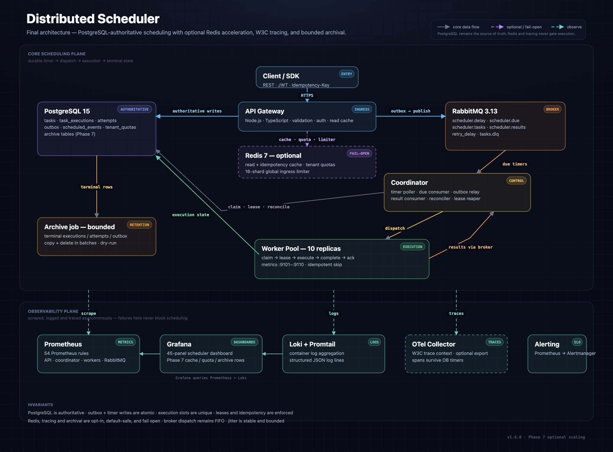
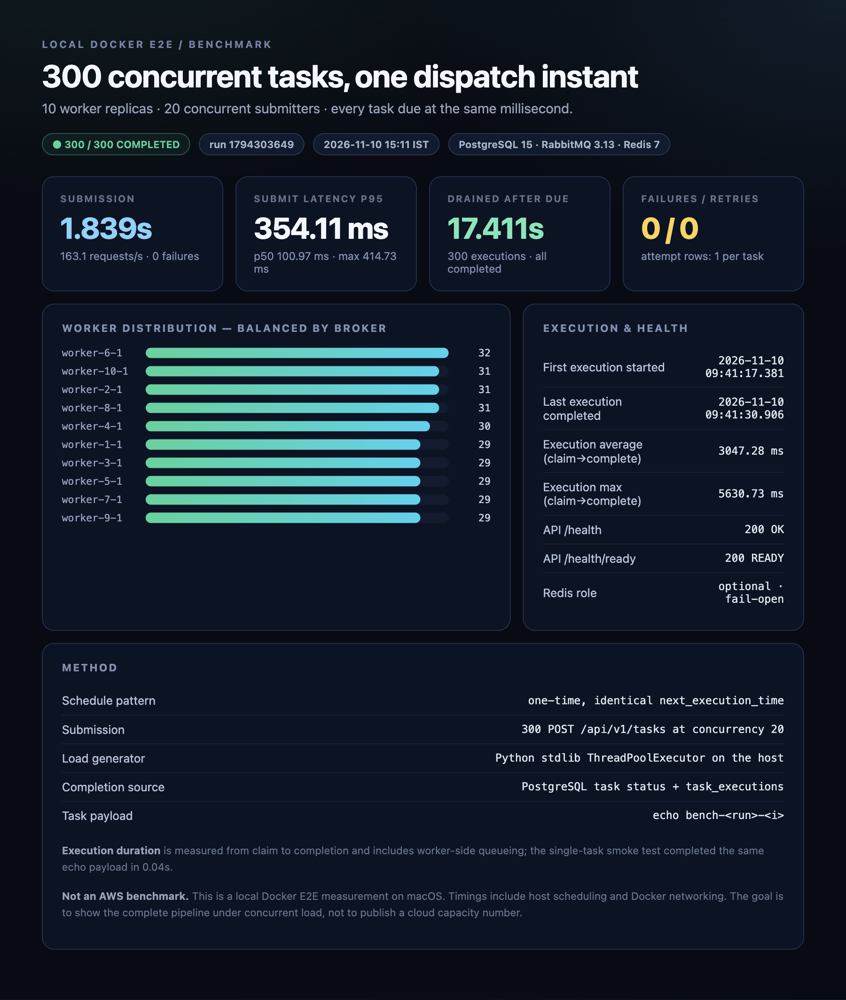
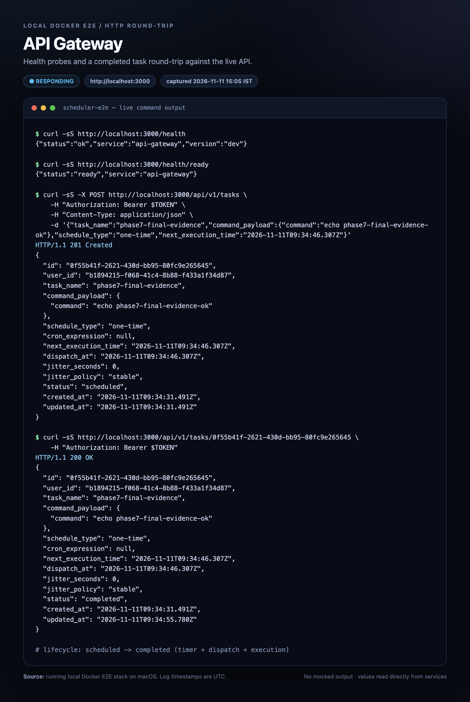
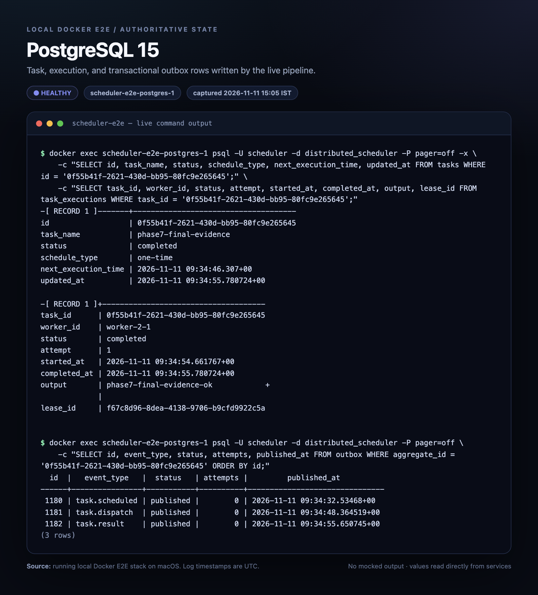
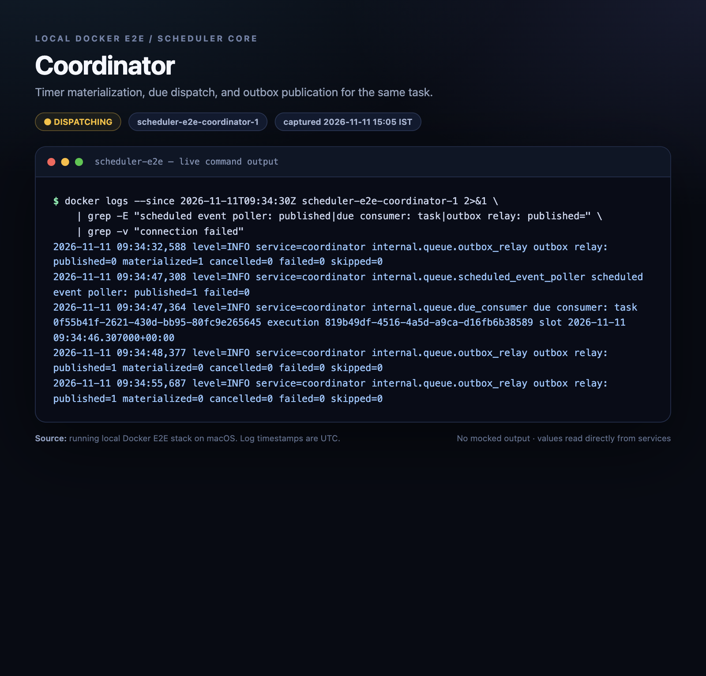
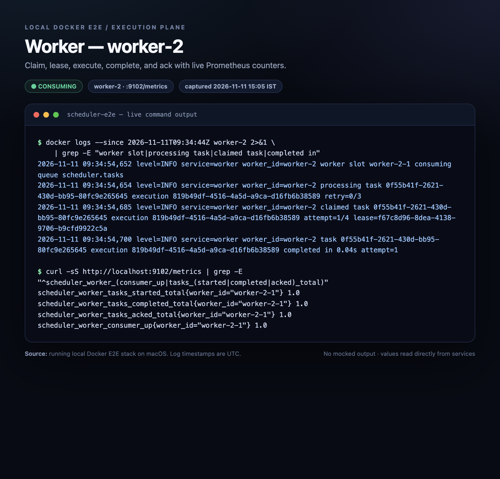
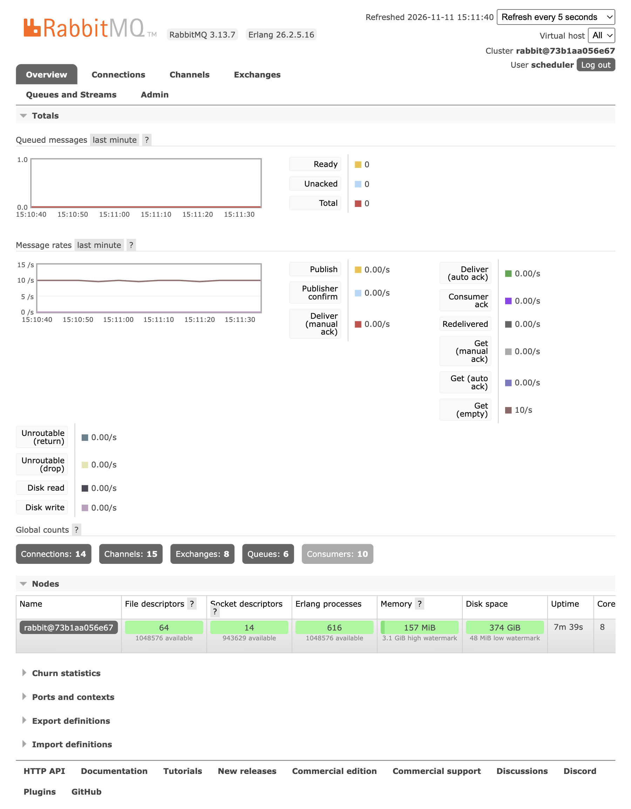
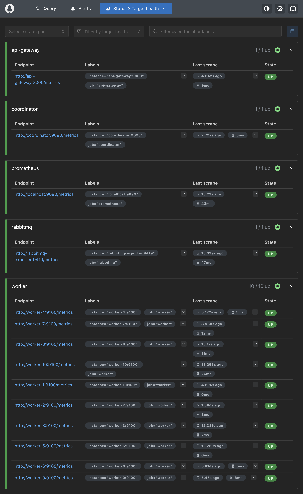
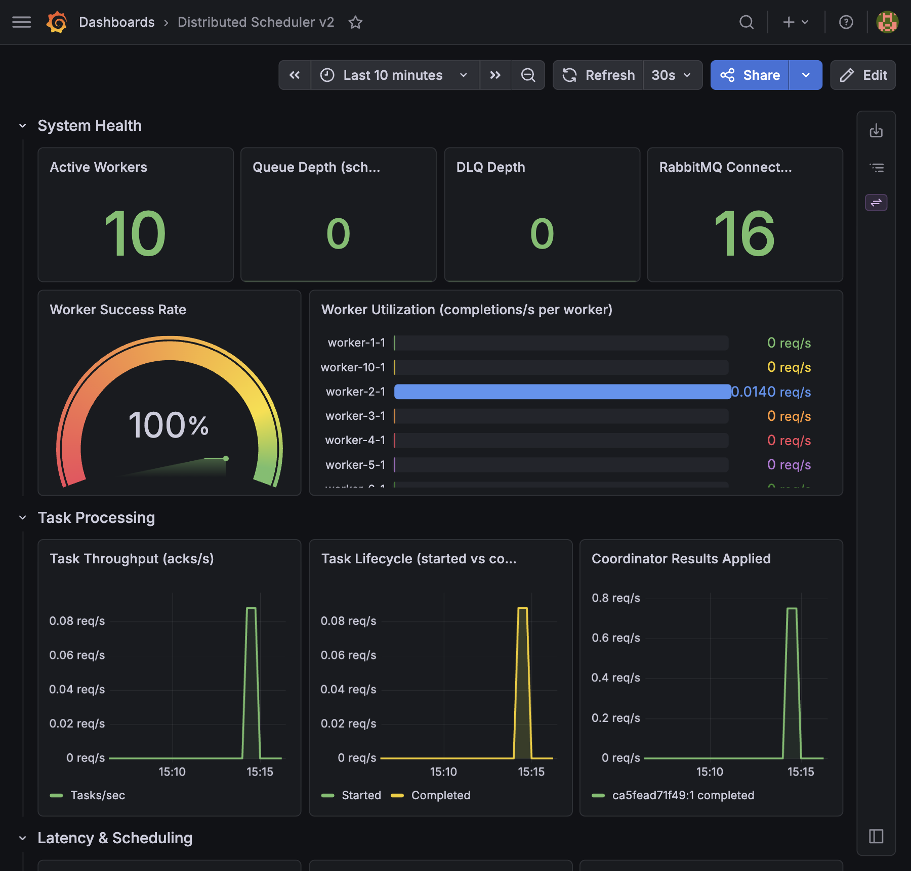

# Distributed Task Scheduler

A fault-tolerant, distributed cron-as-a-service that schedules one-time and recurring tasks and executes them across multiple worker nodes. Built with a microservices architecture, message queues, and production-oriented reliability patterns.

[](https://github.com/theritikkk/distributed-scheduler/actions/workflows/ci.yml)

---

## Table of Contents

- [Architecture](#architecture)
- [Components](#components)
- [Data Flow](#data-flow)
- [Database Schema](#database-schema)
- [Quick Start](#quick-start)
- [Environment Variables](#environment-variables)
- [API Reference](#api-reference)
- [Local Development](#local-development)
- [Monitoring Stack](#monitoring-stack)
- [Runbooks and HA](#runbooks-and-ha)
- [Deployment on AWS](#deployment-on-aws)
- [Benchmark](#benchmark)
- [Live Evidence](#live-evidence)
- [Project Structure](#project-structure)
- [License](#license)

---

## Architecture



*Final v1.6.0 architecture. Phase 7 detail: [optional scaling plane](docs/assets/phase7-scaling.png).*

```
                    ┌─────────────────────────────────────────────────────────┐
                    │                  API Gateway (Node.js/TS)               │
                    │  REST CRUD · JWT Auth · Rate Limit · Input Validation   │
                    └───────────────────────────┬─────────────────────────────┘
                                                │ task + outbox (one transaction)
                    ┌───────────────────────────▼──────────────────────────-─┐
                    │                      PostgreSQL                        │
                    │  users · tasks · task_executions · attempts · keys     │
                    │  outbox · scheduled_events                             │
                    └───────┬───────────────────────────────────┬───────────-┘
                            │                                   │
          ┌─────────────────▼──────────────-──┐    ┌────────────▼────────────────┐
          │       Coordinator (Python)        │    │          RabbitMQ           │
          │  · Outbox → DB timers → due       │───▶│  scheduler.due              │
          │  · Dispatch work to workers       │    │  scheduler.tasks            │
          │  · Lease-guarded results          │◀───│  scheduler.results          │
          │  · Slow reconciliation (120s)     │    │  scheduler.tasks.dlq (DLQ)  │
          │  · Reaper + worker heartbeats     │    │  (TTL queues: rollback only)│
          └────────────────────────────────-──┘    └────────────┬────────────────┘
                                                   │ consume
                    ┌──────────────────────────────▼───────────────────────────┐
                    │           worker-1 … worker-10 (Python)                  │
                    │  · Register + heartbeat in DB                            │
                    │  · Atomic claim + execution lease + attempt history      │
                    │  · Durable retry via outbox → scheduled_events           │
                    │  · Publish lease-guarded result to scheduler.results     │
                    └──────────────────────────────────────────────────────────┘
```

The API also talks to Redis for optional shared rate-limit buckets and Phase 7 read/quota caches, and to an OTLP collector when tracing is enabled. Neither is authoritative: PostgreSQL still owns tasks, execution slots, leases, idempotency, the outbox, and timers.

### Key Design Decisions

**DB-backed timers over broker TTL** — when a task is created, the API commits the task and a `task.scheduled` outbox event in one transaction. The relay materializes it into `scheduled_events`, and a poller publishes due rows to `scheduler.due`. Timers survive broker restarts in PostgreSQL, are inspectable, and work with quorum queues. The classic TTL queues remain only for the `OUTBOX_ENABLED=false` rollback.

**Base schedule separate from dispatch time** — `next_execution_time` is the durable, user-visible cron slot (or the requested one-time time). `dispatch_at` is the actual wakeup time and may include a stable per-task offset. `(task_id, scheduled_for)` uniquely identifies one execution slot, so duplicate wakeups cannot insert a second execution.

**Stable, opt-in jitter** — recurring tasks default to `jitter_seconds = 0`, preserving exact cron behavior. Clients can opt into a bounded stable offset; one-time tasks remain exact unless they explicitly request jitter. The master switch `SCHEDULER_JITTER_ENABLED` can disable all offsets for rollback.

**Slow reconciliation as a safety net** — a background poller (default every 120s, randomized by ±20%) scans PostgreSQL for any `scheduled` tasks with `dispatch_at <= NOW()`, catching anything missed due to broker restarts, timer-poller lag, or rollback edge cases.

**Durable API idempotency** — `POST /tasks` accepts an optional `Idempotency-Key`. The key, canonical request hash, and stored response are committed in the same PostgreSQL transaction as the task row. Replaying the same key/body returns the original response without creating another task; reusing the key with a different body returns `409`. Expired keys are removed by the coordinator.

**Leases and attempt history** — the coordinator creates executions as `pending`; a worker atomically claims one, obtains a lease, and heartbeats while the command runs. Results must match the current `lease_id`, so a stale worker cannot overwrite a newer attempt. Every claim is recorded in `task_execution_attempts`, and the reaper recovers expired leases or lost dispatches by re-publishing the same execution for another attempt.

**Idempotent result handling** — result updates require the matching execution lease and only apply when `completed_at IS NULL`, so duplicate deliveries and stale results do not double-advance task state. Delivery is at-least-once; shell command side effects themselves are not guaranteed exactly-once.

**Jittered retry backoff with DLQ** — failed tasks set `next_attempt_at` and commit a `task.retry` outbox event with an exponential ceiling (base 5s, max 5min) plus full jitter. The relay materializes it into `scheduled_events`; the poller republishes the stored worker message when due. `RETRY_JITTER_MODE=full|equal|none` controls the spread. After `TASK_MAX_RETRIES` attempts the message routes to `scheduler.tasks.dlq` for inspection.

**Layered overload protection** — the API can enforce global, login, and per-user token buckets in Redis with a smaller local fallback and a circuit breaker. Admission control rejects task creation with 503/429 when the DB pool or task queue is saturated. The coordinator samples queue depth and DB utilization with hysteresis and can pause due/result/outbox/reconciliation consumers in `enforce` mode while keeping heartbeats alive. Both features default to off/observe and are one env change away from rollback.

**Opt-in Phase 7 accelerators** — PostgreSQL remains authoritative; every feature below is default-off and fails open. Short-TTL Redis caches serve task reads and execution pages (update/delete invalidate the task key and bump a per-task generation), and completed `Idempotency-Key` responses are cached with their request hash while the durable `idempotency_keys` row stays authoritative. Weighted `tenant_quotas` rows multiply a tenant's base task rate and burst, but only for admission; broker dispatch stays FIFO. The global ingress bucket is split across `GLOBAL_INGRESS_SHARDS` Redis keys (default 16), with the total burst divided across them. W3C `traceparent` headers ride the outbox and `scheduled_events` into the coordinator and worker, so one trace spans API → timer delay → execution → result. Terminal execution/attempt/outbox history is copied to archive tables in bounded transactions; pending/running work and pending timers are never selected. Archival is used instead of time-partitioning `task_executions` because the unique `(task_id, scheduled_for)` and active-execution indexes cannot be preserved unchanged under a new partition key.

---

## Components

| Component | Tech | Role |
|-----------|------|------|
| **API Gateway** | Node.js, Express, TypeScript | REST API for task CRUD and auth. JWT authentication, rate limiting (10,000 req/15min), input validation. Exposes `/metrics` for Prometheus. |
| **Coordinator** | Python | Runs the outbox relay and DB-timer poller, consumes `scheduler.due`, creates `task_executions`, and dispatches to `scheduler.tasks`. Consumes `scheduler.results` and applies lease-guarded updates. Runs slow reconciliation, the execution reaper, and worker heartbeat checking in background threads. Exposes metrics on `:9090`. |
| **Worker** | Python | 10 named replicas (`worker-1` … `worker-10`). Each registers in DB, sends heartbeats, claims executions with leases, heartbeats long-running commands, retries with backoff, and exposes independent metrics on its own port. |
| **RabbitMQ** | RabbitMQ 3 | Durable queues and persistent messages. Decouples API/coordinator from workers. `RABBITMQ_QUEUE_TYPE=quorum` enables quorum queues on a multi-node cluster. |
| **PostgreSQL** | PostgreSQL 15 | Source of truth for users, tasks, executions, worker registry, outbox, tenant quotas, and DB-backed timers. |
| **Redis** | Redis / Redis Cluster | Optional shared rate-limit buckets plus short-lived Phase 7 read/quota caches. Never authoritative for task state. |
| **Prometheus** | Prometheus | Scrapes all 10 worker replicas independently, plus API gateway, coordinator, and RabbitMQ every 15s. |
| **Grafana** | Grafana | Pre-provisioned Prometheus and Loki datasources. Ships with the Distributed Scheduler v2 dashboard. |
| **Loki** | Grafana Loki | Log aggregation backend. Receives logs from all containers via Promtail. 7-day retention. |
| **Promtail** | Grafana Promtail | Docker socket discovery — tails every container's stdout/stderr and ships to Loki. |
| **Alertmanager** | Prometheus Alertmanager | Routes fired alerts. Wire up Slack/email in `monitoring/alertmanager/alertmanager.yml`. |

---

## Data Flow

1. **Task creation**: Client → API (JWT) → server computes `next_execution_time` (cron) and `dispatch_at` (base + stable jitter) → writes the task and a `task.scheduled` outbox row in one PostgreSQL transaction.
2. **Timer materialization**: The outbox relay converts the event into a `scheduled_events` row (`kind=wakeup`, `available_at=dispatch_at`) in the same transaction that marks the outbox row published. No per-message TTL is used.
3. **Due publish**: The scheduled-event poller publishes due rows to `scheduler.due` with publisher confirms and marks them published. A crash can duplicate a wakeup; the dispatch path is idempotent.
4. **Dispatch**: Coordinator consumes `scheduler.due` → locks task row → checks `dispatch_at` against database `NOW()` → inserts one `pending` `task_executions` row per `(task_id, scheduled_for)` → publishes to `scheduler.tasks`.
5. **Execution**: Worker consumes `scheduler.tasks` → atomically claims the pending execution with a lease and attempt row → heartbeats the lease → runs shell command → on success writes a lease-guarded result outbox event → on failure schedules a DB-backed retry (or final failure/DLQ after max retries).
6. **Result**: Coordinator consumes `scheduler.results` → applies the result only if the lease still matches → closes the attempt → for recurring tasks advances from `scheduled_for` (skipping missed slots) → updates `next_execution_time` and `dispatch_at` plus the next outbox event.
7. **Recovery**: The coordinator reaper runs every 15s, re-publishes stale pending executions, and returns expired running leases to `pending` (or fails them after max attempts) without creating a second execution. Reconciliation is the final safety net for missed wakeups.

---

## Database Schema

```sql
users            -- id (UUID), email, password_hash, created_at
tasks            -- id, user_id, task_name, command_payload (JSONB),
                 -- schedule_type (one-time|recurring), cron_expression,
                 -- next_execution_time, dispatch_at, jitter_seconds, jitter_policy,
                 -- status, created_at, updated_at
task_executions  -- id, task_id, worker_id, scheduled_for, started_at, completed_at,
                 -- status, output, error_message, lease_id, lease_expires_at,
                 -- next_attempt_at, attempt, created_at
task_execution_attempts -- id, execution_id, attempt, worker_id, started_at,
                        -- finished_at, status, error_message
idempotency_keys -- id, user_id, key, request_hash, state, response_status,
                 -- response_body, resource_id, created_at, updated_at, expires_at
workers          -- id, worker_id, worker_address, status, last_heartbeat
outbox           -- id, aggregate_type/id, event_type, payload, headers, status,
                 -- attempts, available_at, published_at, last_error
scheduled_events -- id, aggregate_id, kind (wakeup|retry), destination, dedupe_key,
                 -- payload, headers, status, attempts, available_at, published_at,
                 -- cancelled_at, last_error
tenant_quotas    -- user_id, weight, tasks_per_min, burst, enabled, timestamps
task_execution_archive / task_execution_attempts_archive / outbox_archive
                 -- terminal history copied by the bounded archive job
```

Indexes: `tasks(dispatch_at) WHERE status IN ('pending','scheduled')`, `tasks(next_execution_time)`, `tasks(user_id, status)`, `task_executions(task_id)`, `task_executions(started_at)`, unique `task_executions(task_id, scheduled_for)`, unique `task_executions(task_id) WHERE status IN ('pending','running')`, `task_executions(next_attempt_at) WHERE status = 'pending'`, `task_execution_attempts(execution_id, attempt)`, `idempotency_keys(expires_at)`, `workers(last_heartbeat)`, `outbox(status, available_at, id) WHERE status = 'pending'`, `outbox(aggregate_type, aggregate_id, id)`, `outbox(published_at) WHERE status = 'published'`, unique `scheduled_events(dedupe_key)`, `scheduled_events(available_at, id) WHERE status = 'pending'`, `scheduled_events(aggregate_type, aggregate_id, status)`, `scheduled_events(published_at) WHERE status IN ('published','cancelled')`, `tenant_quotas(enabled) WHERE enabled`, `task_executions(COALESCE(completed_at, created_at)) WHERE status IN ('completed','failed','timeout','cancelled')`, `outbox(published_at) WHERE status = 'published'`, `outbox(created_at) WHERE status = 'failed'`, and archive lookup indexes on task/execution/outbox identity plus `archived_at`.

### Database migrations

`database/init.sql` remains the bootstrap for a fresh database. Existing databases are adopted once and then upgraded with the versioned runner:

```bash
# Fresh database: create the bootstrap schema, record the baseline, apply pending changes
make migrate

# Existing database: adopt the current schema once, then apply pending changes
make migrate-baseline
make migrate-up

# Inspect or create migrations
make migrate-status
make migrate-create NAME=add_outbox
```

The default `DATABASE_URL` is a local development URL; override it for other environments. Migration files live in `database/migrations/` and are tracked in `schema_migrations` with checksums. Add `-- migrate:no-transaction` near the top of a migration when it must run outside a transaction, such as `CREATE INDEX CONCURRENTLY`; keep that migration to one SQL statement.

Phase 1 uses a staged expand/backfill/contract rollout. To stop before the contract migration:

```bash
# 1. Add nullable columns, indexes, and the unique slot index
make migrate MIGRATE_TARGET=0004

# 2. Deploy the Phase 1 API/coordinator, then apply constraints/NOT NULL
make migrate
```

The backfill migration fails loudly if existing execution rows contain duplicate `(task_id, scheduled_for)` values; review and clean those rows before retrying. Roll back code first, then run `make migrate-rollback` one migration at a time.

Phase 2 uses the same expand/backfill/constraint pattern:

```bash
# 1. Add idempotency, lease, and attempt structures and backfill legacy attempts
make migrate MIGRATE_TARGET=0007

# 2. Deploy the Phase 2 API/coordinator/worker. The reaper must exist before
#    the one-active-execution unique index is enforced.
make migrate

# 3. To roll back code without losing history, disable idempotency enforcement
#    if necessary and leave additive tables/columns in place.
IDEMPOTENCY_ENFORCE=false
```

Migration `0007` fails with an actionable error if a task has multiple pending/running
executions. Resolve those rows before applying `0008_active_execution_unique`. The
`0006` and `0007` down migrations are intentionally no-ops so execution/idempotency
history is not destroyed; `0008` only drops the active unique index.

Phase 3 adds the transactional outbox with `0009_outbox`. It is additive and safe to apply
while the Phase 2 services are running:

```bash
make migrate
# Deploy the Phase 3 API/coordinator/worker together. The coordinator starts the relay.
# Rollback: set OUTBOX_ENABLED=false in every service; keep the outbox table and rows.
```

Do not delete pending outbox rows during a rollback. The relay can be disabled
independently with `OUTBOX_ENABLED=false`; direct publisher-confirm delivery resumes.

Phase 6 adds DB-backed timers with `0010_scheduled_events`. Apply it before deploying
the Phase 6 coordinator. The poller drains `scheduled_events` and the outbox relay stops
publishing scheduled/retry events to the TTL queues:

```bash
make migrate
# Deploy API, coordinator, and workers together.
# Rollback: SCHEDULED_EVENTS_ENABLED=false and OUTBOX_ENABLED=false together.
# Keep the scheduled_events table and let reconciliation/reaper recover delayed work.
```

Quorum queue mode is opt-in with `RABBITMQ_QUEUE_TYPE=quorum`. It requires
`OUTBOX_ENABLED=true` and `SCHEDULED_EVENTS_ENABLED=true`, and all services must use the
same value. Drain and delete the old `scheduler.delay` and `scheduler.retry_delay`
queues before converting, otherwise those classic TTL queues remain a single-node
dependency. It is validated in the three-node lab; see [docs/HA.md](docs/HA.md). Quorum
membership is fixed at declaration, so verify `list_queues ... members` after bringing
up a cluster incrementally (the lab deploy script enforces this).

Phase 7 adds three additive migrations; they can be applied before the new images, and
every behavior change is behind a default-off flag:

```bash
make migrate                      # 0011 tenant_quotas, 0012 archive tables, 0013 timer headers
# Deploy the Phase 7 API/coordinator/worker with all Phase 7 flags off.
# Enable cache -> idempotency cache -> tenant quotas (observe first) -> tracing.
# Run the archive dry-run before ARCHIVE_ENABLED=true:
make archive-data ARCHIVE_DRY_RUN=1
```

Rollback is flag-first: `CACHE_ENABLED=false`, `IDEMPOTENCY_CACHE_ENABLED=false`,
`TENANT_QUOTAS_ENABLED=false`, `OTEL_ENABLED=false`, `ARCHIVE_ENABLED=false`. Schema
rollback is not required. Dropping `0012` destroys archived history; export it first.
See the [Phase 7 runbook](docs/runbooks/phase7-scaling.md).

---

## Quick Start

### Prerequisites

- Docker and Docker Compose
- Node.js 20+ (for local API development only)
- Python 3.10+ (for local coordinator/worker development only)

### 1. Clone and configure

```bash
git clone https://github.com/theritikkk/distributed-scheduler.git
cd distributed-scheduler
cp .env.example .env
# Fill in all passwords and JWT_SECRET before starting
```

### 2. Start everything

```bash
docker compose up -d --build
```

### 3. Verify

```bash
docker compose ps                        # all containers should show Up
curl http://localhost:3000/health        # {"status":"ok","service":"api-gateway"}
```

### Service endpoints

| Service | URL |
|---------|-----|
| API Gateway | `http://localhost:3000` |
| Grafana | `http://localhost:3001` |
| Prometheus | `http://localhost:9091` |
| RabbitMQ Management | `http://localhost:15672` |

### 4. Register, login, and create tasks

```bash
# Register
curl -s -X POST http://localhost:3000/api/v1/auth/register \
  -H "Content-Type: application/json" \
  -d '{"email":"you@example.com","password":"passw0rd123"}' | jq

# Login — capture token
TOKEN=$(curl -s -X POST http://localhost:3000/api/v1/auth/login \
  -H "Content-Type: application/json" \
  -d '{"email":"you@example.com","password":"passw0rd123"}' | jq -r '.token')

# One-time task
curl -s -X POST http://localhost:3000/api/v1/tasks \
  -H "Authorization: Bearer $TOKEN" \
  -H "Content-Type: application/json" \
  -d '{
    "task_name": "Say hello",
    "command_payload": {"command": "echo hello"},
    "schedule_type": "one-time",
    "next_execution_time": "2026-06-01T10:00:00Z"
  }' | jq

# Recurring task (every minute), with a stable 10s jitter window
# next_execution_time is computed from the cron expression by the API.
curl -s -X POST http://localhost:3000/api/v1/tasks \
  -H "Authorization: Bearer $TOKEN" \
  -H "Content-Type: application/json" \
  -d '{
    "task_name": "Recurring ping",
    "command_payload": {"command": "echo ping"},
    "schedule_type": "recurring",
    "cron_expression": "* * * * *",
    "jitter_seconds": 10,
    "jitter_policy": "stable"
  }' | jq

# List tasks
curl -s http://localhost:3000/api/v1/tasks \
  -H "Authorization: Bearer $TOKEN" | jq

# Execution history
curl -s "http://localhost:3000/api/v1/tasks/<TASK_ID>/executions" \
  -H "Authorization: Bearer $TOKEN" | jq
```

---

## Environment Variables

Copy `.env.example` to `.env`. Change every password and `JWT_SECRET` before deploying.

| Variable | Description |
|----------|-------------|
| `POSTGRES_USER` | PostgreSQL user |
| `POSTGRES_PASSWORD` | PostgreSQL password |
| `POSTGRES_DB` | PostgreSQL database name |
| `DATABASE_URL` | Full PostgreSQL connection string |
| `RABBITMQ_DEFAULT_USER` | RabbitMQ user |
| `RABBITMQ_DEFAULT_PASS` | RabbitMQ password |
| `RABBITMQ_URL` | Full RabbitMQ connection string |
| `JWT_SECRET` | Secret for signing JWT tokens (min 32 chars) |
| `APP_ENV` / `NODE_ENV` | Runtime environment. Production requires explicit URLs and a non-default JWT secret. |
| `PORT` | API gateway listen port (default `3000`) |
| `CORS_ORIGIN` | Allowed CORS origin (default `*`) |
| `TRUST_PROXY` | Express trust-proxy setting (`false`, `true`, or hop count) |
| `DB_POOL_MAX` | API gateway PostgreSQL pool size (default `20`) |
| `DB_IDLE_TIMEOUT_MS` | API gateway idle connection timeout (default `30000`) |
| `DB_CONNECTION_TIMEOUT_MS` | API gateway connection timeout (default `2000`) |
| `RATE_LIMIT_WINDOW_MS` | Legacy API rate-limit window retained for compatibility (default `900000`) |
| `RATE_LIMIT_MAX` | Legacy API request limit retained for compatibility (default `10000`) |
| `RATE_LIMIT_ENABLED` | Enable Redis-backed layered rate limiting (default `false`) |
| `RATE_LIMIT_MODE` | `observe` (headers/metrics only) or `enforce` (`429` on limit) (default `observe`) |
| `REDIS_URL` | Redis URL used by the shared rate limiter (for example `redis://redis:6379/0`) |
| `GLOBAL_INGRESS_RPS` / `GLOBAL_INGRESS_BURST` | Global API ingress token bucket (defaults `2000`/`4000`) |
| `RATE_LIMIT_LOGIN_PER_MIN` / `RATE_LIMIT_LOGIN_BURST` | Login limit before bcrypt (defaults `5`/`2`) |
| `RATE_LIMIT_USER_TASKS_PER_MIN` / `RATE_LIMIT_USER_TASKS_BURST` | Per-user task creation budget (defaults `60`/`10`) |
| `GLOBAL_INGRESS_SHARDS` | Redis keys the global ingress bucket is split across; `1` disables sharding (default `16`) |
| `CACHE_ENABLED` / `CACHE_TTL_SEC` | Short-TTL task/execution read cache (default off, `15`s) |
| `CACHE_REDIS_TIMEOUT_MS` | Fail-open timeout per cache operation (default `50`) |
| `IDEMPOTENCY_CACHE_ENABLED` / `IDEMPOTENCY_CACHE_TTL_SEC` | Cache completed idempotent responses; PostgreSQL stays authoritative (default off, `900`s) |
| `TENANT_QUOTAS_ENABLED` | Replace the static per-user task limiter with weighted tenant quotas (default `false`) |
| `TENANT_QUOTA_CACHE_TTL_SEC` | Tenant-quota cache TTL (default `30`) |
| `TENANT_DEFAULT_WEIGHT` / `TENANT_DEFAULT_TASKS_PER_MIN` / `TENANT_DEFAULT_BURST` | Defaults when a tenant has no enabled row (defaults `1`/`60`/`10`; never unlimited) |
| `OTEL_ENABLED` / `OTEL_SAMPLER_ARG` | W3C tracing across API/coordinator/worker (default off, root ratio `0.1`) |
| `OTEL_SERVICE_NAME` / `OTEL_EXPORTER_OTLP_ENDPOINT` | Service identity and OTLP/HTTP endpoint (defaults per service, `http://localhost:4318/v1/traces`) |
| `ARCHIVE_ENABLED` | Coordinator bounded archival of terminal history (default `false`) |
| `ARCHIVE_RETENTION_DAYS` / `ARCHIVE_BATCH_SIZE` | Terminal-row retention and rows per batch (defaults `30`/`500`) |
| `ARCHIVE_INTERVAL_SEC` / `ARCHIVE_MAX_BATCHES` / `ARCHIVE_SLEEP_MS` | Archive cycle cadence and bounded work (defaults `3600`/`20`/`50`) |
| `ADMISSION_ENABLED` | Reject new task creation when DB/queue pressure is high (default `false`) |
| `DB_POOL_HIGH_WATERMARK` / `DB_POOL_MAX_WAITERS` | Admission thresholds for DB pool pressure |
| `QUEUE_BACKLOG_HIGH` / `QUEUE_BACKLOG_LOW` | Task queue depth admission thresholds |
| `BACKPRESSURE_MODE` | Coordinator `observe` or `enforce` mode (default `observe`) |
| `BACKPRESSURE_TASKS_HIGH` / `BACKPRESSURE_TASKS_LOW` | Task queue pause/resume watermarks (defaults `5000`/`1000`) |
| `BACKPRESSURE_RESULTS_HIGH` / `BACKPRESSURE_RESULTS_LOW` | Result queue pause/resume watermarks (defaults `2000`/`500`) |
| `DB_POOL_MAX` / `DB_POOL_RESUME_WATERMARK` | Shared DB gate limit and coordinator resume watermark |
| `DISPATCH_RATE_PER_SEC` / `DISPATCH_BURST` | Local coordinator dispatch token bucket (defaults `200`/`20`) |
| `RECONCILE_BATCH` / `RECONCILE_PACE_SEC` | Reconciliation batch size and pacing |
| `OUTBOX_ENABLED` | Commit events transactionally and let the relay publish them (default `true`; `false` is the direct-confirm rollback) |
| `SCHEDULED_EVENTS_ENABLED` | Materialize wakeups/retries in PostgreSQL instead of TTL queues (default `true`) |
| `SCHEDULED_EVENT_POLL_INTERVAL_SEC` / `SCHEDULED_EVENT_BATCH_SIZE` | Due-timer poll interval and batch size |
| `SCHEDULED_EVENT_MAX_ATTEMPTS` / `SCHEDULED_EVENT_BACKOFF_*` | Due-timer publish retry policy |
| `RABBITMQ_QUEUE_TYPE` | `classic` (local default) or `quorum`; quorum requires outbox and DB timers |
| `LOG_REQUESTS` | Enable HTTP request logging (default `true`, disabled in tests) |
| `DB_CONNECT_TIMEOUT_SEC` | Coordinator/worker database connection timeout (default `5`) |
| `RABBITMQ_METRICS_POLL_SEC` | Coordinator RabbitMQ metric poll interval (default `15`) |
| `COMMAND_TIMEOUT_SEC` | Worker command timeout (default `300`) |
| `MAX_OUTPUT_BYTES` | Maximum captured stdout+stderr returned by a worker (default `1048576`) |
| `WORKER_CONCURRENCY` | Consumer threads per worker process, `1`–`8` (default `1`) |
| `HEARTBEAT_INTERVAL_SEC` | Worker registration heartbeat interval (default `20`) |
| `EXECUTION_LEASE_SEC` | Worker execution lease duration (default `60`) |
| `LEASE_HEARTBEAT_SEC` | Lease extension interval; must be less than the lease (default `20`) |
| `IDEMPOTENCY_ENFORCE` | Enforce durable `Idempotency-Key` replay (default `true`) |
| `REAPER_ENABLED` | Enable the coordinator stale-execution reaper (default `true`) |
| `REAPER_INTERVAL_SEC` | Reaper scan interval in seconds (default `15`) |
| `PENDING_RETRY_GRACE_SEC` | Grace after a pending dispatch/retry becomes due before re-publishing (default `300`) |
| `IDEMPOTENCY_CLEANUP_INTERVAL_SEC` | Expired idempotency key cleanup interval (default `3600`) |
| `GF_SECURITY_ADMIN_USER` | Grafana admin username |
| `GF_SECURITY_ADMIN_PASSWORD` | Grafana admin password |
| `TASK_MAX_RETRIES` | Worker retries before routing to DLQ (default `3`) |
| `RETRY_JITTER_MODE` | Worker retry spread: `full`, `equal`, or `none` (default `full`) |
| `SCHEDULER_RECONCILE_INTERVAL_SEC` | Coordinator reconciliation interval in seconds (default `120`) |
| `RECONCILE_INTERVAL_JITTER_RATIO` | Reconciliation interval jitter, `0.0`–`0.5` (default `0.2`) |
| `SCHEDULER_JITTER_ENABLED` | Master switch for task dispatch jitter (default `false`) |
| `DEFAULT_RECURRING_JITTER_SEC` | Default recurring jitter when client omits it (default `0`) |
| `MAX_JITTER_SEC` | Maximum accepted API jitter, schema permits up to `3600` (default `300`) |
| `COORDINATOR_ID` | Optional coordinator metric identity; defaults to `hostname:pid` |

---

## API Reference

All task endpoints require `Authorization: Bearer <token>`. Full spec: [docs/openapi.yaml](docs/openapi.yaml).

### Auth

| Method | Path | Description |
|--------|------|-------------|
| `POST` | `/api/v1/auth/register` | Register a new user |
| `POST` | `/api/v1/auth/login` | Login and receive a JWT |

### Tasks

| Method | Path | Description |
|--------|------|-------------|
| `GET` | `/api/v1/tasks` | List tasks (`?page=1&limit=20`) |
| `POST` | `/api/v1/tasks` | Create a task |
| `GET` | `/api/v1/tasks/:id` | Get a single task |
| `PUT` | `/api/v1/tasks/:id` | Update a task |
| `DELETE` | `/api/v1/tasks/:id` | Delete a task |
| `GET` | `/api/v1/tasks/:id/executions` | Execution history |
| `GET` | `/api/v1/tasks/:id/executions/:executionId/attempts` | Per-attempt worker history |

`POST /api/v1/tasks` accepts an optional `Idempotency-Key` header (1–255 characters).
Repeating the same key and request body returns the stored `201` response with
`Idempotent-Replayed: true`; reusing the key with a different body returns `409`.

`command_payload` runs the `command` field as a shell command on the worker:

```json
{ "command": "echo hello world" }
```

`cron_expression` is required for `recurring` tasks (standard 5-field cron) and must be omitted for `one-time`.

---

## Local Development

```bash
# Start just the infrastructure
docker compose up -d postgres rabbitmq

# API Gateway
cd api-gateway && npm install && npm run dev

# Coordinator
cd coordinator && pip install -r requirements.txt && python main.py

# Worker
cd worker && pip install -r requirements.txt && WORKER_ID=worker-dev python main.py
```

### Tests

Service tests run from each service directory because both coordinator and worker
use a top-level `main.py`; the root pytest suite covers migrations only.

```bash
# API unit tests, plus PostgreSQL integration tests when TEST_DATABASE_URL is set
cd api-gateway && TEST_DATABASE_URL=postgresql:///scheduler_test npm run test:coverage

# Coordinator and worker
cd coordinator && TEST_DATABASE_URL=postgresql:///scheduler_test python -m pytest tests
cd worker && python -m pytest tests

# Migration runner
TEST_DATABASE_URL=postgresql:///scheduler_test python -m pytest tests/migrations
```

CI runs the same suites with Postgres and RabbitMQ service containers. The concurrent
task-submission harness is documented in `tests/concurrency/README.md`.

---

## Monitoring Stack

The full observability stack starts automatically with `docker compose up`.

```
All container logs (stdout/stderr)
         │
         ▼
   Promtail — Docker socket discovery, labels: service, container, stream
         │
         ▼
   Loki :3100 — 7-day retention
         │
         ▼
   Grafana :3001 ◀──── Prometheus :9091
```

### Prometheus scrape targets

| Job | Target | Metrics |
|-----|--------|---------|
| `api-gateway` | `api-gateway:3000/metrics` | HTTP rates, latency |
| `coordinator` | `coordinator:9090/metrics` | Dispatch, reconciliation, results, stale-lease rejections, lease reaping, idempotency cleanup, jitter, schedule lag, slot conflicts, queue depth, backpressure state, consumer reconnects |
| `worker` | `worker-1:9100` … `worker-10:9100` | Task completions, acks, duration, retry backoff, lease heartbeat failures, DLQ |
| `rabbitmq` | `rabbitmq-exporter:9419` | Queue depths, message rates |

### Alert rules (`monitoring/prometheus/alerts.yml`)

| Alert | Severity | Fires when |
|-------|----------|-----------|
| `ServiceTargetDown` | critical | A Prometheus scrape target is down for 2 min |
| `TaskQueueBacklogHigh` | critical | `scheduler.tasks` depth > 1000 for 5 min |
| `DLQMessagesPresent` | critical | Any message in DLQ for 1 min |
| `WorkerConsumerDown` | critical | Zero workers connected for 2 min |
| `WorkerAckRateZero` | warning | Workers up but no acks in 5 min |
| `HighTaskRetryRate` | warning | Retry rate > 0.5/s for 10 min |
| `DLQGrowthRate` | warning | New DLQ messages over 5 min |
| `TaskScheduleLagHigh` | warning | p95 schedule lag > 10 min for 10 min |
| `TaskSlotConflicts` | warning | Any unique-slot conflict over 10 min |
| `ExecutionLeaseReapRateHigh` | warning | More than 5 lease recoveries in 15 min |
| `StaleLeaseResultsRejected` | warning | Any result rejected for a stale lease over 10 min |
| `TaskNextRunDriftHigh` | warning | p95 recurring cadence drift > 60s for 10 min |
| `RateLimitFallbackActive` | warning | Redis rate limiting falls back locally for 5 min |
| `RateLimitCircuitOpen` | warning | The rate-limit Redis circuit is open for 1 min |
| `AdmissionRejectionsHigh` | warning | Sustained 429/503 admission rejections for 5 min |
| `DbPoolSaturation` | critical | DB utilization > 85% for 5 min |
| `CoordinatorBackpressurePaused` | warning | Coordinator paused for 10 min |
| `CoordinatorBackpressureUnknown` | critical | Backpressure signals stale for 5 min |
| `CoordinatorConsumerReconnects` | warning | More than 3 consumer reconnects in 10 min |
| `DueQueueBacklogHigh` | warning | `scheduler.due` depth > 500 for 5 min |
| `CacheErrorRateHigh` | warning | Cache errors > 0.1/s for 10 min; the API fails open to PostgreSQL |
| `CacheHitRatioLow` | warning | Hit ratio < 20% with meaningful traffic for 15 min |
| `TenantQuotaLookupErrors` | warning | Quota lookups are failing and defaults/local values are serving |
| `TenantQuotaDenialsHigh` | warning | `tenant:tasks` denials > 1/s for 10 min |
| `GlobalIngressShardsMissing` | warning | The global ingress shard gauge is below 1 |
| `TraceExportErrors` | warning | OTLP span exports are failing; requests continue |
| `ArchiveErrors` | warning | At least one archive cycle failed in the last hour |
| `ArchiveLagHigh` | warning | Oldest live terminal row is older than 90 days |

To wire up Slack alerts, edit `monitoring/alertmanager/alertmanager.yml`:

```yaml
receivers:
  - name: default
    slack_configs:
      - api_url: 'https://hooks.slack.com/services/YOUR/WEBHOOK'
        channel: '#alerts'
```

### Grafana dashboard

The **Distributed Scheduler v2** dashboard loads automatically. Open Grafana → Dashboards → Distributed Scheduler v2.

Panels: Active Workers · Queue Depth · DLQ Depth · RabbitMQ Connections · Worker Success Rate · Worker Utilization per replica · Task Throughput · Task Lifecycle · Coordinator Results · Task Latency p95 · Dispatch Rate · Reconciliation Nudges · All Queue Sizes · Workers Marked Offline · Backpressure State · Rate Limit Fallback · Rate Limit Denials · DB Gate Waiters · Coordinator Reconnects · Phase 7 Cache Hit Ratio · Cache Hits vs Misses · Cache Errors · Tenant Quota Denials · Tenant Quota Lookup Errors · Global Ingress Shards · Tracing Enabled · Archive Rows/Errors · Archive Oldest Row Age · Archive Cycle Duration/Failures.

### Runbooks and HA

| Document | Use it for |
|----------|------------|
| [Rate limiting runbook](docs/runbooks/rate-limiting.md) | Enable/rollback limits, Redis outage/fallback, login limits, admission |
| [Phase 7 scaling runbook](docs/runbooks/phase7-scaling.md) | Enable/rollback cache, tenant quotas, sharded ingress, tracing, and archival |
| [Backpressure runbook](docs/runbooks/backpressure.md) | Diagnose coordinator pauses, queue/DB saturation, reconnect loops |
| [Failover runbook](docs/runbooks/failover.md) | PostgreSQL/broker/Redis drills, quorum membership, PITR validation, invariant checks |
| [HA design](docs/HA.md) | Topology, validated drill results, RPO/RTO, checklists |
| [HA lab](deploy/ha-lab/README.md) | Three-node AWS lab: provision, deploy, destroy |
| [System evolution](docs/evolution/README.md) | Versioned record of what changed, with preserved earlier results |
| [Internals](docs/internals/README.md) | Diagrams of the request path, timers, queues, rate limiting, pooling, failure recovery, and load balancing |

The default Compose stack is intentionally single-node. A self-managed three-node lab
(`deploy/ha-lab/`) provisions etcd + Patroni PostgreSQL 16.6, a 3-node RabbitMQ cluster
with quorum queues, Redis master/replica with three Sentinels, per-node HAProxy, and
per-node PgBouncer. The v1.4.0 drills passed there: PostgreSQL failed over with RPO 0 in
~2.8 s, a RabbitMQ leader loss retained all 301 queued messages, and Redis failover fell
back locally without a 5xx. v1.5.0 adds Redis Cluster support, quorum TTL/delivery
limits, PgBouncer, a PITR design plus local restore drill, an nginx load balancer, and
HA observability; those were validated locally/config-level, not in a re-provisioned AWS
lab. It is still a lab, not production: Spot instances, a node1-only nginx endpoint, and
no production S3 backup bucket. The validation lab was destroyed after the v1.4.0 drills
to stop charges; redeploy it with [`deploy/ha-lab/`](deploy/ha-lab/README.md) to rerun
them. Results are in [docs/HA.md](docs/HA.md#validated-lab-results-2026-11-06) and the
[version record](docs/evolution/v1.5.0-data-plane-hardening.md). v1.6.0 then added
default-off Phase 7 accelerators — read/idempotency caches, weighted tenant quotas,
sharded ingress, W3C tracing, and bounded archival — validated locally against
disposable PostgreSQL and the repository suites. See the
[v1.6.0 record](docs/evolution/v1.6.0-optional-scaling.md) and the
[Phase 7 internals](docs/internals/09-cache-quotas-tracing-archival.md).

### Querying logs in Grafana → Explore → Loki

```logql
{service="coordinator"}                          # all coordinator logs
{service="worker"} |= "ERROR"                    # worker errors
{service=~"coordinator|worker"} |= "<task-uuid>" # trace a specific task
{service="api-gateway"} |~ "5[0-9]{2}"          # API 5xx errors
```

---

## Deployment on AWS

The current demo deployment is a **single-node, credit-based free-tier**
stack: one EC2 instance (`m7i-flex.large`, Amazon Linux 2023, `ap-south-1`)
created by Terraform and managed over SSM. PostgreSQL, RabbitMQ, Redis, the
coordinator, and all ten workers share that host. This is **not** HA.

The separate [`deploy/ha-lab/`](deploy/ha-lab/README.md) stack provisions a
three-node, cross-AZ HA lab and is where the Phase 6 failover drills ran. It is
also credit-based (Spot instances) and not a production deployment. See
[docs/HA.md](docs/HA.md) for the topology and measured results.

### Provision

Requirements: Terraform 1.5+, AWS CLI v2, and credentials with EC2, IAM,
S3, and SSM permissions. Keep credentials in the environment, never in the
repository.

```bash
cd deploy/free-tier
terraform init
terraform apply -var="allowed_cidr=$(curl -s https://checkip.amazonaws.com)/32"
```

The stack creates an encrypted root volume, an IAM instance profile with
`AmazonSSMManagedInstanceCore`, an encrypted S3 artifact bucket, and a
security group that exposes only ports `3000`, `3001`, `9091`, and `15672`
to `allowed_cidr`. There is no SSH ingress and no public database or broker
port. See [deploy/free-tier/README.md](deploy/free-tier/README.md).

### Deploy the working tree

```bash
cd deploy/free-tier
export INSTANCE_ID="$(terraform output -raw instance_id)"
export BUCKET="$(terraform output -raw artifact_bucket)"
export PUBLIC_IP="$(terraform output -raw public_ip)"
./deploy.sh
```

The script generates a fresh production `.env`, uploads the bundle to the
encrypted bucket, builds and starts the stack over SSM, waits for
`/health`, and deletes the bundle. It does not commit or print secrets.

### Verify

```bash
curl "http://$PUBLIC_IP:3000/health"
curl "http://$PUBLIC_IP:3000/health/ready"
```

Grafana, Prometheus, and the RabbitMQ management UI use the same IP with
ports `3001`, `9091`, and `15672`. The API is HTTP only; put a TLS
terminator in front of it before exposing it beyond a demo.

### Cost and teardown

The AWS Free plan is credit-based. `m7i-flex.large` is free-tier eligible
but still consumes the plan credits (the account showed about `$94.66`
remaining when this stack was deployed). Check the balance with:

```bash
aws freetier get-account-plan-state --region us-east-1
```

Destroy the demo when it is no longer needed:

```bash
cd deploy/free-tier
terraform destroy
```

Use a scoped deployment role rather than an admin user for automation, and
rotate any credentials used during setup.

---

## Project Structure

```
distributed-scheduler/
├── api-gateway/               # Node.js/TypeScript REST API
├── coordinator/               # Python coordinator service
├── worker/                    # Python worker (runs as worker-1 … worker-10)
├── database/
│   ├── init.sql               # Bootstrap schema and indexes
│   └── migrations/            # Versioned schema changes
├── scripts/                   # Migration and bootstrap tooling
├── monitoring/
│   ├── prometheus.yml         # Scrape config
│   ├── prometheus/alerts.yml  # 26 alert rules
│   ├── grafana/
│   │   ├── provisioning/      # Datasources + dashboard provider
│   │   └── dashboards/        # scheduler-overview.json
│   ├── loki/loki-config.yml
│   ├── promtail/promtail-config.yml
│   └── alertmanager/alertmanager.yml
├── docs/                      # Architecture, API spec, runbooks, HA guide,
│                              # versioned evolution, and internals diagrams
├── deploy/free-tier/          # Terraform + SSM single-node EC2 demo
├── docker-compose.yml
├── Makefile
└── .env.example
```

---

## Benchmark

See [Benchmark.md](Benchmark.md) for the load-test commands, the Phase 0 API submission baseline (~740 req/s, p95 84.5 ms, p99 163.2 ms with the legacy rate limit raised), a 1,362-task single-worker full-stack baseline, and the Phase 6 HA lab results (7,586 submissions at 126 req/s, p95 69.6 ms, 8,040 tasks executed exactly once).

The v1.6.0 local E2E burst in [Live Evidence](#live-evidence) completed **300/300** tasks (0 failures) at **163.1 req/s** submission, with a **17.4 s** drain after a shared due time across ten workers.

---

## Live Evidence

Captured on 2026-11-11 from the running local Docker Compose E2E stack on macOS. The AWS HA lab was not re-provisioned for this run, so these are **local evidence captures, not an AWS deployment or cloud benchmark**. The full write-up, environment, and reproduction commands are in [`screenshots/deployment/test-6/`](screenshots/deployment/test-6/README.md).

**300 one-time tasks, one shared due time, 10 worker replicas** — 300/300 completed, 0 failures, 163.1 req/s submission, submit p95 354 ms, drained 17.4 s after the due time. The broker spread work within 29–32 tasks per worker.

[](screenshots/deployment/test-6/benchmark.png)

<table>
<tr>
<td width="33%" align="center"><a href="screenshots/deployment/test-6/api.png"></a><br><sub><b>API Gateway</b> — health probes and a scheduled → completed task</sub></td>
<td width="33%" align="center"><a href="screenshots/deployment/test-6/postgres-task.png"></a><br><sub><b>PostgreSQL</b> — authoritative task, execution, and outbox rows</sub></td>
<td width="33%" align="center"><a href="screenshots/deployment/test-6/coordinator.png"></a><br><sub><b>Coordinator</b> — timer materialization, due dispatch, result</sub></td>
</tr>
<tr>
<td width="33%" align="center"><a href="screenshots/deployment/test-6/worker.png"></a><br><sub><b>Worker</b> — claim, lease, execute, complete, ack</sub></td>
<td width="33%" align="center"><a href="screenshots/deployment/test-6/rabbitmq-overview.png"></a><br><sub><b>RabbitMQ</b> — 10 consumers, 6 queues, zero backlog</sub></td>
<td width="33%" align="center"><a href="screenshots/deployment/test-6/prometheus-targets.png"></a><br><sub><b>Prometheus</b> — 14/14 scrape targets UP</sub></td>
</tr>
</table>

[](screenshots/deployment/test-6/grafana-dashboard.png)

*Grafana during a separate 40-task burst: 10 active workers, 100% success, zero queue/DLQ depth. The optional Phase 7 panels are provisioned but were not enabled for this evidence run; see the [Phase 7 runbook](docs/runbooks/phase7-scaling.md).*

The Phase 7 schema evidence — `tenant_quotas`, the three archive tables, and `scheduled_events.headers` — is in [`postgres-schema.png`](screenshots/deployment/test-6/postgres-schema.png).

**Separate AWS HA evidence (2026-11-12).** A freshly provisioned three-node
`ap-south-1` lab ran four live failover drills against v1.6.0: PostgreSQL primary
loss (720/720, 1 s promotion, RPO 0), RabbitMQ queue-leader loss with a 200-message
backlog (200/200 exactly once), Redis master loss with rate limiting enforced (0 5xx,
Sentinel promotion in 5.95 s), and API/HAProxy node failure through nginx (717/720
accepted, all accepted completed). Screenshots, raw logs, and caveats are in
[`screenshots/deployment/test-7/`](screenshots/deployment/test-7/README.md). This is
**AWS evidence**, kept separate from the local test-6 captures above; the lab was
destroyed after capture.

---

## Current limitations

These are known gaps, not hidden guarantees:

- DB-backed timers are the default path, so classic TTL queues are only used for the `OUTBOX_ENABLED=false` rollback. If you keep `OUTBOX_ENABLED=false`, per-message TTL still expires at the queue head and reconciliation every 120s is the recovery bound.
- Quorum queue mode is implemented and validated in the three-node AWS lab, but the Compose stack remains single-node/classic. Quorum membership is fixed at queue declaration; `deploy/ha-lab/deploy.sh` adds missing members, and the [runbook](docs/runbooks/failover.md#quorum-queue-membership) shows the manual check.
- Jitter spreads load but is not admission control. API admission and coordinator backpressure are available but default to disabled/observe; turn them on only after load testing.
- Missed recurring slots are skipped, not caught up. A long outage therefore resumes at the next future slot.
- Delivery is at-least-once. Execution records are deduplicated by `executionId` and lease-guarded, but shell commands are not sandboxed and their external side effects are not exactly-once.
- State changes, outbox rows, and scheduled-event rows are committed transactionally. Reconciliation and the reaper remain direct publisher-confirm operations; if one is lost, the next reconciliation or reaper cycle recovers it.
- The outbox relay is a single logical consumer by default. It uses per-aggregate advisory locks so multiple relay instances do not process the same aggregate concurrently, and it pauses when task/result queue depth is high in enforce mode.
- The reaper must remain enabled for stale-dispatch and lease recovery. Disabling it leaves crashed executions stuck until manual intervention.
- Redis-backed rate limiting is opt-in (`RATE_LIMIT_ENABLED=false` by default). When disabled, the API relies on edge/network controls; when enabled in `observe` mode it records decisions without rejecting. Use `enforce` for a distributed budget.
- Phase 7 caches, tenant quotas, tracing, and archival are opt-in and validated locally. The cache can serve a task representation up to `CACHE_TTL_SEC` old; execution pages are invalidated by generation, and task update/delete invalidates the task key. Quotas change admission only, not FIFO broker dispatch. Tracing drops spans if the OTLP collector is unavailable. Archival moves only terminal rows; it is not live-table partitioning, and no production S3 lifecycle policy is included.
- The Phase 7 default tenant quota applies to every user without an enabled `tenant_quotas` row. Enabling `TENANT_QUOTAS_ENABLED` without reviewing those defaults can deny low-volume users earlier than expected; use `RATE_LIMIT_MODE=observe` first.
- The coordinator DB gate bounds concurrent connections but is not a long-lived `psycopg_pool`; workers do use `psycopg2.pool.ThreadedConnectionPool`.
- The free-tier EC2 demo and Docker Compose both run a single PostgreSQL and RabbitMQ instance. The HA lab is real but not production-grade: Spot instances, a node1-only nginx `:8081` endpoint instead of a managed load balancer, and no production S3 PITR backup bucket. PostgreSQL/PgBouncer failover, RabbitMQ queue-leader loss, Redis Sentinel failover, and nginx/API-node failure were re-run in AWS on 2026-11-12 ([test-7 evidence](screenshots/deployment/test-7/README.md)); Redis Cluster, quorum network partition, PITR, and full AZ loss remain locally validated only. See [the v1.5.0 record](docs/evolution/v1.5.0-data-plane-hardening.md).
- Workers execute the configured command with the container's environment and permissions. Command allow-listing, sandboxing, and resource limits are future work.
- `database/init.sql` is the baseline schema; future schema changes must use `database/migrations/`.

---

## License

[MIT](LICENSE)