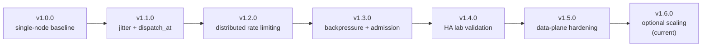

# System evolution

This directory is a versioned record of how the scheduler changed. The version
numbers are **documentation track labels**, not git tags: the repository has no
tags and the work described here is uncommitted. Earlier documents and test
results are kept; each version adds a layer instead of replacing history.

| Version | Theme | Status | Evidence |
| --- | --- | --- | --- |
| [v1.0.0](v1.0.0-single-node.md) | Single-node Compose/EC2 demo | validated | [DEMO.md](../DEMO.md), [ARCHITECTURE.md](../ARCHITECTURE.md) |
| [v1.1.0](v1.1.0-jitter-dispatch.md) | Stable jitter, `dispatch_at`, execution identity | validated | [design/01](../design/01-jitter-and-dispatch-time.md) |
| [v1.2.0](v1.2.0-rate-limiting.md) | Token bucket, Redis fallback, circuit breaker | validated | [design/02](../design/02-rate-limiting-and-redis-fallback.md) |
| [v1.3.0](v1.3.0-backpressure.md) | Coordinator backpressure, admission control | validated | [design/03](../design/03-coordinator-backpressure.md) |
| [v1.4.0](v1.4.0-ha-lab.md) | Patroni/etcd, RabbitMQ quorum, Redis Sentinel, HAProxy | validated in AWS lab | [HA.md](../HA.md), [failover runbook](../runbooks/failover.md) |
| [v1.5.0](v1.5.0-data-plane-hardening.md) | Redis Cluster, quorum hardening, PgBouncer, PITR, nginx LB, HA observability | locally validated; PgBouncer/nginx/observability re-run in AWS 2026-11-12; Redis Cluster/PITR local only | this directory, [internals](../internals/) |
| [v1.6.0](v1.6.0-optional-scaling.md) | Opt-in read/idempotency caches, weighted tenant quotas, sharded ingress, W3C tracing, bounded archival | locally validated; Phase 7 stayed off during the 2026-11-12 AWS HA re-validation | [Phase 7 internals](../internals/09-cache-quotas-tracing-archival.md), [runbook](../runbooks/phase7-scaling.md) |

## How to read the versions

- **v1.0.0–v1.3.0** describe the application-level correctness work: scheduling
  identity, jitter, rate limiting, and backpressure. Their test evidence remains
  in the original design documents.
- **v1.4.0** is the original three-node HA lab. It proved PostgreSQL RPO 0 with
  a synchronous standby, quorum-queue backlog survival, and Redis Sentinel
  fallback. The lab was deliberately destroyed after the drills; the results are
  preserved in [HA.md](../HA.md) and the [failover runbook](../runbooks/failover.md).
- **v1.5.0** hardens the data plane. The 2026-11-12 AWS re-validation exercised
  PgBouncer, nginx, quorum-queue leader loss, and HA observability; Redis Cluster and
  PITR remain locally validated only. It adds Redis Cluster compatibility, quorum-only
  TTL/delivery declarations, PgBouncer transaction pooling, a PITR design and local
  drill, an nginx software load balancer, and Patroni/HAProxy/PgBouncer/Redis metrics
  and alerts.
- **v1.6.0** implements the optional Phase 7 accelerators while keeping
  PostgreSQL authoritative: short-TTL task/execution caches, a completed
  idempotency-response cache, weighted tenant admission quotas, a sharded global
  ingress limiter, W3C tracing through the outbox and timer boundary, and
  bounded archival of terminal history. Every feature is default-off and fails
  open.

## Version policy

1. Never delete a prior version page or its test results.
2. Add a new page when the architecture or operational contract changes.
3. Record what was **actually run** separately from what is design-only.
4. Keep the current state in [HA.md](../HA.md) and the implementation plan; the
   evolution pages explain how it got there.

## Related documentation

- [Internals](../internals/README.md) — diagrams of functions, data flow, and
  failure handling.
- [HA design](../HA.md) — current topology and validated results.
- [Failover runbook](../runbooks/failover.md) — drills and incident procedure.
- [Implementation plan](../design/04-implementation-plan.md) — phase-by-phase
  delivery plan.
