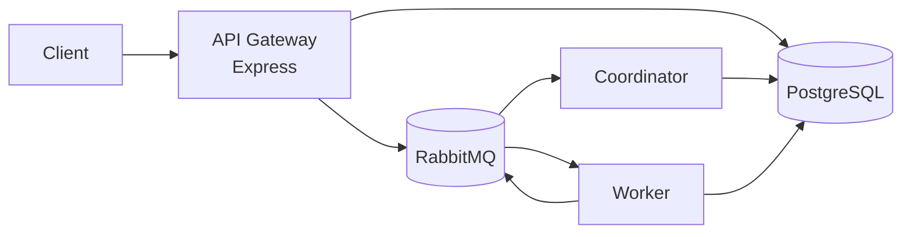

# v1.0.0 — single-node baseline

**Theme:** a working distributed-task-scheduler demo on one host.

## What existed

- Express API with JWT authentication and task CRUD.
- PostgreSQL for tasks and execution history.
- RabbitMQ for task delivery.
- Coordinator process for delayed wakeups, results, and reconciliation.
- Worker process that claims an execution, runs the command, and publishes the
  result.

## Guarantees

- Durable task rows and execution rows in PostgreSQL.
- Durable RabbitMQ messages (`delivery_mode=2`).
- Basic retry and dead-letter behavior.

## Limits

- One PostgreSQL, one RabbitMQ, one Redis (when rate limiting is enabled).
- No transactional outbox, no execution leases, no idempotency keys, no
  `dispatch_at` identity.
- No HA claim. Losing the host loses the deployment.

## Evidence

- [Demo guide](../DEMO.md)
- [Architecture](../ARCHITECTURE.md)
- [Project overview](../PROJECT_OVERVIEW.md)

This page is retained as the baseline. Later versions add guarantees without
removing the original demo path.
