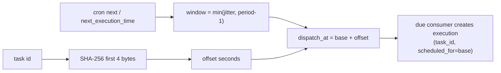

# v1.1.0 — stable jitter and dispatch identity

**Theme:** make a scheduled slot unique and spread load without losing the
intended execution time.

## What changed

- Added `tasks.dispatch_at`, `jitter_seconds`, and `jitter_policy`.
- Added `task_executions.scheduled_for` and the unique slot index
  `(task_id, scheduled_for)`.
- `dispatch_at` is the base schedule plus a stable per-task offset.
- The offset is derived from the first four bytes of `SHA-256(task_id)`:

```text
offset = uint32_be(sha256(task_id)[0:4]) % (window_seconds + 1)
dispatch_at = base + offset
```

- For recurring tasks the window is capped at `period_seconds - 1` so one
  occurrence cannot move past the next.
- The TypeScript API (`api-gateway/src/scheduling.ts`) and the Python
  coordinator (`coordinator/internal/scheduling.py`) compute the same offset.



## Guarantees

- A duplicate wakeup for the same base slot conflicts on the unique slot index
  and is a no-op.
- Jitter is deterministic for a task, so retries and duplicate dispatches agree
  on `dispatch_at`.
- The base schedule, not the jittered wall-clock time, is the execution identity.

## Evidence

- [Jitter and dispatch-time design](../design/01-jitter-and-dispatch-time.md)
- Migrations `0002`–`0005` in `database/migrations/`.

## Limits retained

- Single-node data plane.
- No transactional outbox or PgBouncer yet.
