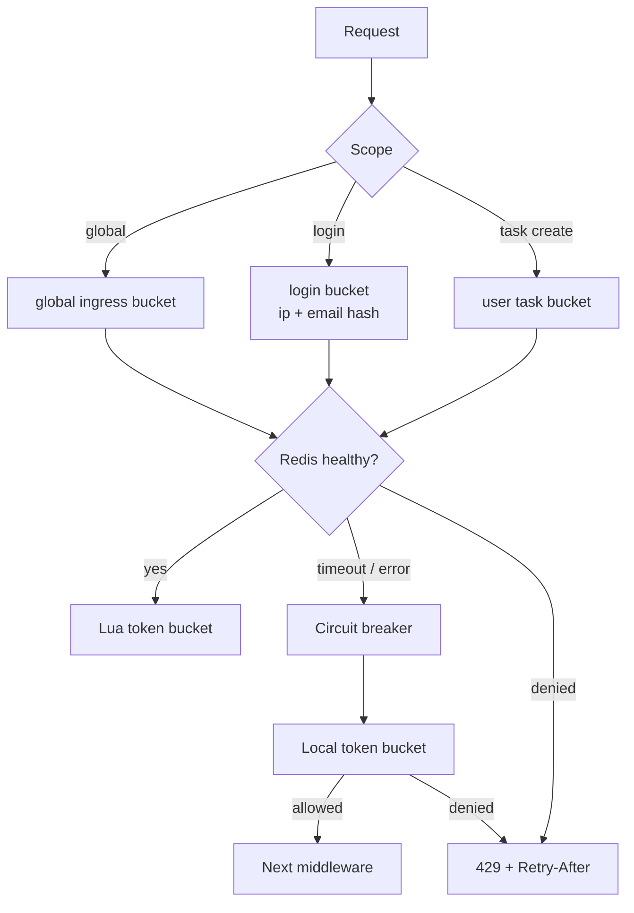

# v1.2.0 — distributed rate limiting with fallback

**Theme:** bound request rates across API replicas without turning Redis into a
new hard dependency.

## What changed

- Added three scopes: global ingress, login, and per-user task creation.
- Added a single-key token-bucket Lua script executed in Redis.
- Added a local token bucket and a circuit breaker. When Redis is slow or down,
  the API serves from the local bucket rather than returning 5xx.
- Added `RATE_LIMIT_MODE=observe|enforce`; observe mode records denials without
  rejecting traffic.
- Added response headers `X-RateLimit-Limit`, `X-RateLimit-Remaining`,
  `X-RateLimit-Source`, and `Retry-After` on enforced denials.

## Guarantees

- Atomic token accounting: the Lua script reads `TIME`, refills, consumes, and
  writes the new state in one Redis command.
- A Redis denial is a successful call and does not open the circuit.
- Redis failure degrades to a conservative local limit, never to unbounded
  traffic.
- Later (v1.5.0) the same script runs on Redis Cluster because every key is a
  single key and needs no hash tag.

## Evidence

- [Rate-limiting and Redis fallback design](../design/02-rate-limiting-and-redis-fallback.md)
- [Rate-limiting runbook](../runbooks/rate-limiting.md)
- `api-gateway/src/rate-limit/`

## Limits retained

- Single-node Redis in the original deployment.
- Fallback capacity is per API replica, so it is a safety valve rather than a
  globally exact limit.
