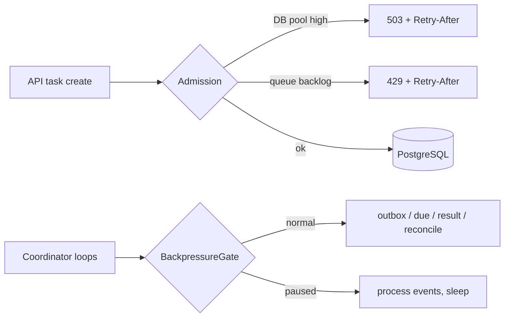

# v1.3.0 — coordinator backpressure and admission

**Theme:** stop overload at the edge instead of letting PostgreSQL and RabbitMQ
time out every request.

## What changed

- Coordinator backpressure controller with hysteresis:
  - task-queue depth high/low
  - result-queue depth high/low
  - database gate utilization and waiters
  - stale/missing signal handling
- Per-consumer gating: outbox, scheduled events, results, reconciliation, and
  due dispatch can pause independently.
- Result processing keeps draining unless the database or result queue itself is
  the bottleneck.
- API admission middleware rejects with `503` when the DB pool is saturated and
  `429` when the task queue is above the high watermark.
- API-side queue-depth cache with a freshness bound (`15 s`) and a latch between
  high and low watermarks.
- Coordinator `DbGate` bounds short-lived connections and exposes utilization.

## Guarantees

- A single noisy queue sample does not flip the coordinator state; high and low
  conditions must hold for consecutive samples.
- The result consumer is not starved by a task backlog.
- Rejections are explicit and retryable rather than generic timeouts.

## Evidence

- [Coordinator backpressure design](../design/03-coordinator-backpressure.md)
- [Backpressure runbook](../runbooks/backpressure.md)
- `coordinator/internal/backpressure/`

## Limits retained

- Backpressure is per coordinator process for local gates; the shared decision
  comes from queue depth and DB gate snapshots.
- No HA data plane yet.
