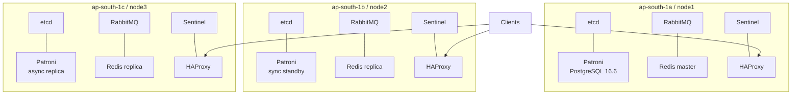

# v1.4.0 — three-node HA lab

**Theme:** survive the loss of a PostgreSQL primary or a RabbitMQ node without
losing task state or silently duplicating work.

## Topology that was actually built

- Three Spot `m7i-flex.large` instances across three AZs.
- etcd + Patroni PostgreSQL 16.6 with a synchronous standby.
- Three-node RabbitMQ cluster with four quorum queues, three members each.
- Redis master/replica plus three Sentinels and a sentinel-aware proxy (`:6380`).
- Per-node HAProxy for PostgreSQL primary/replica, RabbitMQ, and the API.
- Three API replicas and nine workers.

## Drill results (preserved)

| Drill | Result |
| --- | --- |
| PostgreSQL primary loss | RPO 0, promotion in ~2.8 s |
| RabbitMQ queue-leader loss | 301-message backlog retained; 300/300 expected messages delivered exactly once (one probe excluded) |
| Redis master loss | Sentinel failed over; API stayed on the fallback bucket without 5xx |
| Load through node1 HAProxy | 7,586 requests at 126 req/s, p95 69.6 ms, 0 failures; 8,040 tasks completed exactly once, 0 retries, 0 duplicate slots, outbox drained |

The lab was destroyed after validation (12 Terraform resources removed). The
results above remain the v1.4.0 evidence; they are not overwritten by later
configuration work.

## Limits recorded at the time

- No stable NLB (the account did not support load balancers); clients used a
  per-node HAProxy address.
- No PgBouncer, no PITR/off-site backups.
- Spot instances, self-managed Patroni/etcd.
- No Patroni/HAProxy/PgBouncer/Redis alerting at that point.

## Follow-on

v1.5.0 addresses the data-plane gaps without re-provisioning the destroyed lab:
Redis Cluster, quorum TTL/delivery hardening, PgBouncer, PITR, nginx load
balancing, and HA observability.

## Evidence

- [HA design and results](../HA.md)
- [Failover runbook drill log](../runbooks/failover.md#drill-log)
- `deploy/ha-lab/`
