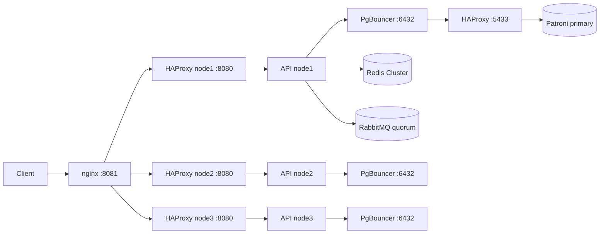

# v1.5.0 — data-plane hardening (current)

**Theme:** close the production gaps found by the v1.4.0 lab without deleting or
rewriting the earlier validation.

This version was validated **locally and at configuration level**. The AWS lab
from v1.4.0 was destroyed and was not re-provisioned for these changes, so this
page records local evidence and design work, not a second live HA run.

## What changed

### Redis Cluster

- `REDIS_CLUSTER_NODES` accepts a comma-separated seed list.
- The API uses ioredis `Cluster` when configured, standalone `Redis` otherwise.
- The existing token-bucket Lua script works unchanged because it touches one key
  per call; no hash tags are required.
- Seed nodes only bootstrap discovery; ioredis follows `MOVED`/`ASK` and keeps
  commands on masters.
- Six-node local harness (three masters, three replicas) passed, including
  `CLUSTER FAILOVER FORCE`.

### Quorum queue hardening

- Quorum declarations now include quorum-only `x-message-ttl` and
  `x-delivery-limit` in the API, coordinator, and worker.
- Constants are duplicated across the three services and must match; changing
  them requires draining and recreating queues.
- RabbitMQ config adds resource alarms, `pause_minority`, and consumer-timeout
  protection.
- Partition drill passed: 160 messages consumed exactly once across single-broker
  loss, minority pause, and recovery.

| Queue | TTL | Delivery limit |
| --- | --- | --- |
| `scheduler.tasks` | none (accepted work must not expire) | 20 |
| `scheduler.due` | 1 h | 10 |
| `scheduler.results` | 7 d | 20 |
| `scheduler.tasks.dlq` | 14 d | none |

### PgBouncer

- `edoburu/pgbouncer` in transaction-pooling mode, one pool per node.
- Services connect to `host.docker.internal:6432`; migrations stay direct on
  HAProxy `:5433`.
- SCRAM-SHA-256 auth, `DISCARD ALL` after every transaction
  (`server_reset_query_always=1`), and advisory transaction locks validated.
- PgBouncer exporter on `:9127` with `database` labels.
- Local harness asserted SCRAM, transaction reuse, `pg_try_advisory_xact_lock`,
  session reset, `SHOW POOLS`, and exporter metrics.

### PITR

- Production design: pgBackRest or WAL-G to encrypted S3, with Patroni
  `archive_mode`/`archive_command` and a documented restore target.
- Local drill: `pg_basebackup` plus archived WAL, restored twice to two target
  times. Target 1 returned 20 rows, target 2 returned 30 rows, and post-target
  rows 31–40 were absent from both.
- Both restores promoted (`pg_is_in_recovery()=false`) and stopped replaying at
  the requested time.

### nginx load balancer

- The account cannot create an AWS load balancer, so an nginx template replaces
  the external NLB.
- nginx accepts HTTP on `:8081` and load balances across the three per-node
  HAProxy API listeners on `:8080`.
- Passive health checks (`max_fails=2`, `fail_timeout=10s`) and
  `proxy_next_upstream` retry the next node.
- Local harness passed: all three backends received traffic, a stopped backend
  was removed from rotation, and it returned after `fail_timeout`.
- The nginx tier is started on node1 by `deploy.sh`; per-node `:8080` remains a
  direct fallback. A stable production endpoint still needs nginx on every node
  behind DNS or a managed LB.

### HA observability

- Prometheus scrapes Patroni `:8008`, HAProxy `:8404`, PgBouncer `:9127`, and
  Redis `:9121`.
- Alerts cover target down, no primary, Postgres down, unlocked DCS, replication
  lag, missing synchronous standby, archive recovery, PgBouncer waiting/
  saturation/maxwait, Redis down/link down/replica count, and RabbitMQ alarms.
- HA-only selectors require `topology="ha"` so the single-node stack never
  matches them.

## Validation evidence

| Check | Result |
| --- | --- |
| Redis Cluster six-node harness | passed; cluster-wide token bucket and failover |
| Quorum partition drill | 160/160 messages exactly once |
| PgBouncer harness | SCRAM, pooling, advisory locks, reset, exporter all passed |
| PITR drill | two target times, 20 and 30 rows, both promoted |
| nginx harness | three-backend distribution, failover, recovery |
| API config/rate-limit/queue tests | passed |
| Coordinator/worker topology tests | passed |
| `bash -n deploy.sh` | passed |

## Not claimed

- No live AWS PostgreSQL failover, PITR, or network-partition re-run after these
  changes.
- No production S3 backup bucket or WAL-G/pgBackRest deployment.
- No Alertmanager route test against a real pager.
- No managed load balancer or DNS-based stable endpoint.

## Evidence

- [Internals](../internals/README.md)
- [Redis Cluster harness](../../tests/redis-cluster/README.md)
- [Quorum partition harness](../../tests/rabbitmq-quorum/README.md)
- [PgBouncer harness](../../tests/pgbouncer/README.md)
- [PITR drill](../../tests/pitr/README.md)
- [nginx LB harness](../../tests/nginx-lb/README.md)
- [HA design](../HA.md), [failover runbook](../runbooks/failover.md)
