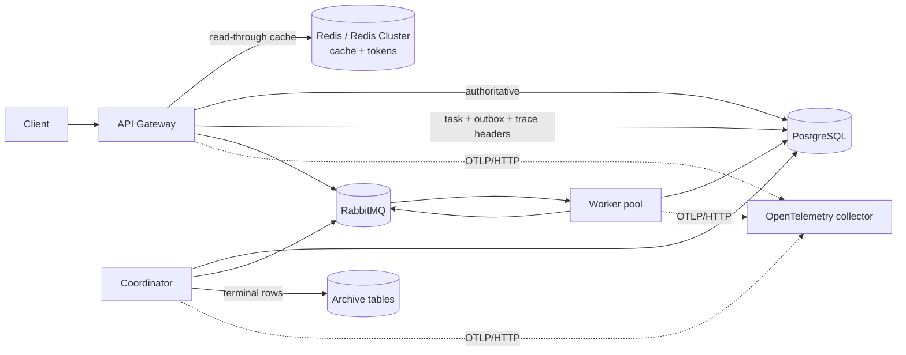

# v1.6.0 — optional Redis scaling, quotas, tracing, archival (current)

**Theme:** make the Phase 7 accelerators real without changing the scheduler's
authority model. Redis caches reads and rate-limit state; PostgreSQL still owns
tasks, execution slots, leases, idempotency, the outbox, and timers.

This version was validated **locally**. The v1.4.0 AWS lab remains destroyed, so
the page records test evidence from the local stack, disposable PostgreSQL
containers, and the repository test suites. It does not claim a second live HA
run.

## What changed

Every feature is default-off and fails open to PostgreSQL. The Phase 4 token
bucket remains the only Redis dependency on the correctness path, and even that
degrades to a smaller local bucket rather than falling back to the database.

### Read-through task and execution cache

- `CACHE_ENABLED=false` by default. `CACHE_TTL_SEC` defaults to 15 seconds and
  `CACHE_REDIS_TIMEOUT_MS` to 50 ms.
- Task reads and paginated execution history are cached as JSON under
  `sched:cache:<namespace>:<key>`.
- Writes update the task cache; update and delete invalidate both the task key
  and a per-task execution generation counter. Execution pages include the
  generation in their key, so invalidation is O(1) instead of a key scan.
- A cache error, timeout, or malformed value is a miss. The request continues
  against PostgreSQL.

### Completed idempotency-response cache

- `IDEMPOTENCY_CACHE_ENABLED=false` by default; `IDEMPOTENCY_CACHE_TTL_SEC`
  defaults to 900 seconds.
- The cache stores the completed status, response body, and canonical request
  hash. A hit is served only when the hash matches.
- A hash mismatch still returns `409`, exactly as the durable PostgreSQL path
  does. The `idempotency_keys` row remains the authority and is written in the
  same transaction as the task.

### Weighted tenant admission quotas

- Migration `0011_tenant_quotas` adds `tenant_quotas(user_id, weight,
  tasks_per_min, burst, enabled, timestamps)` with positive-value constraints.
- Effective rate and burst are `base × weight`, serialized to the token bucket.
  `weight` is a multiplier on admission, not a broker scheduling policy: the
  work queues remain FIFO and workers do not preempt or reorder tasks.
- Resolution order is process-local TTL cache → Redis TTL cache → PostgreSQL.
  A missing row, disabled row, lookup failure, or Redis loss uses
  `TENANT_DEFAULT_*`, never unlimited access.
- `TENANT_QUOTAS_ENABLED=true` replaces the static `user:tasks` limiter with the
  `tenant:tasks` limiter. `RATE_LIMIT_MODE=observe|enforce` still decides
  whether a denial is recorded or returned as `429`.
- Responses expose `X-Quota-Source`, `X-Quota-Weight`,
  `X-Quota-Tasks-Per-Min`, and `X-Quota-Burst`.

### Sharded global ingress limiter

- `GLOBAL_INGRESS_SHARDS` defaults to 16 and is bounded to 1–256.
- The global bucket is split across N Redis keys, each with `1/N` capacity and
  refill. A request is routed by an FNV-1a hash of the hashed client ingress
  key, so one client stays on one shard while aggregate key load is spread.
- `scheduler_ratelimit_shards{scope="global:ingress"}` reports the shard count.
  The advertised remaining tokens are the selected shard's count and therefore
  conservative.
- `GLOBAL_INGRESS_SHARDS=1` restores the single-key behavior.

### W3C tracing across the database boundary

- `OTEL_ENABLED=false` by default; `OTEL_SAMPLER_ARG` defaults to 0.1.
- The API starts one SERVER span per request, injects `traceparent` into the
  outbox transaction, and writes the same headers to RabbitMQ messages.
- Migration `0013_scheduled_event_headers` adds `scheduled_events.headers`, so a
  trace survives the PostgreSQL timer delay as well as the outbox.
- The coordinator creates spans for outbox materialization/publish, timer
  publish, due processing, and result processing. The worker creates a
  `task.process` span from the propagated context.
- Python tracing is optional: if the OpenTelemetry packages are absent or the
  flag is off, every helper is a no-op and behavior is unchanged.
- The API exports `scheduler_tracing_enabled`,
  `scheduler_trace_spans_exported_total`, and
  `scheduler_trace_export_errors_total`.

### Bounded archival instead of live-table partitioning

- Migration `0012_archive_tables` adds `task_execution_archive`,
  `task_execution_attempts_archive`, and `outbox_archive`, plus partial scan
  indexes on the live tables.
- Only terminal rows move: executions in `completed`, `failed`, `timeout`, or
  `cancelled`, and outbox rows in `published` or `failed`, older than
  `ARCHIVE_RETENTION_DAYS` (default 30).
- Each batch copies and deletes in one transaction with
  `FOR UPDATE SKIP LOCKED`; a crash leaves rows either fully live or fully
  archived. Pending/running executions, pending outbox rows, and pending timers
  are never selected.
- The coordinator runs bounded cycles when `ARCHIVE_ENABLED=true`; operators can
  run the same code with `scripts/archive_data.py` or `make archive-data`,
  including `--dry-run`.
- **Why not declarative time partitioning:** `task_executions` relies on unique
  `(task_id, scheduled_for)` and active-execution indexes that cannot be
  preserved unchanged when `scheduled_for` becomes a partition key. Archival
  keeps the hot-path invariants and indexes exactly as they were. Partitioning
  remains a separate design change.

### Configuration

| Variable | Default | Purpose |
| --- | --- | --- |
| `CACHE_ENABLED` | `false` | Task/execution read cache |
| `CACHE_TTL_SEC` | `15` | Cache entry TTL |
| `CACHE_REDIS_TIMEOUT_MS` | `50` | Fail-open timeout per cache operation |
| `IDEMPOTENCY_CACHE_ENABLED` | `false` | Completed response cache |
| `IDEMPOTENCY_CACHE_TTL_SEC` | `900` | Response cache TTL |
| `TENANT_QUOTAS_ENABLED` | `false` | Weighted tenant admission |
| `TENANT_QUOTA_CACHE_TTL_SEC` | `30` | Quota cache TTL |
| `TENANT_DEFAULT_WEIGHT` | `1` | Weight when no enabled row exists |
| `TENANT_DEFAULT_TASKS_PER_MIN` | `60` | Base task rate |
| `TENANT_DEFAULT_BURST` | `10` | Base burst |
| `GLOBAL_INGRESS_SHARDS` | `16` | Redis keys for the global bucket |
| `OTEL_ENABLED` | `false` | Tracing in API/coordinator/worker |
| `OTEL_SAMPLER_ARG` | `0.1` | Root sampler ratio |
| `ARCHIVE_ENABLED` | `false` | Coordinator archival loop |
| `ARCHIVE_RETENTION_DAYS` | `30` | Terminal-row retention |
| `ARCHIVE_BATCH_SIZE` | `500` | Rows per batch |
| `ARCHIVE_INTERVAL_SEC` | `3600` | Loop interval |
| `ARCHIVE_MAX_BATCHES` | `20` | Bounded work per cycle |
| `ARCHIVE_SLEEP_MS` | `50` | Pause between batches |

## Validation evidence

| Check | Result |
| --- | --- |
| API suite | 63 passed / 20 skipped across 10 passing files / 2 skipped |
| API build (`npm run build`) | passed |
| Coordinator/worker pytest | passed against the disposable PostgreSQL instance |
| Root pytest (excluding `tests/pgbouncer`) | passed |
| Phase 7 API tests | cache, tenant quota, sharded limiter, config |
| Phase 7 coordinator/worker tests | archival, tracing, outbox/timer header propagation |
| Migrations `0011`–`0013` | applied from bootstrap, rolled back, re-applied on disposable PostgreSQL |
| Archive dry-run / real run / `make archive-data` | only old terminal rows moved; pending and recent rows stayed |
| Prometheus rules | `promtool check rules` passed, 54 rules |
| Grafana dashboard | valid JSON, 45 panels (Phase 7 IDs 116–126) |
| Live Docker E2E | completed task on `worker-2`; 300/300 burst completed, 0 failures, 17.4 s drain after a shared due time |
| Documentation | evolution, internals, runbook, README, deployment and design indexes updated |

## Not claimed

- No live AWS re-provisioning or HA rerun after Phase 7.
- No production cache hit-ratio or quota calibration; both are opt-in.
- No load test at production scale for the sharded limiter or quotas.
- No production S3 lifecycle policy for archive tables.
- No automatic partition maintenance; archival only.
- No claim that shell-command side effects are exactly-once. Delivery remains
  at-least-once and execution state remains lease-guarded.

## Evidence

- [Phase 7 internals](../internals/09-cache-quotas-tracing-archival.md)
- [Phase 7 runbook](../runbooks/phase7-scaling.md)
- [Rate limiting internals](../internals/04-rate-limiting.md)
- [Outbox and timers](../internals/03-outbox-and-timers.md)
- [Implementation plan](../design/04-implementation-plan.md)
- [Live E2E evidence](../../screenshots/deployment/test-6/README.md)
- [Deployment guide](../DEPLOYMENT-DOCS.md)
