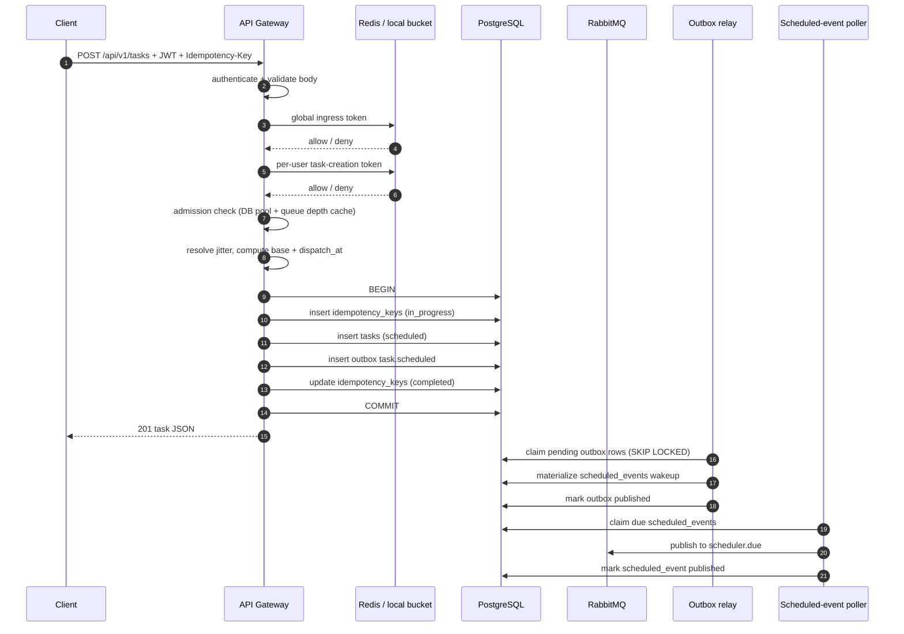
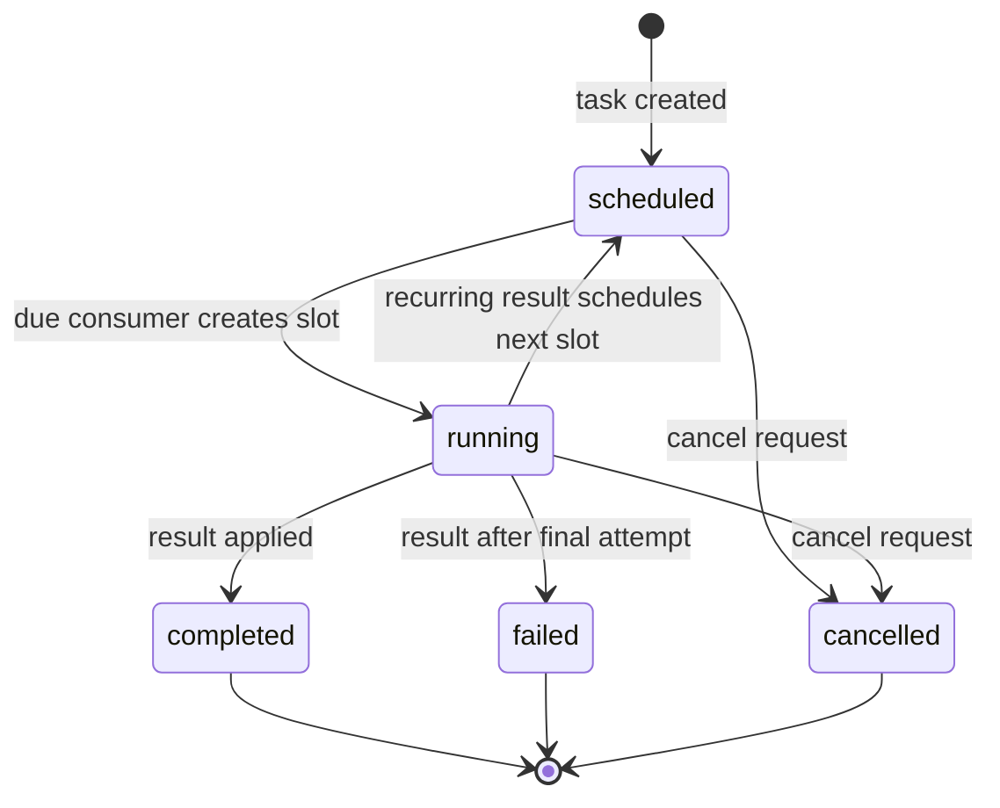

# 01 — request lifecycle

## Creating a task

The API does **not** publish to RabbitMQ before the database commit. The task row
and the `task.scheduled` outbox row commit together, which closes the
database-to-broker dual-write gap. The relay may publish twice after a crash
between publish and commit; the due consumer is idempotent.

### Idempotency states

`idempotency_keys` is keyed by `(user_id, key)` and stores a hash of the request
body.

| Existing row | Result |
| --- | --- |
| no row | insert `in_progress`, continue |
| `completed`, same body | replay the stored status/body with `Idempotent-Replayed: true` |
| `completed`, different body | `409` — key reused with a different body |
| `in_progress` | `409` with `Retry-After: 1` |
| `failed` | `409` — use a new key |

The `ON CONFLICT DO NOTHING` insert is the race arbiter, so two concurrent
requests with the same key cannot both create a task.

### When the outbox is disabled

`OUTBOX_ENABLED=false` is the rollback path for the classic single-node stack.
After the task transaction commits, the API calls `publishScheduleWakeup`, which
publishes to `scheduler.delay` with a per-message TTL. That path is deliberately
not used together with quorum queues: quorum queues do not support per-message
TTL, and losing the publish after commit would lose the wakeup.

## Status transitions

`task_executions` has its own status (`pending` → `running` → `completed` /
`failed` / `timeout` / `cancelled`). The task status is the aggregate view; the
execution row is the unit of work and the unit of lease protection.

## Why the ID is generated before the insert

The stable jitter offset is derived from the task UUID. Generating the UUID in
the API before `INSERT` means the same identity is used for:

- the `tasks.id` primary key,
- the jitter offset,
- the `dispatch_at` value,
- the outbox `aggregate_id`,
- the worker message `taskId`.

No later process has to recompute or guess the offset.

## Code references

- `api-gateway/src/routes/tasks.ts` — validation, idempotency, transaction.
- `api-gateway/src/scheduling.ts` — offset and `dispatch_at`.
- `api-gateway/src/outbox.ts` — event shape.
- `api-gateway/src/rate-limit/` — rate and admission middleware.
- `coordinator/internal/queue/outbox_relay.py` — relay.
- `coordinator/internal/queue/scheduled_event_poller.py` — due timer publisher.
