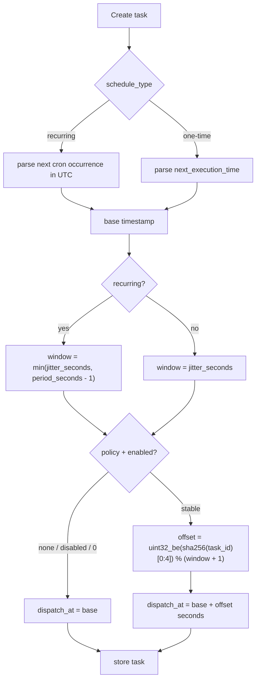
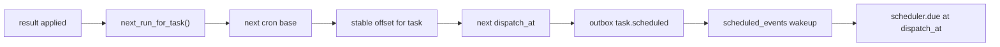

# 02 — scheduling and jitter

## The three timestamps

| Timestamp | Meaning | Written by |
| --- | --- | --- |
| `next_execution_time` | The base schedule: the cron occurrence or the requested one-time time | API |
| `dispatch_at` | `next_execution_time` plus the stable jitter offset; the earliest time a worker should see the task | API |
| `scheduled_for` | The base slot copied onto the execution row; part of the unique slot identity | Due consumer |

Jitter moves the **dispatch** time, not the logical schedule. A task scheduled
for 12:00 with 60 s of jitter is still the 12:00 slot; it may be released between
12:00:00 and 12:01:00.

## Computing `dispatch_at`



The implementation exists twice and must stay in sync:

- TypeScript: `api-gateway/src/scheduling.ts`
- Python: `coordinator/internal/scheduling.py`

```text
stableOffset(task_id, window) =
    uint32_be(SHA-256(task_id)[0..3]) % (window + 1)
```

`window + 1` is inclusive, so both the base time and `base + window` are
reachable. For recurring tasks the window is capped at `period - 1`; otherwise a
one-minute task with 90 s of jitter could be dispatched after the next occurrence
has already become due.

## Due decision

The due consumer does not trust the application clock. While holding the task row
lock it asks PostgreSQL:

```sql
(COALESCE(dispatch_at, next_execution_time) <= NOW()) AS is_due
```

- If the row is not due, it returns a `redeliver` action with the effective
  dispatch time.
- If the row is due and the task is `scheduled`, it inserts one execution for the
  base slot.
- If the insert conflicts on `(task_id, scheduled_for)`, the wakeup was a
  duplicate and the action is `slot_conflict`.
- If the task is no longer `scheduled` (cancelled, already running), it skips.

```mermaid
sequenceDiagram
    participant D as scheduler.due
    participant C as Due consumer
    participant P as PostgreSQL

    D->>C: {taskId}
    C->>P: BEGIN; SELECT ... FOR UPDATE
    P-->>C: task row + is_due
    alt not due
        C->>P: ROLLBACK
        C->>D: republish with remaining TTL
    else due and scheduled
        C->>P: INSERT task_executions (task_id, scheduled_for)
        alt slot already exists
            C->>P: ROLLBACK
            C-->>C: slot_conflict (duplicate wakeup)
        else new slot
            C->>P: UPDATE tasks SET status='running'
            C->>P: INSERT outbox task.dispatch (or direct publish)
            C->>P: COMMIT
            C->>D: ACK
        end
    end
```

## Recurring tasks

After a result is applied, the result consumer computes the next base slot from
the cron expression and the current run, applies the same stable offset, and
writes either an outbox `task.scheduled` row or a direct delay publish. The
`task.executions` unique slot index prevents two coordinators from materializing
the same occurrence.



## Retry jitter is separate

Worker retry backoff has its own jitter (`RETRY_JITTER_MODE`):

- `full` (default): uniform `0..ceiling`
- `equal`: uniform `ceiling/2..ceiling`
- `none`: deterministic ceiling

The ceiling is `min(60 s, 1 s × 2^retry_count)` with the exponent capped at 20.
This spreads retry storms; it does not change `dispatch_at` or the execution
slot identity.

## Metrics that expose scheduling behavior

- `scheduler_task_schedule_lag_seconds` — base time to actual dispatch.
- `scheduler_task_dispatch_delay_seconds` — `dispatch_at` to actual dispatch.
- `scheduler_task_jitter_seconds` — observed jitter.
- `scheduler_task_slot_conflicts_total` — duplicate wakeups absorbed by the
  unique slot.

A positive jitter value with a near-zero schedule lag means jitter is working as
designed; a growing schedule lag means the due consumer or the broker is behind.
