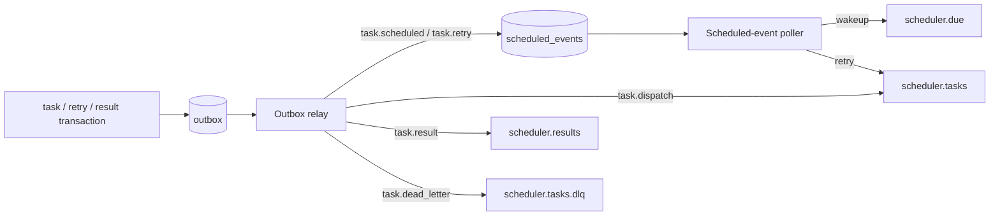
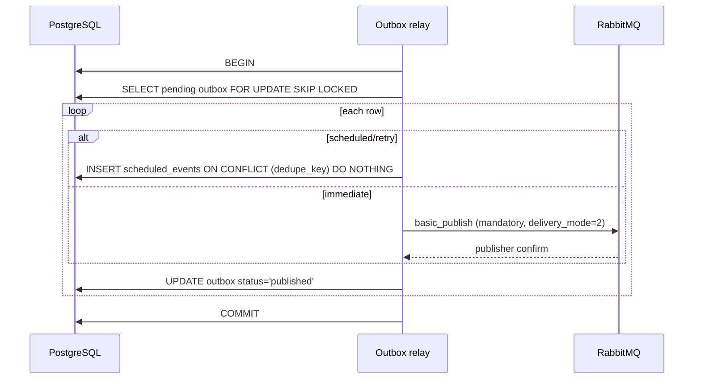
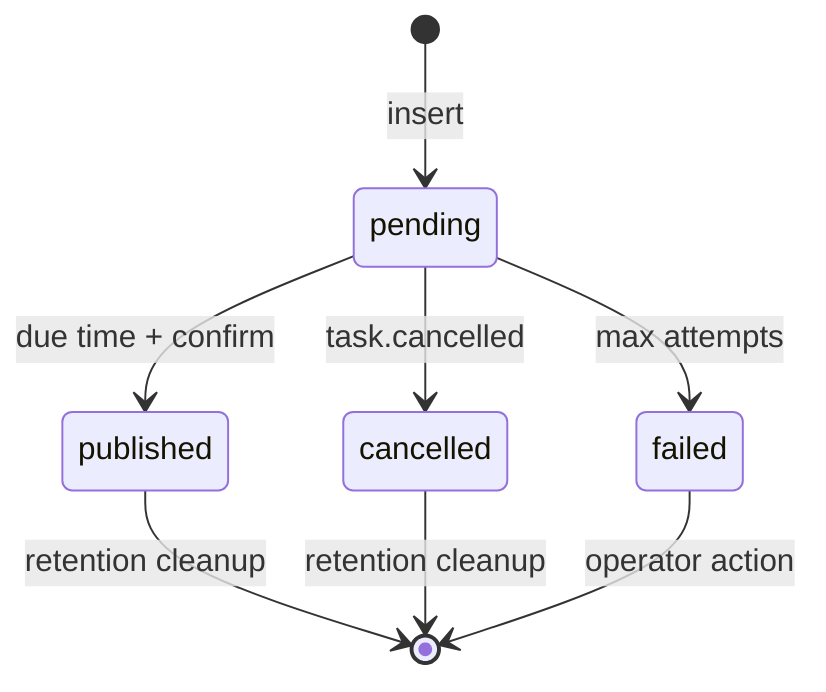

# 03 — outbox and DB-backed timers

## Why both layers exist

The scheduler must not lose an event when PostgreSQL commits and RabbitMQ is
unavailable, and it must not create a task without a wakeup. Two tables solve
that:

- `outbox` — events produced in the same transaction as a state change.
- `scheduled_events` — future work materialized from the outbox, with a due time,
  destination, deduplication key, and status.



## Event routing

| `event_type` | Source | Destination | Delay |
| --- | --- | --- | --- |
| `task.scheduled` | API create / recurring result | materialized as `scheduled_events(kind=wakeup)` | until `dispatch_at` |
| `task.cancelled` | API cancel | marks pending timers cancelled | immediate |
| `task.dispatch` | due consumer | `scheduler.tasks` | immediate |
| `task.retry` | worker failure | materialized as `scheduled_events(kind=retry)` | `retryAt` |
| `task.result` | worker completion / final failure | `scheduler.results` | immediate |
| `task.dead_letter` | final worker failure | `scheduler.dlx` → `scheduler.tasks.dlq` | immediate |

The critical path for scheduled work is:

```text
task row + outbox row (same transaction)
  → outbox relay materializes scheduled_events
  → scheduled-event poller publishes to scheduler.due at available_at
  → due consumer creates the execution and dispatches to scheduler.tasks
```

This replaces per-message TTL on the critical path. Quorum queues support a
queue-level TTL and delivery limit, not per-message TTL, so the DB timer is what
makes quorum queues usable for delayed work.

## Relay transaction



`FOR UPDATE SKIP LOCKED` lets multiple relay loops run without processing the
same row. `pg_try_advisory_xact_lock(hashtext(aggregate_type:aggregate_id))`
serializes event materialization for one aggregate without a second connection.
Publisher confirms and `mandatory=True` catch unroutable messages.

### Crash semantics

| Crash point | Result | Why it is safe |
| --- | --- | --- |
| after `INSERT outbox`, before commit | task and event both roll back | one transaction |
| after publish, before `UPDATE published` | event can be published again | consumers are idempotent |
| after `UPDATE published`, before commit | same duplicate window | consumers are idempotent |
| broker unavailable | connection error rolls back the batch; rows stay pending | retry with backoff |
| malformed payload | row marked failed after max attempts | visible in `outbox.status='failed'` |

The system deliberately chooses **at-least-once delivery with idempotent
consumers** over trying to make PostgreSQL and RabbitMQ atomic.

## Deduplication

`scheduled_events.dedupe_key` is unique. A `task.scheduled` event for the same
task and dispatch time maps to the same key:

```text
wakeup:<task_id>:<ISO-8601 dispatchAt>
retry:<task_id>:<execution_id>:<retryCount>:<ISO-8601 retryAt>
retry:<task_id>:outbox:<outbox_id>          # legacy message without executionId
```

A duplicate outbox materialization returns `duplicate` and does not create a
second timer. A late wakeup after a cancel is ignored by the due consumer
because the task status is no longer `scheduled`.

## Status lifecycle



Both relays expose pending counts and lag. The HA alert set uses
`outbox_pending_rows` and the timer lag gauges to catch a stuck relay.

## Backpressure

The outbox relay and scheduled-event poller consult `BackpressureGate`. When the
coordinator is paused they stop claiming rows and let the backlog remain in
PostgreSQL, where it is visible and durable. The result consumer is allowed to
keep draining unless the database or result queue itself is the bottleneck.

## Code references

- `coordinator/internal/queue/outbox_relay.py`
- `coordinator/internal/queue/scheduled_event_poller.py`
- `coordinator/internal/scheduled_events.py`
- `coordinator/internal/outbox.py`
- `database/migrations/0009_outbox.sql`, `0010_scheduled_events.sql`
