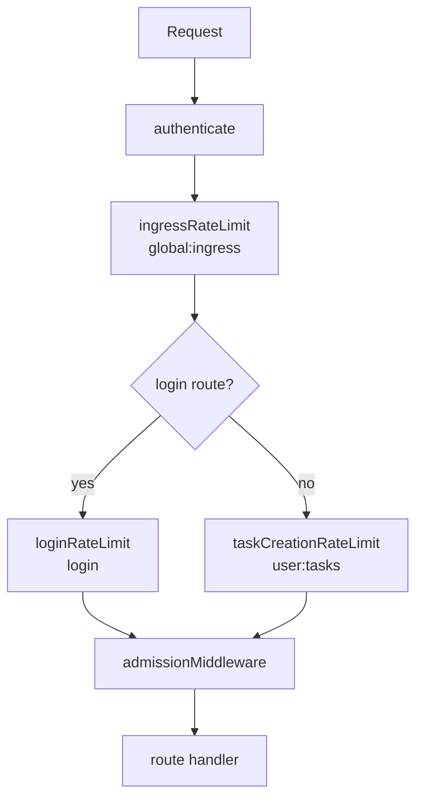
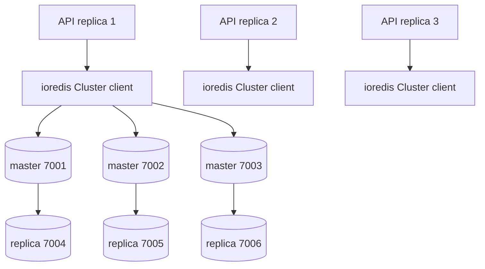
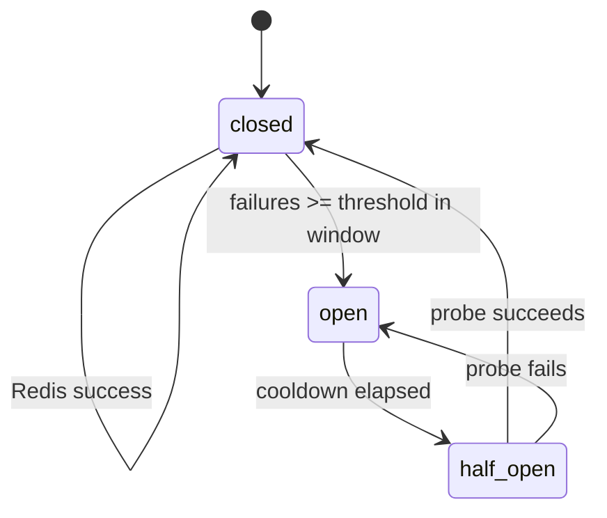

# 04 — rate limiting and Redis fallback

## Request path

Rate limiting is applied per API replica, but the counters are shared in Redis so
the limit is global across replicas.



| Scope | Key | Default |
| --- | --- | --- |
| `global:ingress` | `rl:global:ingress` | 2,000 rps, burst 4,000 |
| `login` | `rl:login:<ip-hash>:<email-hash>` | 5/min, burst 2 |
| `user:tasks` | `rl:user:<user-id>:tasks` | 60/min, burst 10 |

Hashes are the first 32 hex characters of SHA-256. They keep raw IPs and emails
out of Redis keys.

## Token-bucket Lua

The script runs atomically inside Redis:

```lua
now    = TIME()                         -- Redis clock, not the API clock
tokens = HMGET(key, tokens, ts)
tokens = min(burst, tokens + elapsed_s * rate)
if tokens >= cost then
  tokens = tokens - cost
  allowed = 1
else
  retry_after_ms = ceil((cost - tokens) / rate * 1000)
end
HSET(key, tokens, now)
PEXPIRE(key, ceil(burst / rate * 1000) + 1000)
return {allowed, floor(tokens), retry_after_ms}
```

Using the Redis clock avoids skew between API replicas. The TTL is one full
refill window plus one second, so idle buckets disappear without changing the
limit.

A denial is a successful Redis call:
- `allowed=0`, `remaining` and `retryAfterMs` are returned,
- observe mode records the denial but forwards the request,
- enforce mode returns `429` with `Retry-After`.

## Redis Cluster



- `REDIS_CLUSTER_NODES` is a comma-separated seed list.
- Seeds only bootstrap discovery; ioredis learns the slot map and follows
  `MOVED`/`ASK`.
- `scaleReads` defaults to `master`, so token accounting stays authoritative even
  if a replica lags.
- The Lua script touches exactly one key. No hash tag is needed.
- With `REDIS_CLUSTER_NODES` set, `REDIS_URL` is ignored and a warning is emitted.

If cluster mode is not configured, the API uses a standalone `Redis` client with
the same `defineCommand` API. This is why the same `RedisTokenBucket` class works
for both topologies.

## Fallback and circuit breaker



On timeout or connection failure:

1. The circuit breaker records a failure.
2. The request is served by a local token bucket.
3. `rate_limit_fallback_active{scope=...}` is set to 1.
4. After the cooldown, one half-open probe goes to Redis.

The fallback bucket is conservative:

```text
fallback_capacity = min(scope_capacity, RATE_LIMIT_FALLBACK_RPS)
fallback_refill   = min(scope_refill,  RATE_LIMIT_FALLBACK_RPS)
```

It is per API replica, so during a Redis outage the effective global limit can be
up to `replicas × fallback_rps`. That is intentional: the fallback is a safety
valve, not an exact distributed limit. When Redis returns, the breaker closes and
the shared bucket resumes.

## What never happens

- Redis latency does not block a request longer than
  `RATE_LIMIT_REDIS_TIMEOUT_MS`.
- A Redis denial does not open the circuit breaker.
- A Redis outage does not produce 5xx from the limiter; it produces local
  decisions.

## Metrics

- `rate_limit_allowed_total{scope,source}`
- `rate_limit_denied_total{scope,source,reason}`
- `rate_limit_redis_errors_total{reason}`
- `rate_limit_fallback_active{scope}`
- `rate_limit_circuit_state{state}`
- `rate_limit_latency_seconds{scope,source}`

`source="redis"` versus `source="local"` tells you which path served the request.
