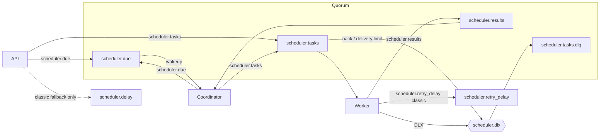
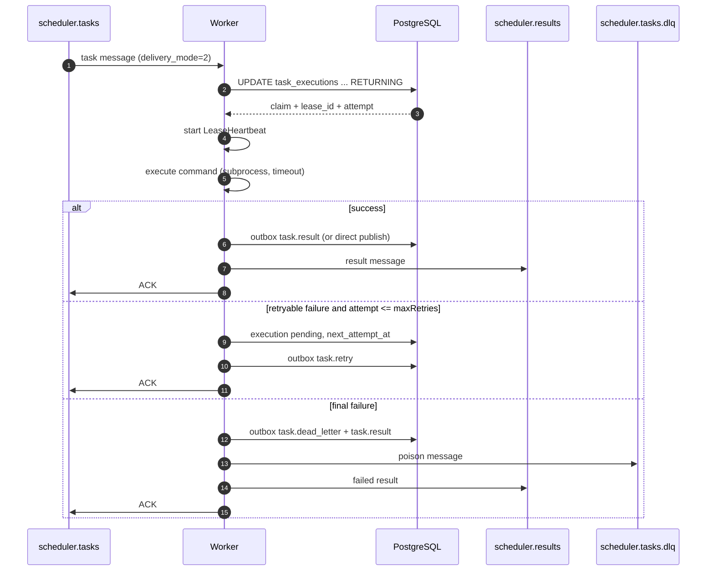
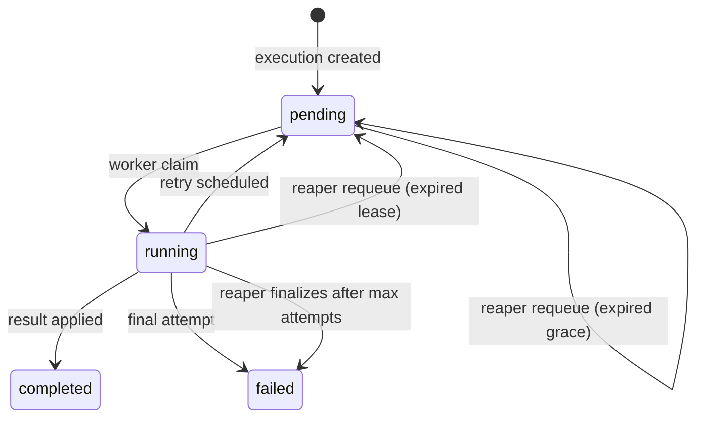

# 05 — queues and workers

## RabbitMQ topology

- All messages are persistent (`delivery_mode=2`) and queues are durable.
- In `quorum` mode the four queues above are declared as quorum queues with
  queue-level TTL/delivery limits.
- `scheduler.delay` and `scheduler.retry_delay` are **classic-only** rollback
  paths. Quorum mode requires `OUTBOX_ENABLED=true`, so delayed work is in
  `scheduled_events`, not a per-message TTL queue.
- `scheduler.tasks` has no message TTL: accepted work must not expire. Poison
  messages are bounded by `x-delivery-limit=20` and dead-lettered.

## Worker lifecycle

Each worker slot has its own connection, channel, and prefetch of one. This
keeps a slow command from blocking other slots and bounds unacknowledged work to
the slot count.

### Claim SQL

The claim is a single conditional `UPDATE ... FROM tasks`:

- task must still be `running`,
- execution must be `pending`,
- `next_attempt_at` must be null or in the past,
- the update sets `running`, `worker_id`, `lease_id`, `lease_expires_at`,
  `attempt = attempt + 1`,
- a `task_execution_attempts` row records the claim.

A duplicate message therefore finds no claimable row and is acknowledged as an
idempotent skip. It does not run the command twice.

### Lease heartbeat

- Default execution lease: 60 s.
- Heartbeat interval: 20 s; the heartbeat extends `lease_expires_at` only while
  `lease_id` still matches and the execution is still `running`.
- If the heartbeat loses the lease, it stops extending and logs `lease lost`.
- The heartbeat stops before writing the result or retry, so the final update is
  guarded by the current lease id.

### Retry and dead letter

- Retry backoff: `min(60 s, 1 s × 2^attempt)` with full/equal/none jitter.
- The execution returns to `pending` with `next_attempt_at`, and an outbox
  `task.retry` row commits in the same transaction.
- After `max_retries + 1` attempts, the worker writes a `task.result` with
  `failed` and a `task.dead_letter` event. The poison message goes to
  `scheduler.dlx` → `scheduler.tasks.dlq`.

## Reaper

The reaper is the safety net for at-least-once delivery:

It selects with `FOR UPDATE SKIP LOCKED`:

- `pending` executions older than `PENDING_RETRY_GRACE_SEC`,
- `running` executions whose `lease_expires_at < NOW()` (or whose attempt row is
  stale).

It either republishes the existing execution for another attempt or finalizes it
after `max_attempts`. It never creates a new execution row for the same slot.

## Exactly-once effect

RabbitMQ is at-least-once. Exactly-once **effects** come from database guards:

| Guard | Protects against |
| --- | --- |
| `uq_task_executions_slot (task_id, scheduled_for)` | duplicate wakeups creating two executions for one base slot |
| `uq_task_executions_active (task_id) WHERE pending/running` | two live executions for one task |
| claim `WHERE status='pending' AND next_attempt_at <= NOW()` | duplicate messages running the command twice |
| `lease_id` condition on result/retry updates | a stale worker overwriting the new owner |
| result `WHERE completed_at IS NULL` | duplicate result messages |
| `idempotency_keys (user_id, key)` | duplicate API task creation |
| `scheduled_events.dedupe_key` | duplicate timers |

The result is: **at least one delivery, at most one effective execution per slot,
and at most one terminal result per execution.**

## Quorum queue TTL constants

These are part of the declaration and immutable after creation. Changing them
requires draining and recreating the queue.

| Queue | TTL | Delivery limit |
| --- | --- | --- |
| `scheduler.tasks` | none | 20 |
| `scheduler.due` | 1 h | 10 |
| `scheduler.results` | 7 d | 20 |
| `scheduler.tasks.dlq` | 14 d | none |

The values are duplicated in:

- `api-gateway/src/queue.ts`
- `coordinator/internal/queue/topology.py`
- `worker/rabbit_topology.py`

Keep them in sync.

## Code references

- `worker/main.py` — claim, heartbeat, execute, retry, DLQ.
- `coordinator/internal/queue/due_consumer.py` — slot creation.
- `coordinator/internal/queue/result_consumer.py` — lease-guarded result apply.
- `coordinator/internal/queue/reaper.py` — stale execution recovery.
- `coordinator/internal/queue/topology.py`, `worker/rabbit_topology.py`,
  `api-gateway/src/queue.ts` — declarations.
