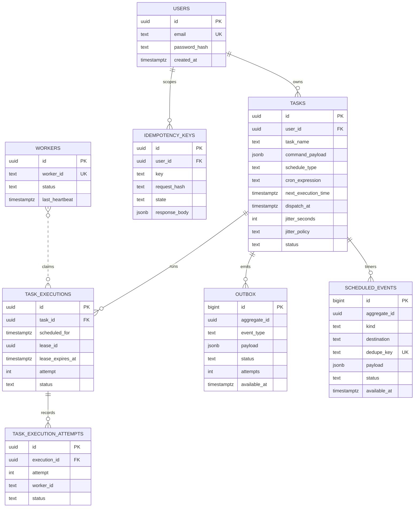
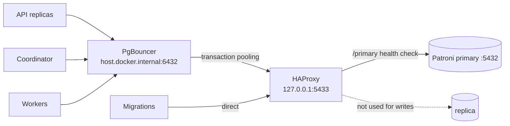

# 06 — PostgreSQL, pooling, and PITR

## Schema map



The outbox and timer tables are polymorphic; their `aggregate_id` is not a
foreign key so they can represent task or execution events. The unique indexes
are the real contract:

```sql
CREATE UNIQUE INDEX uq_task_executions_slot
  ON task_executions(task_id, scheduled_for);

CREATE UNIQUE INDEX uq_task_executions_active
  ON task_executions(task_id) WHERE status IN ('pending', 'running');

CREATE UNIQUE INDEX uq_scheduled_events_dedupe
  ON scheduled_events(dedupe_key);
```

## Transaction boundaries

| Operation | Transaction |
| --- | --- |
| API create | idempotency claim + task insert + outbox insert + idempotency complete |
| Due dispatch | task row lock + execution insert + task status + outbox `task.dispatch` |
| Worker claim | execution update + attempt row |
| Worker result | execution update + outbox `task.result` |
| Worker retry | execution pending + attempt close + outbox `task.retry` |
| Result apply | execution completion + task update + next recurring outbox |
| Outbox relay | select pending + materialize/publish + mark published |
| Reaper | select stale + execution/task update + optional outbox |

A publish is never the only durable record of a state change. Either the outbox
row or the timer row commits with the database change.

## Connection path



- Application services connect to the **local** PgBouncer on
  `host.docker.internal:6432`.
- PgBouncer opens server connections to the local HAProxy primary listener
  (`127.0.0.1:5433`).
- HAProxy uses Patroni's `/primary` endpoint, so the pool follows a leader change
  without a DNS update.
- Migrations use HAProxy `:5433` directly, not the transaction pooler.

### Why transaction pooling is safe here

- The application does not use session-scoped state or session advisory locks.
- `pg_try_advisory_xact_lock` is released at commit/rollback and works through
  the pooler.
- `server_reset_query = DISCARD ALL` with
  `server_reset_query_always = 1` clears `SET`, temp tables, prepared
  statements, and session state after every transaction.
- psycopg2 does not use server-side prepared statements by default, so the extra
  round trip does not break the drivers.
- The Node `pg` pool uses unnamed statements.

If a future driver enables server-side prepared statements, either disable this
reset policy and prove no session state is used, or enable PgBouncer prepared
statement tracking with `max_prepared_statements`.

### Pool sizing (lab)

| Setting | Value |
| --- | --- |
| `pool_mode` | `transaction` |
| `max_client_conn` | 1000 |
| `default_pool_size` | 40 |
| `min_pool_size` | 5 |
| `reserve_pool_size` | 10 |
| `max_db_connections` | 80 |
| `server_reset_query` | `DISCARD ALL` |
| `server_reset_query_always` | 1 |

One pooler runs per node, so the primary sees at most
`3 × max_db_connections` server connections if every node saturates.

## PITR design

### Production target


- Use **pgBackRest** or **WAL-G** with an encrypted S3 bucket, versioning, and a
  lifecycle policy.
- `archive_mode=on`, `archive_command` (or `archive-async`), and
  `archive_timeout` on every Patroni member.
- Full/differential base backups on a schedule; continuous WAL archiving.
- Retain enough WAL to cover the longest acceptable restore window.
- Restore into a new data directory or instance, replay to the target time,
  promote, then repoint HAProxy/Patroni.
- `pg_rewind` (Patroni `use_pg_rewind: true`) lets a demoted primary rejoin.

**RPO / RTO:** with a synchronous standby, primary-loss RPO is 0. PITR RPO is
bounded by the last archived WAL segment plus `archive_timeout`; RTO is the base
restore plus WAL replay plus promotion. Record both in the incident checklist.

### Local drill

The current lab template does not configure `archive_mode`; the drill uses a
disposable PostgreSQL 16 primary with:

```conf
wal_level = replica
archive_mode = on
archive_command = 'test ! -f /backup/archive/%f && cp %p /backup/archive/%f'
archive_timeout = 1
```

The drill:

1. Creates 10 baseline rows, then takes a `pg_basebackup` (`-Fp -Xs`).
2. Inserts rows 11–20, records a target time, and forces a WAL switch.
3. Inserts rows 21–30, records a second target time, and forces a WAL switch.
4. Inserts rows 31–40 after both targets.
5. Restores the base backup twice with `recovery_target_time`,
   `recovery_target_action=promote`, and `restore_command` from the archive.
6. Asserts target 1 has 20 rows, target 2 has 30 rows, and neither contains rows
   above its target.

Result: both restores promoted and stopped at the requested time; the
post-target batch was absent. See
[tests/pitr/README.md](../../tests/pitr/README.md).

### Operational checks

- `pg_stat_archiver.last_archived_wal` is advancing.
- No `last_failed_wal` younger than the last success.
- Base-backup age is within the policy.
- A restore drill has run in the last quarter.
- The restore target is recorded in UTC before the incident.

## PostgreSQL is authoritative

If RabbitMQ loses a message, the outbox/timer rows still describe the intended
work. If a worker dies, the execution row and lease remain. If Redis is lost,
only rate-limit state is lost. This is why recovery starts with the database, not
the broker.
