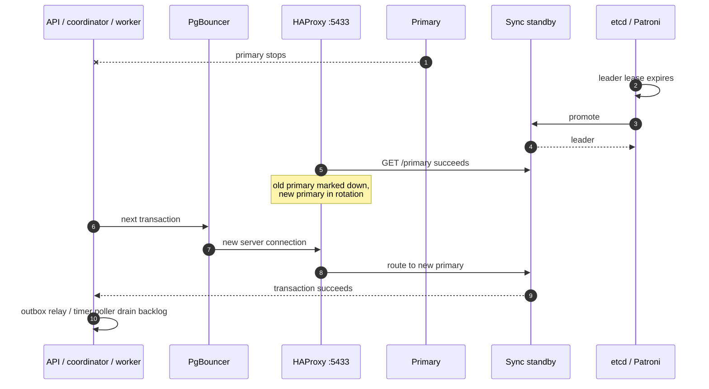
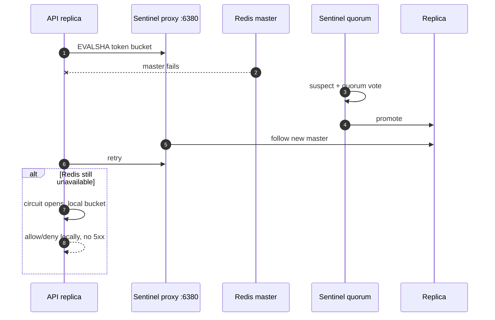
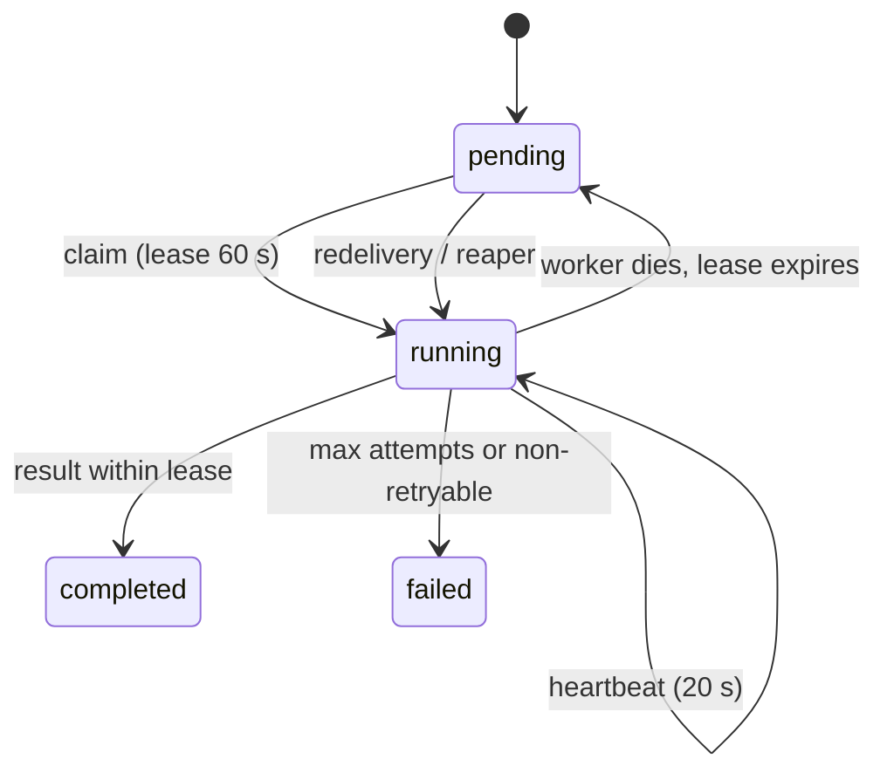
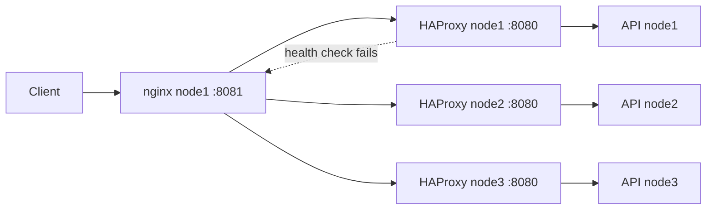
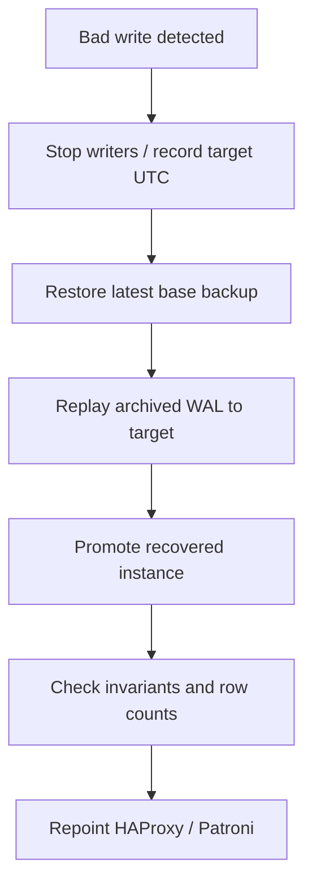

# 07 — failure and recovery

## Failure matrix

The application is designed around **PostgreSQL as the authority**, at-least-once
delivery, and idempotent state transitions. The table separates what has been
actually exercised from what is a design expectation.

| Failed component | Blast radius | What survives | Automatic recovery | Evidence |
| --- | --- | --- | --- | --- |
| PostgreSQL primary | Writes fail until Patroni promotes the sync standby | All committed tasks, executions, outbox, timers | Patroni + HAProxy `/primary`; PgBouncer reconnects | Live lab drill: RPO 0, ~2.8 s |
| Synchronous standby | No RPO change; primary continues | Everything | Replica rebuild / `pg_rewind` | Design; not separately drilled |
| etcd majority | Patroni cannot fail over or change DCS state | Running PostgreSQL keeps serving | Restore quorum | Design; not drilled |
| RabbitMQ node | Quorum leader re-election; brief publish/consume errors | Confirmed quorum messages (majority intact) | Queue leader election + client reconnect | Live lab: 301-message backlog retained |
| RabbitMQ majority | Producers/consumers cannot reach quorum | PostgreSQL outbox/timer rows | Resume when quorum returns | Local partition harness: minority pause, then drain |
| Redis standalone / Sentinel master | Rate-limit decisions fail briefly | Task state (Redis is not authoritative) | Sentinel promotion or local fallback bucket | Live lab: no 5xx, 59 fallback requests |
| Redis Cluster master | Slots on that master unavailable briefly | Task state | Replica promotion, `MOVED`/`ASK` handling | Local six-node harness with `CLUSTER FAILOVER FORCE` |
| PgBouncer | New DB connections fail on that node | Other nodes' poolers and the direct HAProxy path | Health check restart; connection retry | Local harness; pooler is per node |
| HAProxy | That node's API/DB/RabbitMQ entry point fails | Other nodes | Client/nginx retries another node | Local nginx failover harness |
| nginx (node1) | The `:8081` entry point fails | Per-node HAProxy `:8080` still serves | None automatic today | Known single point of failure |
| API replica | In-flight requests fail | Durable task + idempotency rows | nginx/HAProxy rotates to another replica | Load test: 0 failed submissions |
| Worker | In-flight execution is redelivered | Execution row, lease, attempt history | Lease expiry + reaper; duplicate claim prevented | Unit/integration tests; live load test |
| Coordinator | Timers/results pause | Outbox and timer rows | Another coordinator or restart drains them | Backpressure and relay tests |
| Host / AZ | One third of the data plane | Quorum/majority on the remaining two nodes | Patroni/etcd/RabbitMQ majority | Design; Spot lab is not production |

**Not validated in AWS after v1.5.0:** the lab was destroyed after the v1.4.0
drills. PgBouncer, PITR, nginx, quorum partition behavior, and Redis Cluster
were validated locally or at configuration level. Do not describe a live re-run
that did not happen.

## PostgreSQL failover



What the application guarantees during this window:

1. **No ack before commit.** A due/result message is acknowledged only after its
   database transaction commits. A failed commit means redelivery, not loss.
2. **One effect per slot.** `(task_id, scheduled_for)` is unique, and the active
   execution index prevents two live executions for one task.
3. **Leases fence stale workers.** A worker that lost its lease cannot overwrite
   the result of the new owner.
4. **The outbox bridges the gap.** If PostgreSQL was unavailable when a result
   arrived, the result message remains unacked and is retried.

PgBouncer adds one behavior to understand: server connections are broken by the
failover. The pooler discards them, reconnects through HAProxy, and re-authenticates
with SCRAM. Client transactions in flight fail and must be retried by the caller;
the application's transaction boundaries already make that safe. Advisory locks
must be transaction-scoped (`pg_try_advisory_xact_lock`), never session-scoped.

## RabbitMQ node loss and partitions

```mermaid
sequenceDiagram
    autonumber
    participant P as Producer
    participant L as Queue leader (node1)
    participant F1 as Follower (node2)
    participant F2 as Follower (node3)
    participant C as Consumer

    P->>L: publish (confirm)
    L->>F1: replicate
    L->>F2: replicate
    L-->>P: publisher confirm
    L--xP: node1 fails
    F1->>F2: Raft election
    F1-->>C: leader for the queue
    C->>F1: redeliver unacked messages
    Note over C: claim SQL rejects duplicates;<br/>each execution runs once
```

- **Quorum queues require a majority.** With three nodes, one failure keeps the
  queue available; two failures stop it. `pause_minority` makes the broker stop
  serving rather than risk split-brain.
- **Queue membership is fixed at declaration.** `deploy.sh` adds missing members
  after startup. Verify with `rabbitmqctl list_queues name type leader members`.
- **The partition harness** (`tests/rabbitmq-quorum/`) covers single-broker loss,
  minority pause, and recovery: 160 messages were consumed exactly once.
- **Delayed work lives in PostgreSQL**, not per-message TTL, so a broker outage
  cannot expire a future task. The outbox relay and timer poller resume when the
  broker returns.

## Redis loss

### Sentinel topology



- Bucket state is **ephemeral by design**. A failover resets counters; task state is
  unaffected.
- The circuit breaker opens after repeated failures and probes half-open after a
  cooldown. A Redis denial (`allowed=0`) does **not** count as a failure.
- The local fallback bucket is per replica and deliberately conservative. It is a
  safety valve, not an exact global limit.

### Redis Cluster

The same single-key Lua script works because no command touches more than one key.
ioredis discovers the slot map from the seed list and follows `MOVED`/`ASK`; reads
stay on masters so token accounting is authoritative. The local harness ran three
masters and three replicas and forced a failover with `CLUSTER FAILOVER FORCE`.
During a slot migration, requests can see `TRYAGAIN`/`CLUSTERDOWN`; the limiter
treats those as Redis errors and uses the fallback path rather than failing the
request.

## Worker and coordinator crashes



- A worker crash leaves a `running` execution with an expiring lease. The reaper
  requeues it; the claim update is conditional on `status='pending'` and
  `lease_id`/`lease_expires_at`, so a duplicate message is an idempotent skip.
- A coordinator crash stops the outbox relay, timer poller, result consumer, and
  reaper. All of that state is in PostgreSQL; another coordinator or a restart
  resumes from the pending rows.
- The reaper must stay enabled. Without it, a crashed execution can remain
  `running` until an operator intervenes.

## Load-balancer failure



- nginx removes a failed upstream after `max_fails=2` within `fail_timeout=10s`
  and retries the next node via `proxy_next_upstream`.
- HAProxy independently health-checks each API `/health` and Patroni's `/primary`
  for PostgreSQL, so a node with a dead API or an old primary is not selected.
- **node1 is a single point of failure for the external `:8081` endpoint.** The
  per-node `:8080` listeners still work. Production needs nginx on every node
  behind DNS/a managed LB, or a managed load balancer. See
  [08 — load balancing](08-load-balancing.md).

## PITR (point-in-time recovery)

PITR is not automatic failover; it is recovery from logical damage (bad migration,
accidental delete) by restoring a base backup and replaying WAL to a chosen time.



The local drill (`tests/pitr/`) restored the same base backup to two target times:
target 1 returned 20 rows, target 2 returned 30 rows, and rows 31–40 (after both
targets) were absent. Both instances promoted. The production procedure and the
pgBackRest/WAL-G design are in
[06 — PostgreSQL, pooling, PITR](06-postgres-pooling-pitr.md#pitr-design) and the
[restore runbook](../runbooks/failover.md#pitr-restore-validation).

## Recovery order

1. **PostgreSQL** — confirm a single primary and that PgBouncer/HAProxy see it.
2. **RabbitMQ** — confirm majority, quorum leaders, and three queue members.
3. **Redis** — confirm a master (or cluster slots covered) and that the API's
   limiter is on Redis rather than fallback.
4. **Coordinator and workers** — let the outbox relay, timer poller, and reaper
   drain the backlog.
5. **nginx/HAProxy** — confirm all API upstreams healthy.
6. **Verify invariants** — duplicate slots, duplicate active executions, pending
   outbox/timers, and DLQ depth.

Nothing in this order deletes pending outbox or timer rows. Those rows are the
recovery record.
