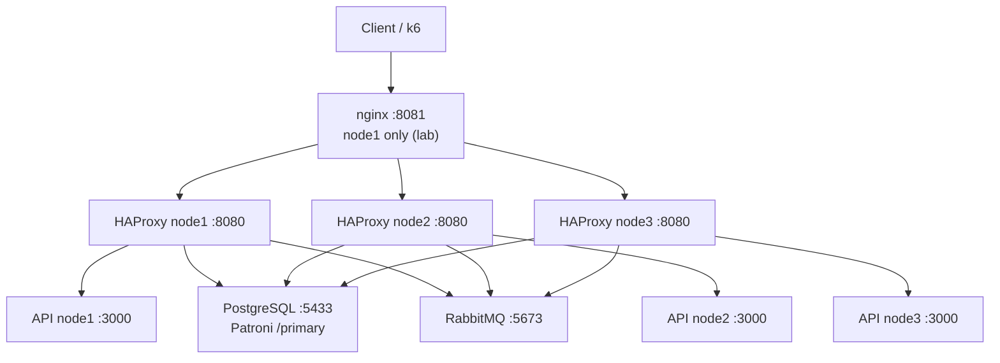
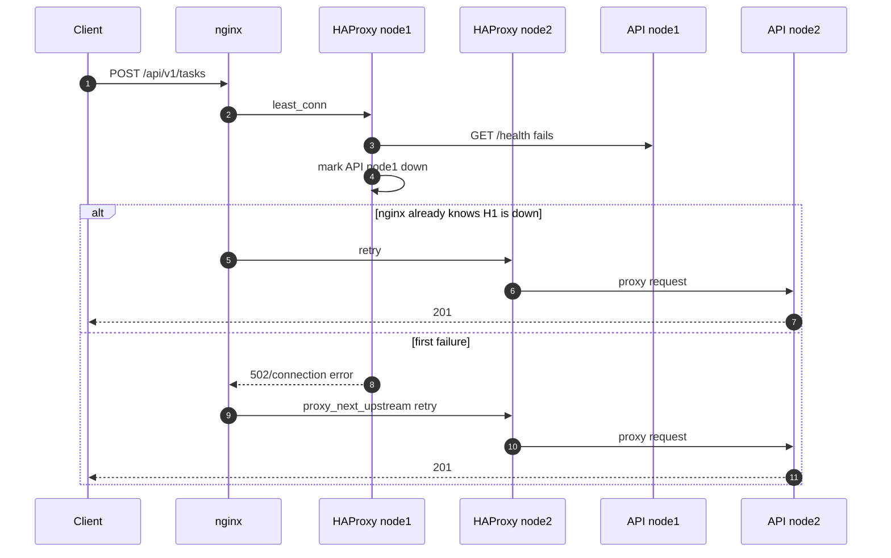
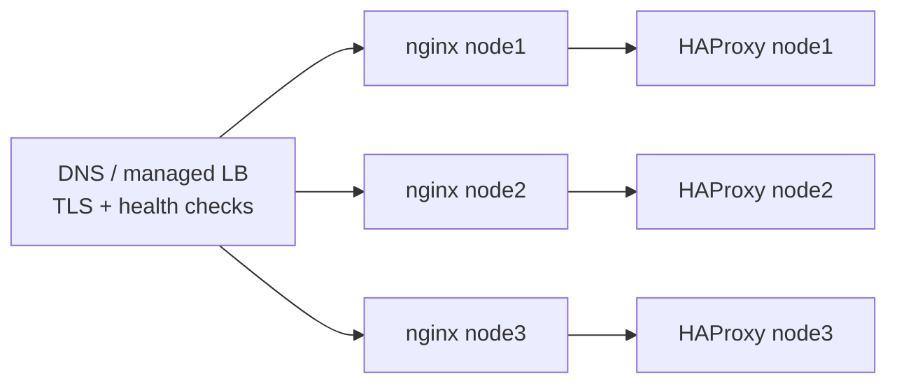

# 08 — load balancing

## Two tiers, different jobs



| Tier | Listens | Balances | Health model |
| --- | --- | --- | --- |
| nginx | `:8081` on node1 | the three per-node HAProxy API listeners | Passive (`max_fails`, `fail_timeout`) + active retry |
| HAProxy | `:8080` per node | all three API replicas | Active `GET /health` every 2 s |
| HAProxy | `:5433` per node | Patroni primary only | Active `GET /primary` on Patroni `:8008` |
| HAProxy | `:5434` per node | Patroni replicas | Active `GET /replica` |
| HAProxy | `:5673` per node | the three RabbitMQ AMQP nodes | TCP check |
| PgBouncer | `:6432` per node | its local HAProxy primary listener | `pg_isready` health check |

The account used for the v1.4.0 lab could not create an AWS load balancer, so nginx
replaces the external NLB. HAProxy still does the per-node backend health checking;
nginx only decides which **node** receives the request.

## Why two tiers

- **nginx gives one stable API entry point.** Clients do not need to know node IPs.
- **HAProxy already knows backend health.** It checks Patroni's role endpoints and
  each local API, so a request that reaches a node's HAProxy is routed only to a
  healthy API replica and a writable primary.
- **The layers fail independently.** A dead API replica is removed by HAProxy; a
  dead node is removed by nginx.

This is the minimum viable replacement for an NLB, not a managed load balancer.

## nginx configuration

Template: `deploy/ha-lab/ha/nginx.conf.tmpl`, rendered by `deploy.sh` into
`runtime/nginx.conf` and started on node1 under the `lb` profile.

```nginx
upstream scheduler_api {
    least_conn;
    server __NODE1_IP__:8080 max_fails=2 fail_timeout=10s;
    server __NODE2_IP__:8080 max_fails=2 fail_timeout=10s;
    server __NODE3_IP__:8080 max_fails=2 fail_timeout=10s;
    keepalive 64;
}

server {
    listen 8081;

    location = /health {
        return 200 "ok\n";          # nginx liveness, not API health
    }

    location / {
        proxy_pass http://scheduler_api;
        proxy_http_version 1.1;
        proxy_set_header Connection "";
        proxy_next_upstream error timeout http_502 http_503 http_504;
        proxy_next_upstream_tries 2;
        proxy_next_upstream_timeout 10s;
        proxy_connect_timeout 3s;
        proxy_read_timeout 30s;
    }
}
```

Key decisions:

- **`least_conn`** — API requests have uneven latency; least-connections avoids
  piling work onto a replica that is already slow.
- **Keepalive to upstreams** — `Connection ""` plus `keepalive 64` avoids a new TCP
  handshake per request.
- **`proxy_next_upstream`** — a connection failure, timeout, or 502/503/504 from one
  node is retried on another node. Two tries bound the added latency.
- **`/health` is local** — it answers even when every API is down, so it is a
  liveness probe, not a readiness probe. Use HAProxy `:8080/health` or the API
  `/health/ready` for readiness.

Open-source nginx only has passive health checks. A node is taken out after two
failures within the fail window and retried after `fail_timeout=10s`. That is why
the harness waits 11 seconds before checking recovery.

## Failover sequence



If an entire node is lost, nginx's passive check removes its `:8080` upstream after
the configured failures. If only an API process died, HAProxy removes that backend
without nginx changing anything.

## What the local harness proved

`tests/nginx-lb/` renders the real template against three `http-echo` backends:

1. Twelve requests reached all three backends.
2. Stopping `backend1` removed it from rotation; traffic landed on backends 2 and 3.
3. Restarting it and waiting 11 seconds returned it to the pool.
4. `nginx -t` accepted the rendered configuration.

The harness does not exercise TLS, WebSocket upgrades, or multi-node nginx.

## Activation in the lab

`deploy.sh` renders `runtime/nginx.conf` on every node, then after API health checks
pass it starts nginx on **node1**:

```bash
docker compose -f docker-compose.ha-data.yml --profile lb up -d nginx
curl -fsS http://127.0.0.1:8081/health
```

Terraform exposes `8081` only on node1 (`exposed_ports = [3001, 8081, 9091, 15672]`).
The deployment output prints both the per-node `:8080` URLs and the
`http://<node1-public-ip>:8081` load-balancer URL.

## Limitations and production path

1. **node1 is a SPOF for `:8081`.** Losing node1 removes the friendly endpoint even
   though PostgreSQL/RabbitMQ/API stay available through the other nodes.
2. **No TLS.** Terminate TLS at a real LB or add certificates and an HTTPS server
   block before exposing this beyond a lab.
3. **No active nginx health checks.** The open-source build cannot probe upstreams
   proactively. `nginx-plus`, HAProxy, Envoy, or a managed LB would.
4. **No cross-node coordination.** Each nginx instance is independent and stateless;
   running one per node behind DNS round-robin or a managed LB is safe.

Recommended production shape:



Until that exists, use per-node HAProxy `:8080` as the documented fallback and keep
the client's retry policy enabled.

## Verification commands

```bash
# From the repository root, locally
./tests/nginx-lb/run.sh

# In the lab
curl -fsS http://<node1-ip>:8081/health
for ip in <node1-ip> <node2-ip> <node3-ip>; do
  curl -fsS "http://$ip:8080/health/ready"; echo
done

# HAProxy backend state for every service
curl -fsS http://<node-ip>:8404/ | grep -E 'api|pg_primary|rabbitmq'
```

## Code references

- `deploy/ha-lab/ha/nginx.conf.tmpl` — nginx upstream and retry policy.
- `deploy/ha-lab/ha/haproxy.cfg.tmpl` — per-node API/PostgreSQL/RabbitMQ backends.
- `deploy/ha-lab/deploy.sh` — render, start, and health-check nginx.
- `docker-compose.ha-data.yml` — `lb` profile and host networking.
- `tests/nginx-lb/` — local distribution/failover/recovery harness.
