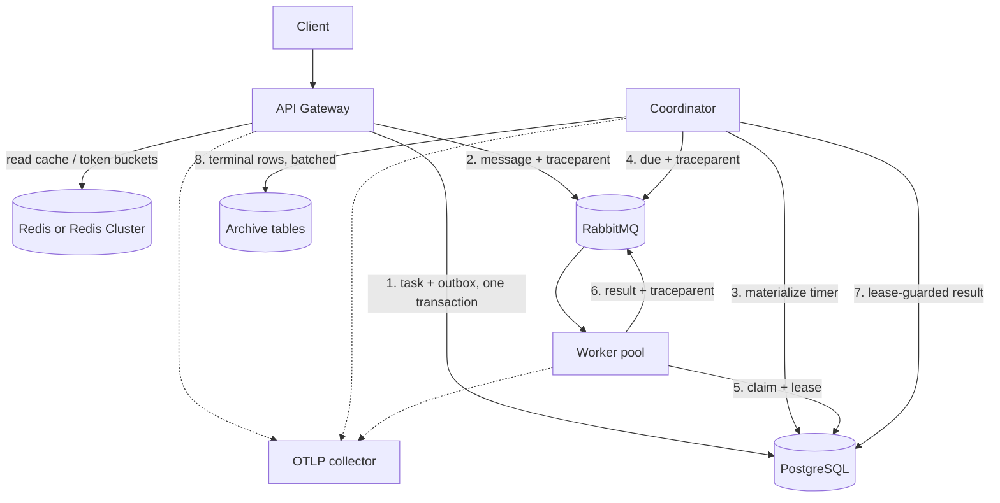
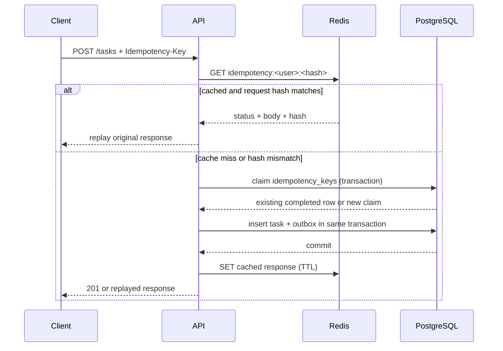
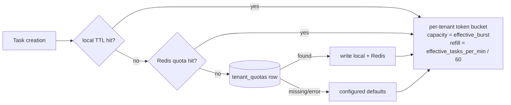
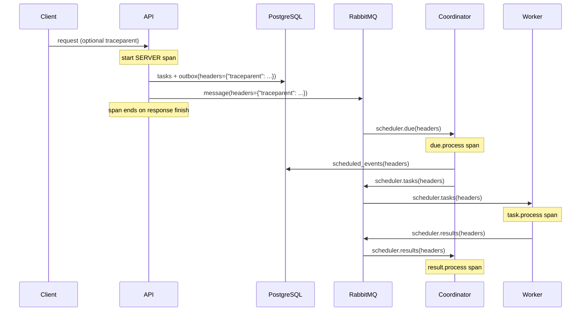
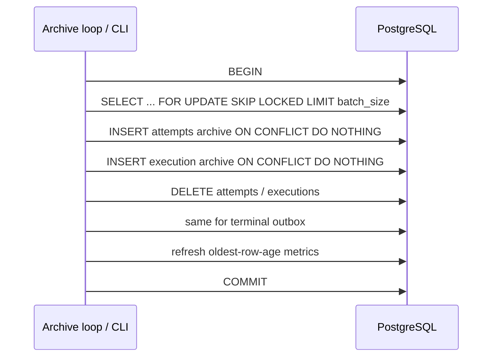

# 09 — Cache, tenant quotas, tracing, and archival

This document describes the Phase 7 accelerators. The invariant is unchanged:
**PostgreSQL is authoritative for tasks, execution slots, leases, idempotency,
the outbox, and timers.** Redis may speed up reads and admission decisions, and
OpenTelemetry may observe a request, but losing either must not create, move, or
duplicate scheduler state.

## Where Phase 7 sits



| Concern | Authority | Accelerator/observer | Loss behavior |
| --- | --- | --- | --- |
| Task state | PostgreSQL | Redis JSON cache | cache miss; read PostgreSQL |
| Execution slots | PostgreSQL unique `(task_id, scheduled_for)` | none | unaffected |
| Idempotency | `idempotency_keys` row | Redis completed-response cache | replay falls back to PostgreSQL |
| Admission quotas | `tenant_quotas` row | local + Redis TTL caches | configured defaults |
| Rate-limit tokens | Redis bucket | process-local fallback | smaller local budget |
| Request trace | W3C headers in DB/broker payloads | OTLP exporter | traced request becomes untraced |
| Old terminal history | archive tables | bounded copy/delete job | live tables grow |

## Read-through cache

### Keys and namespaces

All cache keys share the `sched:cache:` prefix:

| Namespace | Key | Value |
| --- | --- | --- |
| `task` | `<user_id>:<task_id>` | full task JSON |
| `executions` | `<user_id>:<task_id>:<generation>:<page>:<limit>` | paginated execution JSON |
| `task-version` | `<user_id>:<task_id>` | integer generation counter |
| `idempotency` | `<user_id>:<sha256(key)[:32]>` | status, body, request hash |
| `quota` | `<user_id>` | cached `tenant_quotas` row |

The cache uses the same Redis deployment and client selection as rate limiting:
`REDIS_CLUSTER_NODES` selects ioredis `Cluster`, otherwise `REDIS_URL` selects a
standalone client. Cache operations are wrapped in a short timeout
(`CACHE_REDIS_TIMEOUT_MS`, default 50 ms). Any connection error, timeout, or JSON
decode error increments `scheduler_cache_errors_total` and is treated as a miss.

### Invalidation

- `GET /api/v1/tasks/:id` checks the `task` key, then reads PostgreSQL, then
  writes the cache with `CACHE_TTL_SEC`.
- `POST /api/v1/tasks` writes the freshly created task to the cache.
- `PUT /api/v1/tasks/:id` deletes the task key, increments the per-task
  `task-version` generation, and writes the updated task.
- `DELETE /api/v1/tasks/:id` deletes the task key and increments the generation.
- `GET /api/v1/tasks/:id/executions` reads the current generation first and
  embeds it in every page key. Incrementing the generation makes all old pages
  unreachable immediately; TTL removes them later.

The generation counter has `max(300, CACHE_TTL_SEC × 4)` seconds of TTL. A missing
counter is treated as generation `0`, which is safe because a real invalidation
will increment it to at least `1`.

### Why it cannot duplicate work

The cache only stores responses to existing rows. Task creation, slot identity,
leases, and idempotency claims are still PostgreSQL transactions. A stale cache
entry can serve an old task representation for at most `CACHE_TTL_SEC`, but it
cannot create an execution or change a lease.

## Completed idempotency-response cache



- The cache is checked only when `IDEMPOTENCY_ENFORCE=true`,
  `IDEMPOTENCY_CACHE_ENABLED=true`, and a key is present.
- A cache hit with a different request hash returns `409` immediately; it does
  not fall through to PostgreSQL.
- A cache miss takes the normal PostgreSQL path. The unique
  `(user_id, key)` row, `state`, `request_hash`, and stored response remain the
  authority.
- The cache TTL is bounded by `IDEMPOTENCY_CACHE_TTL_SEC` (default 15 minutes),
  while the durable key retention is controlled by the existing idempotency
  cleanup job.
- The cached body is the same response body that was committed to
  `idempotency_keys`. It is not a second source of truth.

## Tenant quotas and weighted admission

### Data model

Migration `0011_tenant_quotas`:

```sql
tenant_quotas(
    user_id UUID PRIMARY KEY REFERENCES users(id) ON DELETE CASCADE,
    weight NUMERIC(6,3) NOT NULL DEFAULT 1.000 CHECK (weight > 0 AND weight <= 100),
    tasks_per_min INTEGER NOT NULL DEFAULT 60 CHECK (tasks_per_min >= 1),
    burst INTEGER NOT NULL DEFAULT 10 CHECK (burst >= 1),
    enabled BOOLEAN NOT NULL DEFAULT TRUE,
    created_at TIMESTAMPTZ NOT NULL DEFAULT NOW(),
    updated_at TIMESTAMPTZ NOT NULL DEFAULT NOW()
)
```

Effective values are computed by the API:

```text
effective_tasks_per_min = max(1, round(tasks_per_min × weight))
effective_burst         = max(1, round(burst × weight))
```

A missing row, a disabled row, or a failed lookup uses
`TENANT_DEFAULT_WEIGHT`, `TENANT_DEFAULT_TASKS_PER_MIN`, and
`TENANT_DEFAULT_BURST`. It never means "unlimited". A disabled row is reported
with source `default`; a failed database lookup is reported with source `local`
when a stale local value exists, otherwise `default`.

### Resolution and limiting



- The local map is bounded to 10,000 entries and uses insertion-order eviction.
- Redis caches the raw row for `TENANT_QUOTA_CACHE_TTL_SEC` (default 30 s).
- The limiter pool is keyed by `user_id`, capacity, and refill rate, so tenants
  never share a local fallback bucket. A quota change naturally creates a new
  entry; the pool is bounded to 10,000 entries.
- `TENANT_QUOTAS_ENABLED=true` swaps the static `user:tasks` limiter for the
  `tenant:tasks` limiter. The scope remains subject to `RATE_LIMIT_MODE`:
  `observe` records denials and sets headers; `enforce` returns `429` with
  `Retry-After`.
- `X-Quota-Source`, `X-Quota-Weight`, `X-Quota-Tasks-Per-Min`, and
  `X-Quota-Burst` describe the decision. `X-RateLimit-*` headers come from the
  shared limiter.

Broker dispatch remains FIFO. A higher weight buys a tenant more **admission**
into the system; it does not reorder messages already in `scheduler.tasks` and
does not reserve worker slots. Per-tenant execution fairness at the worker layer
would be a separate design.

## Sharded global ingress limiter

A single Redis key is a hot spot and a Cluster slot bottleneck. The global
ingress limiter now builds `GLOBAL_INGRESS_SHARDS` independent token buckets:

```text
capacity_per_shard = ceil(GLOBAL_INGRESS_BURST / shards)
refill_per_shard   = GLOBAL_INGRESS_RPS / shards
shard_index        = FNV1a32(ingress_key) % shards
redis_key          = rl:global:ingress:<hash(client_ip)>:shard:<index>
```

- One client maps to one shard, so its requests contend on one key.
- Different clients spread across shards, reducing per-key latency and Cluster
  hot-slot pressure.
- The reported `limit` is the total burst, while `remaining` is the selected
  shard's remaining count. That is conservative: other shards may have tokens,
  but the API never over-advertises capacity.
- `GLOBAL_INGRESS_SHARDS=1` is the compatibility setting and reproduces the
  previous single-key behavior.
- `scheduler_ratelimit_shards{scope="global:ingress"}` exposes the configured
  count for dashboards and the `GlobalIngressShardsMissing` alert.

The local fallback is also divided by the shard count. If Redis is unavailable,
each shard's fallback bucket is smaller, which preserves the original
"degrade to a smaller local budget, never fall back to PostgreSQL" rule.

## W3C tracing

### Propagation path



### API

- `tracingMiddleware` runs before routes. It extracts a parent context from
  incoming HTTP headers, starts a `METHOD /route` SERVER span, and ends it on
  `finish`.
- Route labels replace UUIDs with `<id>` and digits with `<n>` to keep span
  names bounded.
- `currentTraceHeaders()` injects the active context into outbox rows and
  RabbitMQ message headers. When tracing is disabled it returns `{}`, so the
  outbox schema and message shape do not change.
- `startTracing()` ignores startup failure: the API logs a warning and continues
  without tracing. `shutdownTracing()` flushes and stops the SDK on shutdown.

### Outbox and timers

- The outbox already had `headers JSONB`. Migration `0013` adds the same column
  to `scheduled_events` with default `'{}'`.
- The relay reads outbox headers, extracts the parent context, and creates
  `outbox.materialize` / `outbox.publish` spans.
- `materialize_event` copies the outbox headers into the timer row. The timer
  poller extracts the context and creates a `scheduled_event.publish` span.
- Retry and cancellation events follow the same path.

### Coordinator and worker

| Span | Service | Created around |
| --- | --- | --- |
| `outbox.materialize` | coordinator | converting an outbox event to a timer |
| `outbox.publish` | coordinator | publishing an outbox message |
| `scheduled_event.publish` | coordinator | publishing a due timer |
| `due.process` | coordinator | dispatching one due wakeup |
| `result.process` | coordinator | applying one result |
| `task.process` | worker | claiming, executing, and publishing a result |

Python helpers (`configure_tracing`, `extract_context`, `inject_headers`,
`start_span`) degrade to no-ops when the OpenTelemetry packages are absent or
`OTEL_ENABLED=false`. The coordinator/worker requirements list the optional
packages; the local test interpreter may exercise only the fallback.

### Sampling and failure behavior

- Sampling is parent-based with a root ratio of `OTEL_SAMPLER_ARG` (default
  0.1). A sampled parent keeps the trace sampled across services.
- Export is batched and asynchronous. An unreachable collector does not block
  requests or message handling; it increments
  `scheduler_trace_export_errors_total` in the API.
- The API's OTLP endpoint defaults to `http://localhost:4318/v1/traces`;
  override `OTEL_EXPORTER_OTLP_ENDPOINT` per environment.
- `OTEL_SERVICE_NAME` defaults to `api-gateway`, `coordinator`, or `worker`.

## Archival

### Why archival, not live partitioning

`task_executions` is identified by the unique slot `(task_id, scheduled_for)`
and by the partial unique index that allows only one `pending`/`running`
execution per task. Declarative partitioning by a time key would require those
indexes to include the partition key, changing the slot identity and the
active-execution guarantee. Phase 7 therefore keeps the live schema and moves
only old terminal rows to archive tables.

### Tables

| Table | Contents |
| --- | --- |
| `task_execution_archive` | terminal execution rows, plus `archived_at` |
| `task_execution_attempts_archive` | attempts belonging to archived executions |
| `outbox_archive` | published/failed outbox rows, plus `archived_at` |

The archive tables have their own lookup indexes; the live tables gain partial
scan indexes on `COALESCE(completed_at, created_at)` for terminal executions and
on `published_at`/`created_at` for terminal outbox rows.

### Eligibility

```text
task_executions:
  status IN ('completed', 'failed', 'timeout', 'cancelled')
  AND COALESCE(completed_at, created_at) < NOW() - retention_days

outbox:
  (status = 'published' AND published_at < NOW() - retention_days)
  OR (status = 'failed' AND created_at < NOW() - retention_days)
```

Never eligible: `pending`/`running` executions, `pending` outbox rows,
`scheduled_events` of any status, and recent terminal rows.

### Batch transaction



- The copy and delete are in one transaction, so a crash cannot leave a row in
  both places or in neither.
- `FOR UPDATE SKIP LOCKED` lets a manual CLI run and the coordinator loop coexist
  without blocking each other.
- `ON CONFLICT (id) DO NOTHING` makes a retried batch safe.
- Each cycle is bounded by `ARCHIVE_MAX_BATCHES`; the loop sleeps
  `ARCHIVE_SLEEP_MS` between batches and `ARCHIVE_INTERVAL_SEC` between cycles.
- `--dry-run` counts eligible rows in one bounded batch and rolls back, without
  repeating the same count for every `max_batches`.

### Metrics

- `scheduler_archive_rows_total{table}`
- `scheduler_archive_errors_total`
- `scheduler_archive_runs_total{status}`
- `scheduler_archive_duration_seconds`
- `scheduler_archive_oldest_row_age_seconds{table}`

`ArchiveErrors` fires on any failed cycle in the last hour; `ArchiveLagHigh`
fires when the oldest live terminal row exceeds 90 days.

## Failure matrix

| Failure | Read cache | Idempotency cache | Tenant quotas | Rate limiter | Tracing | Archival |
| --- | --- | --- | --- | --- | --- | --- |
| Redis down | miss → PostgreSQL | miss → PostgreSQL | defaults/local → keep admitting | smaller local bucket | unaffected | unaffected |
| Redis slow | timeout → miss | timeout → miss | defaults/local | circuit opens → fallback | unaffected | unaffected |
| PostgreSQL slow | miss, cache may still serve | falls back to authoritative path, may fail | defaults/local | unaffected | unaffected | batch retries later |
| OTLP collector down | unaffected | unaffected | unaffected | unaffected | spans dropped; export errors metric | unaffected |
| Coordinator down | unaffected | unaffected | unaffected | unaffected | trace stops at last span | archival pauses |
| Archive table full/disk | unaffected | unaffected | unaffected | unaffected | unaffected | cycle fails and retries; live rows stay |

## Operational rules

1. Enable one accelerator at a time and watch the matching metrics before
   enabling the next.
2. Never enable `TENANT_QUOTAS_ENABLED` without deciding which rows should be
   disabled; every tenant without an enabled row receives the configured
   defaults.
3. Keep `RATE_LIMIT_MODE=observe` through at least one traffic cycle before
   enforcing quotas.
4. Treat archive tables as history, not as a hot query path. If they are queried
   regularly, add purpose-built indexes rather than widening the live schema.
5. Do not use Redis locks for task state. Phase 7 adds no such lock; PostgreSQL
   leases and unique indexes remain the only correctness mechanism.

See the [Phase 7 runbook](../runbooks/phase7-scaling.md) for enablement,
diagnosis, and rollback procedures.
