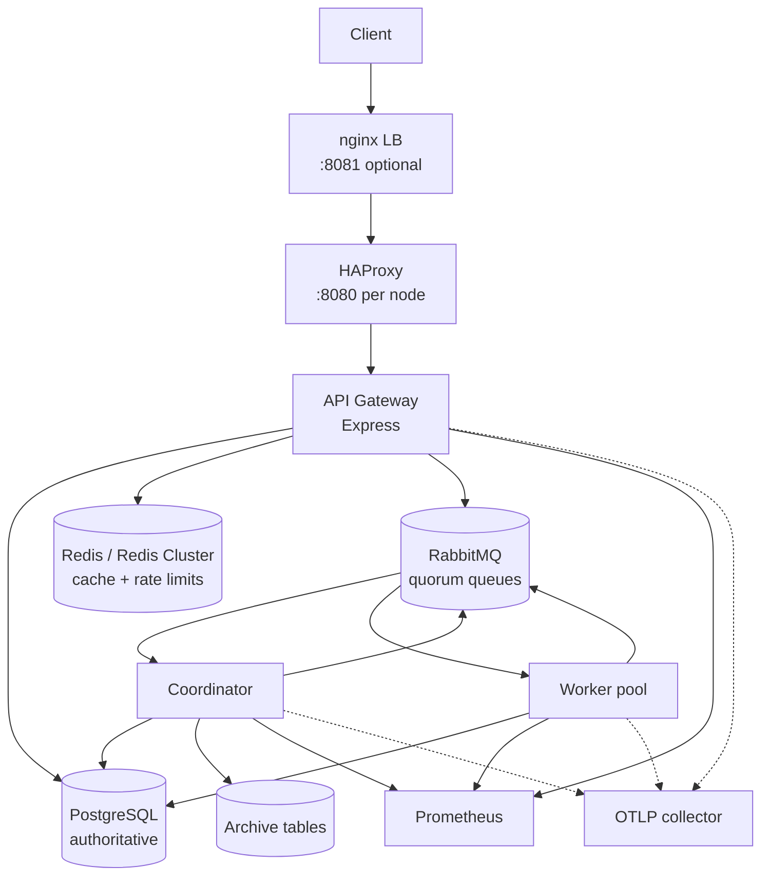

# Internals

This directory explains how the scheduler works inside: the write path, the
scheduling identity, the outbox and timers, rate limiting, the queue/worker
contract, PostgreSQL and pooling, and failure recovery. Diagrams are Mermaid and
render in GitHub, VS Code, and most Markdown viewers.

## System map

**PostgreSQL is the source of truth.** RabbitMQ carries commands and wakeups,
Redis carries rate-limit state and short-lived read caches, and the API replicas are
stateless. A message can be duplicated; the database constraints and lease checks decide
whether work actually runs.

## Documents

| Document | Answers |
| --- | --- |
| [01 — request lifecycle](01-request-lifecycle.md) | What happens from `POST /api/v1/tasks` to a committed task and outbox event? |
| [02 — scheduling and jitter](02-scheduling-and-jitter.md) | How are `next_execution_time`, `dispatch_at`, slots, and recurring runs computed? |
| [03 — outbox and timers](03-outbox-and-timers.md) | How does the system avoid a database/broker dual-write, and how do delayed wakeups work? |
| [04 — rate limiting](04-rate-limiting.md) | How does the token bucket work on Redis and Redis Cluster, and what happens when Redis fails? |
| [05 — queues and workers](05-queues-workers.md) | How are tasks delivered, claimed, leased, retried, and dead-lettered? |
| [06 — PostgreSQL, pooling, PITR](06-postgres-pooling-pitr.md) | What are the tables, invariants, PgBouncer path, and backup/restore design? |
| [07 — failure and recovery](07-failure-recovery.md) | What happens when each component fails? |
| [08 — load balancing](08-load-balancing.md) | Why nginx and HAProxy, and how does traffic fail over? |
| [09 — cache, quotas, tracing, archival](09-cache-quotas-tracing-archival.md) | How do the opt-in Phase 7 accelerators work without becoming authoritative? |

## Reading paths

- **New to the project:** 01 → 02 → 03 → 05.
- **Operating it:** 06 → 07 → 08 → 09, then [HA.md](../HA.md) and the
  [failover runbook](../runbooks/failover.md).
- **Changing the data plane:** 03 → 05 → 06 and the corresponding tests under
  `tests/`.
- **Tuning or rolling out Phase 7:** 09 and the
  [Phase 7 runbook](../runbooks/phase7-scaling.md).

## Evolution

The versions that produced this design are recorded in
[evolution/](../evolution/README.md). Earlier results and designs are kept; new
material is appended as a new version.
