# Phase 7 Evidence — Local Docker E2E

Live evidence for the v1.6.0 Phase 7 work: a completed task traced through the
API, PostgreSQL, the coordinator, and a worker, plus a 300-task burst benchmark.
Every screenshot was captured from the running local Docker Compose stack on
macOS on 2026-11-11; the benchmark itself ran on 2026-11-10. Nothing here was
mocked or replayed.

> **Not AWS evidence.** The AWS HA lab was destroyed after the v1.4.0 drills and
> was not re-provisioned for this test. These captures are explicitly local
> Docker E2E measurements; they are not a cloud capacity benchmark and should
> not be presented as an AWS deployment.

---

## Environment

| Resource | Value |
|----------|-------|
| Host | macOS, Docker Desktop |
| API Gateway | `http://localhost:3000` |
| Coordinator | `scheduler-e2e-coordinator-1` (internal only) |
| Workers | 10 replicas, `worker-1` … `worker-10`, metrics `:9101`–`:9110` |
| PostgreSQL | 15, `scheduler-e2e-postgres-1` |
| RabbitMQ | 3.13.7, management `http://localhost:15672` |
| Redis | 7, optional/fail-open |
| Observability | Prometheus `:9091`, Grafana `:3001`, Loki, Promtail |
| Schema | migrations through `0013`, including `tenant_quotas`, archive tables, `scheduled_events.headers` |

---

## Evidence task

Task `0f55b41f-2621-430d-bb95-80fc9e265645` (`phase7-final-evidence`) was
created through the public API as a one-time task due 15 seconds later. It
completed on `worker-2-1` on attempt 1.

| Event | Observed value |
|-------|----------------|
| Created | `2026-11-11 09:34:31.491Z` |
| Due / `next_execution_time` | `2026-11-11 09:34:46.307Z` |
| Scheduled-event published | `09:34:47.308` |
| Due consumer accepted | `09:34:47.364` |
| Worker claimed | `09:34:54.685` |
| Completed | `09:34:55.780724Z` |
| Execution output | `phase7-final-evidence-ok` |
| Attempt | `1` |
| Lease | `f67c8d96-8dea-4138-9706-b9cfd9922c5a` |

The transactional outbox contains exactly three rows for this task, all
published with zero retries:

| ID | Event | Status | Published |
|----|-------|--------|-----------|
| 1180 | `task.scheduled` | published | `09:34:32.53468` |
| 1181 | `task.dispatch` | published | `09:34:48.364519` |
| 1182 | `task.result` | published | `09:34:55.650745` |

### API — health and lifecycle

`GET /health` returned `200`, `GET /health/ready` returned `200`, task creation
returned `201 Created` as `scheduled`, and the final read returned `200` as
`completed`.

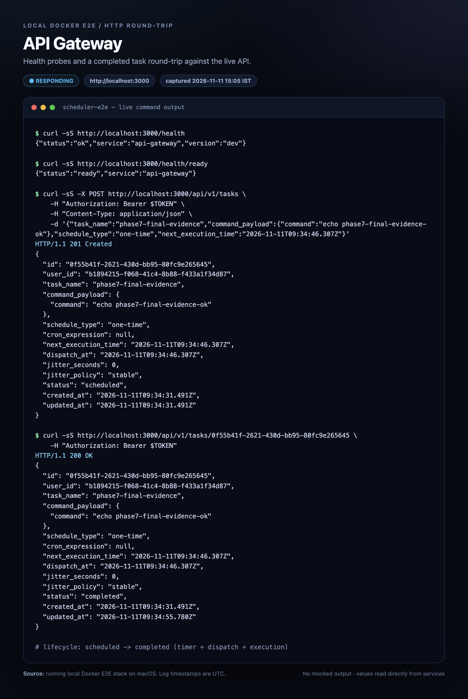

### PostgreSQL — authoritative task and outbox rows

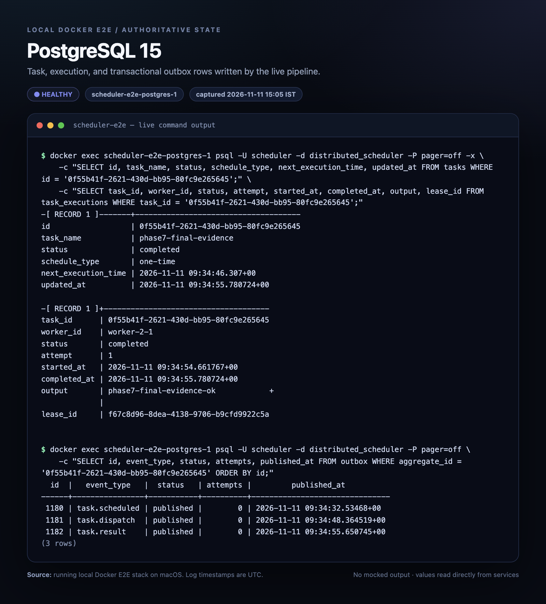

### PostgreSQL — Phase 7 schema is live

The live database has 12 public tables. `tenant_quotas` has `weight`,
`tasks_per_min`, `burst`, and `enabled`; `scheduled_events` has the `headers`
JSONB column used to carry trace context across the timer boundary.

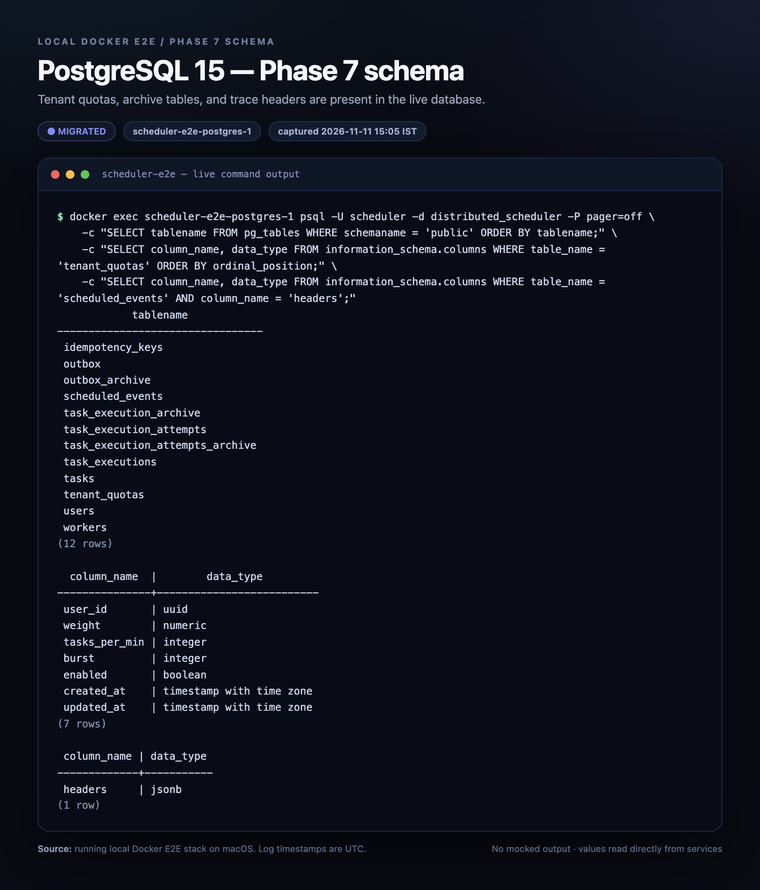

### Coordinator — timer → due → dispatch → result

The DB-backed timer was published once, the due consumer created exactly one
execution slot, and the outbox relay published the dispatch and result events.

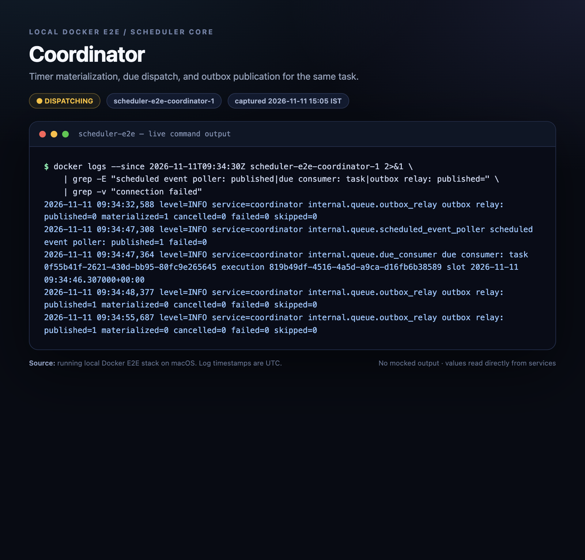

### Worker — claim, lease, execute, complete, ack

`worker-2` claimed the execution with a lease, completed the command in
`0.04s`, and the worker metrics show `consumer_up=1`, `started=1`,
`completed=1`, `acked=1`.

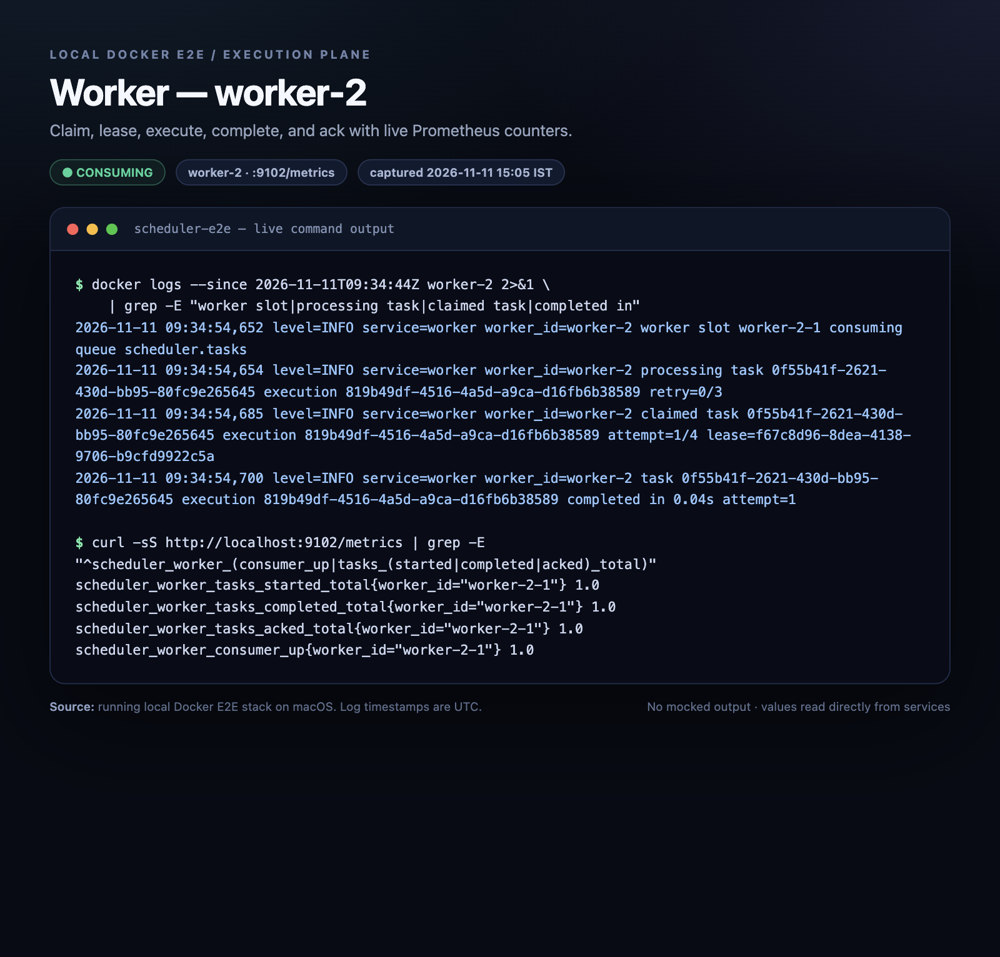

---

## 300-task burst benchmark

| Parameter | Value |
|-----------|-------|
| Tasks | 300 one-time shell tasks |
| Submission concurrency | 20 |
| Due time | one shared `next_execution_time` for every task |
| Workers | 10 replicas |
| Load generator | Python stdlib `ThreadPoolExecutor` on the host |
| Completion source | PostgreSQL task status + `task_executions` |
| Run ID | `1794303649` |
| Scheduled for | `2026-11-10 09:41:14.404Z` |

### Results

| Metric | Value |
|--------|-------|
| Completed | **300 / 300** |
| Failures | **0** |
| Submission wall time | **1.839 s** |
| Submission throughput | **163.1 req/s** |
| Submit latency p50 | **100.97 ms** |
| Submit latency p95 | **354.11 ms** |
| Submit latency max | **414.73 ms** |
| Drain after due time | **17.411 s** |
| Executions recorded | **300** |
| Attempt rows | **300** (1 per task) |
| Execution duration avg (claim → complete) | **3047.28 ms** |
| Execution duration max (claim → complete) | **5630.73 ms** |
| First execution started | `09:41:17.381` |
| Last execution completed | `09:41:30.906` |

### Worker distribution

The broker spread the burst evenly across all ten replicas; no worker was
starved and none exceeded 32 tasks.

| Worker | Completed |
|--------|-----------|
| `worker-6-1` | 32 |
| `worker-10-1` | 31 |
| `worker-2-1` | 31 |
| `worker-8-1` | 31 |
| `worker-4-1` | 30 |
| `worker-1-1` | 29 |
| `worker-3-1` | 29 |
| `worker-5-1` | 29 |
| `worker-7-1` | 29 |
| `worker-9-1` | 29 |
| **Total** | **300** |

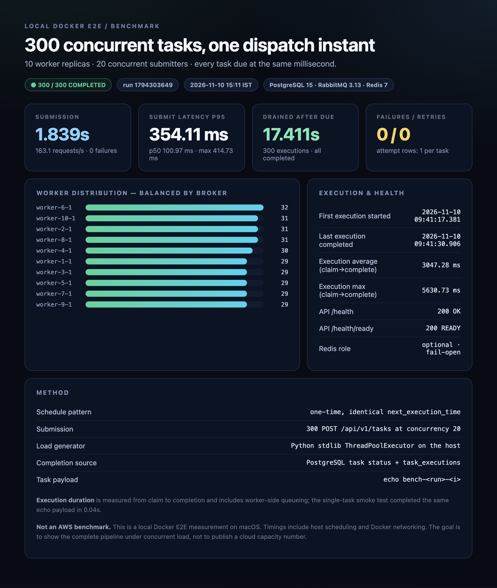

Machine-readable result: [`benchmark.json`](./benchmark.json).

Execution duration is measured from claim to completion and includes
worker-side queueing. The single-task smoke test completed the same echo
payload in `0.04s`.

---

## Service health

### RabbitMQ — 6 queues, all drained

The broker reported 14 connections, 15 channels, 8 exchanges, 6 queues, and
10 consumers. Every queue was running with `Ready=0`, `Unacked=0`, `Total=0`
after the benchmark drained.

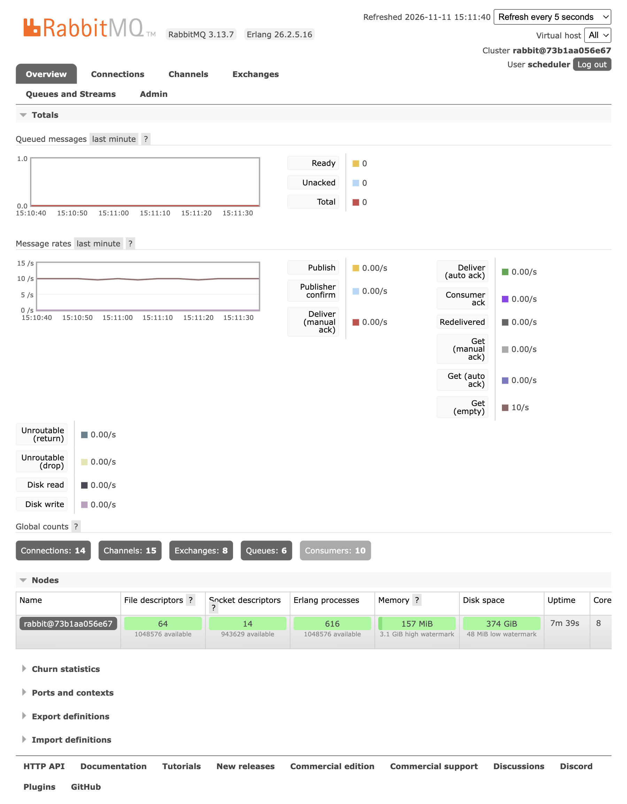

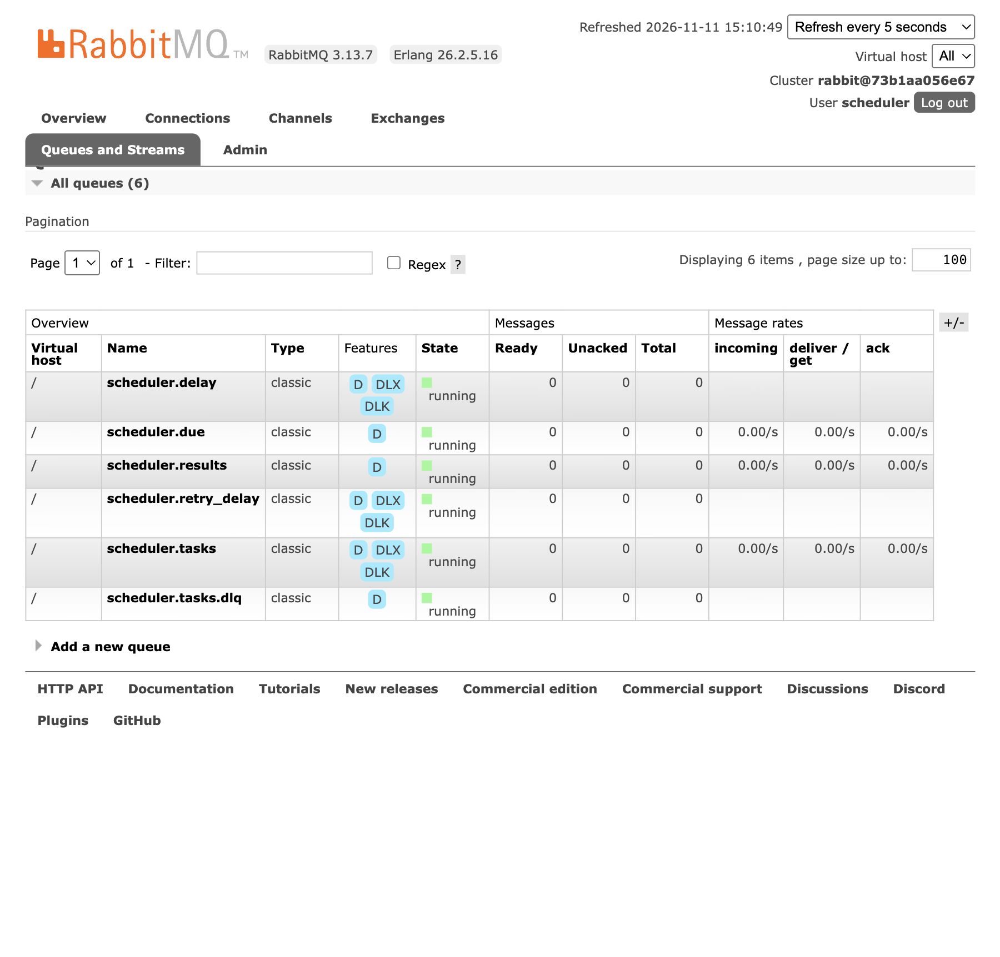

### Prometheus — 14 / 14 targets UP

`api-gateway`, `coordinator`, `prometheus`, `rabbitmq`, and all 10 workers were
`UP` at capture time.

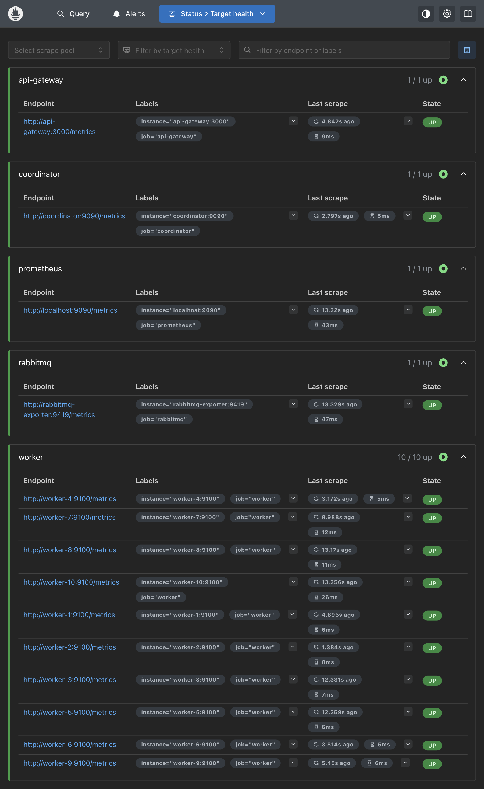

### Grafana — live dashboard during a 40-task burst

A separate 40-task burst was submitted immediately before this capture so the
throughput panels show live activity. The dashboard reports 10 active workers,
100% worker success, queue depth 0, DLQ depth 0, 16 RabbitMQ connections, and
matching started/completed/accepted-result spikes.

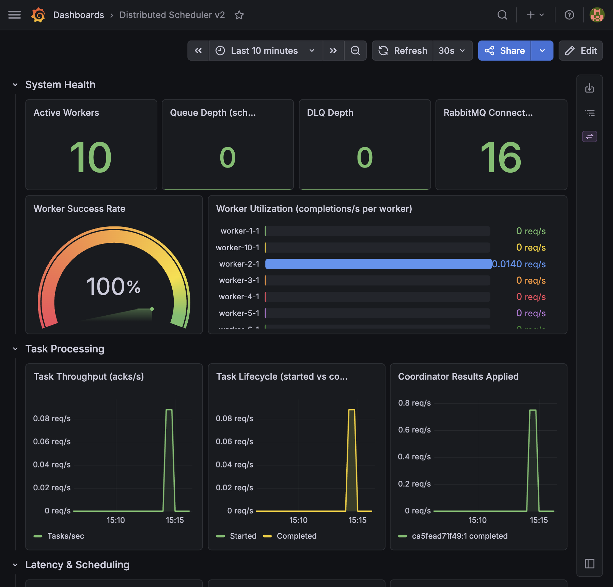

The separate Phase 7 panels (cache, quotas, tracing, archival) are provisioned
in the dashboard but show `No data` on this stack because those optional
features were not enabled for the evidence run. Their correctness is covered by
the repository tests and the [Phase 7 runbook](../../../docs/runbooks/phase7-scaling.md),
not by this screenshot.

---

## Architecture

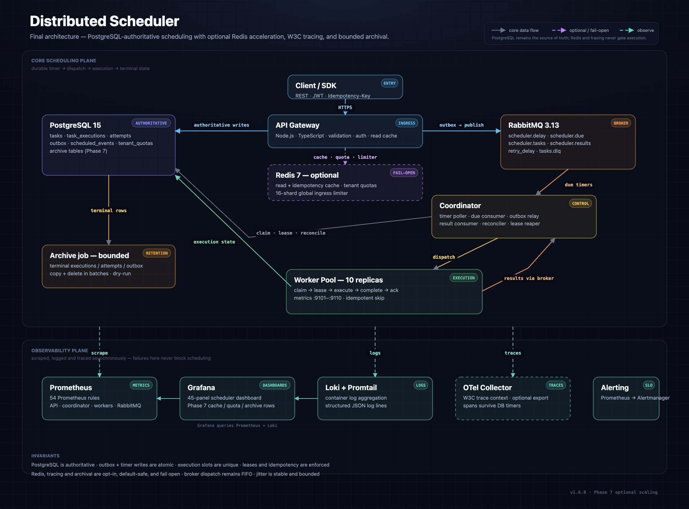

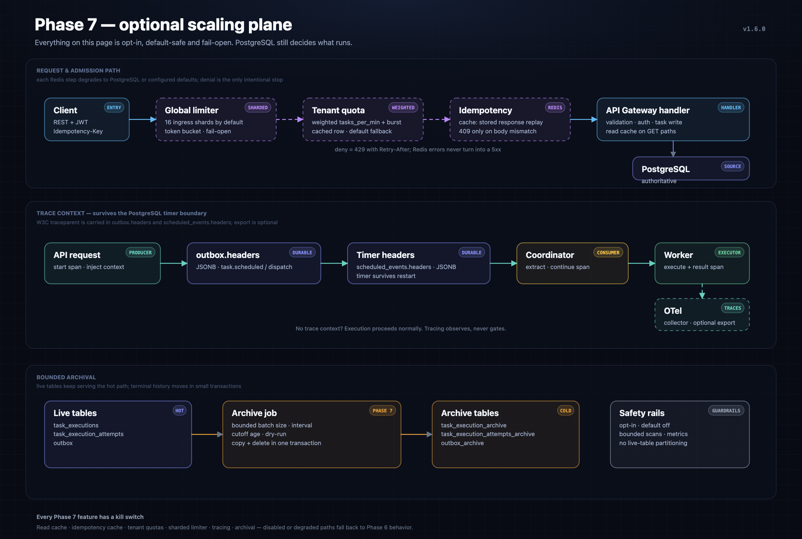

The overall diagram is also the image used by the main
[`README.md`](../../../README.md#architecture); the Phase 7 diagram is stored at
[`docs/assets/phase7-scaling.png`](../../../docs/assets/phase7-scaling.png).

---

## Reproduction

From the repository root, with the Compose stack running:

```bash
# 1. Health and readiness
curl -sS http://localhost:3000/health
curl -sS http://localhost:3000/health/ready

# 2. Create the evidence task (due in 15 seconds)
TOKEN=$(curl -sS -X POST http://localhost:3000/api/v1/auth/login \
  -H 'Content-Type: application/json' \
  -d '{"email":"<user>","password":"<password>"}' | jq -r .token)

RUN_AT=$(python3 -c 'from datetime import datetime,timezone,timedelta; print((datetime.now(timezone.utc)+timedelta(seconds=15)).isoformat().replace("+00:00","Z"))')

curl -sS -X POST http://localhost:3000/api/v1/tasks \
  -H "Authorization: Bearer $TOKEN" \
  -H 'Content-Type: application/json' \
  -H "Idempotency-Key: final-evidence-$(date +%s)" \
  -d "{\"task_name\":\"phase7-final-evidence\",\"command_payload\":{\"command\":\"echo phase7-final-evidence-ok\"},\"schedule_type\":\"one-time\",\"next_execution_time\":\"$RUN_AT\"}"

# 3. Authoritative rows
docker exec scheduler-e2e-postgres-1 psql -U scheduler -d distributed_scheduler -P pager=off \
  -c "SELECT id, task_name, status, next_execution_time, updated_at FROM tasks WHERE id = '<task-id>';" \
  -c "SELECT task_id, worker_id, status, attempt, started_at, completed_at, output, lease_id FROM task_executions WHERE task_id = '<task-id>';" \
  -c "SELECT id, event_type, status, attempts, published_at FROM outbox WHERE aggregate_id = '<task-id>' ORDER BY id;"

# 4. Coordinator and worker logs
docker logs --since 2026-11-11T09:34:30Z scheduler-e2e-coordinator-1 2>&1 \
  | grep -E 'scheduled event poller: published|due consumer: task|outbox relay: published='
docker logs --since 2026-11-11T09:34:44Z worker-2 2>&1 \
  | grep -E 'worker slot|processing task|claimed task|completed in'
curl -sS http://localhost:9102/metrics \
  | grep -E '^scheduler_worker_(consumer_up|tasks_(started|completed|acked)_total)'
```

The benchmark and its result JSON were produced by the load generator described
in [Benchmark.md](../../../Benchmark.md). Completion counts and the worker
distribution were read back from PostgreSQL and `task_executions`; the
submission timings came from the load generator's request measurements.

---

## Screenshot index

| # | File | What it shows |
|---|------|---------------|
| 1 | [`architecture-overall.png`](./architecture-overall.png) | Final overall architecture |
| 2 | [`architecture-phase7.png`](./architecture-phase7.png) | Phase 7 optional scaling plane |
| 3 | [`api.png`](./api.png) | API health and completed task lifecycle |
| 4 | [`postgres-task.png`](./postgres-task.png) | Task, execution, and three published outbox rows |
| 5 | [`postgres-schema.png`](./postgres-schema.png) | Phase 7 schema: quota, archive, and header columns |
| 6 | [`coordinator.png`](./coordinator.png) | Timer materialization, due dispatch, result |
| 7 | [`worker.png`](./worker.png) | Worker claim/lease/complete log and metrics |
| 8 | [`rabbitmq-overview.png`](./rabbitmq-overview.png) | 10 consumers, 6 queues, zero messages |
| 9 | [`rabbitmq-queues.png`](./rabbitmq-queues.png) | All queues drained |
| 10 | [`prometheus-targets.png`](./prometheus-targets.png) | 14/14 scrape targets UP |
| 11 | [`grafana-dashboard.png`](./grafana-dashboard.png) | Live dashboard during a 40-task burst |
| 12 | [`benchmark.png`](./benchmark.png) | 300-task burst benchmark result |
| 13 | [`benchmark.json`](./benchmark.json) | Machine-readable benchmark data |

This folder is mirrored to
[`deploy/free-tier/screenshots/`](../../../deploy/free-tier/screenshots/) so the
AWS deployment folder carries the same local evidence and caveat.
