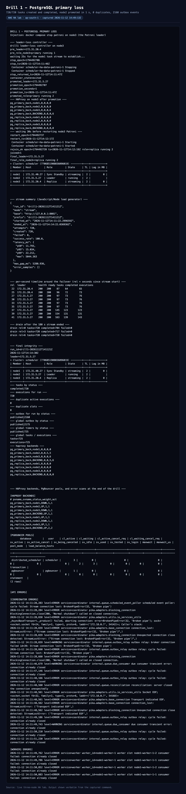
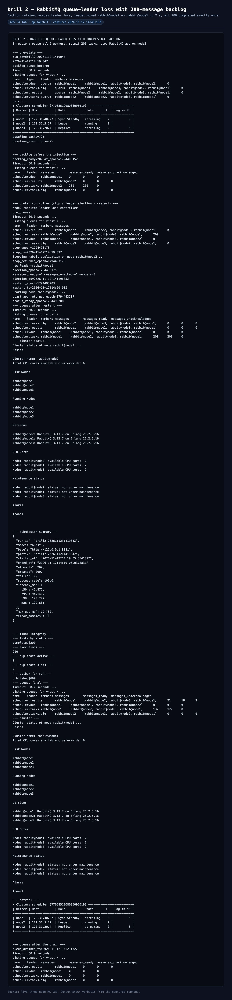
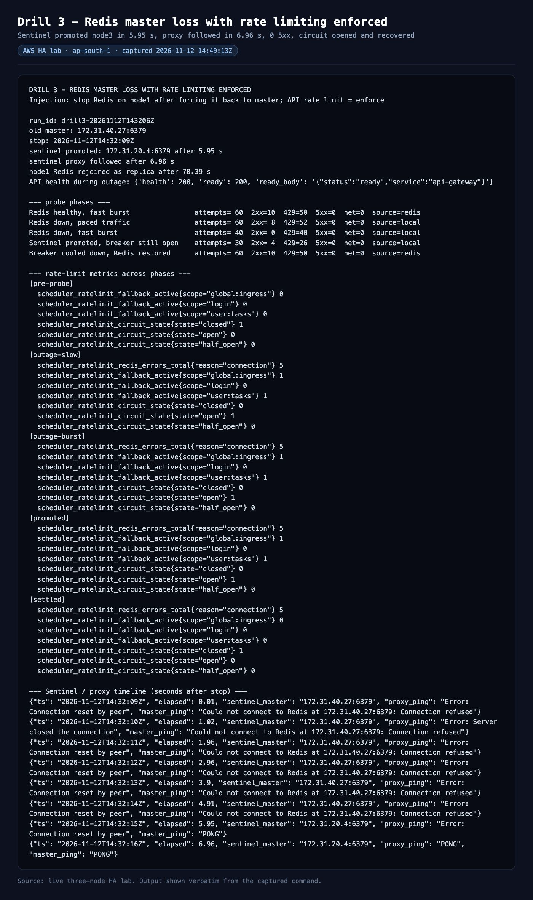
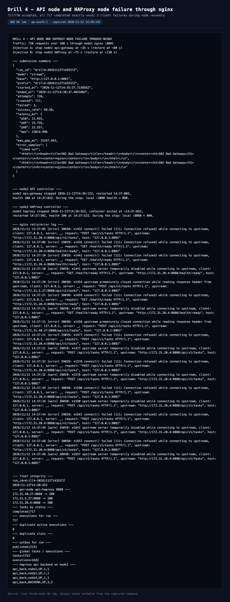
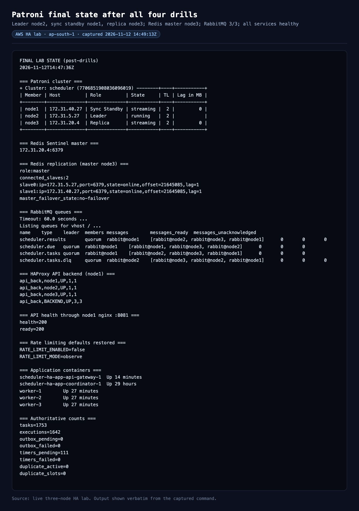
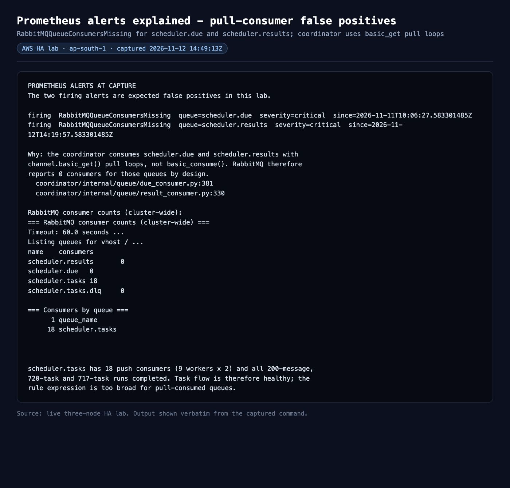

# AWS HA Lab Evidence — Four Failover Drills (2026-11-12)

Live evidence from the three-node AWS HA lab, captured on **2026-11-12** during
the v1.6.0 Phase 7 validation run. Four drills were executed against the real
cluster: PostgreSQL primary loss, RabbitMQ queue-leader loss with a retained
backlog, Redis master loss with rate limiting enforced, and API/HAProxy node
failure through the nginx entry point.

> **This is AWS evidence.** Every number, log line, and screenshot in this
> folder comes from the live `ap-south-1` lab. It is separate from
> [`../test-6/`](../test-6/), which documents the local Docker E2E stack and is
> explicitly **not** AWS evidence. Do not merge the two data sets or present
> test-6 numbers as cloud results.
>
> The lab was destroyed with `terraform destroy` immediately after these
> captures. This is a single validation run, not a benchmark or an availability
> guarantee.

---

## Environment

| Resource | Value |
|----------|-------|
| AWS account / region | `028591095279` / `ap-south-1` |
| Availability zones | `ap-south-1a`, `ap-south-1b`, `ap-south-1c` |
| Compute | 3 × Spot `m7i-flex.large` (2 vCPU, 8 GiB), Amazon Linux 2023 |
| Deployment | Docker Compose, driven over AWS SSM Run Command |
| PostgreSQL | Patroni 16.6 + etcd, leader + sync standby + replica, PgBouncer `:6432` |
| RabbitMQ | 3.13.7 / Erlang 26.2.5.16, three-node cluster, quorum queues |
| Redis | 7, master/replica + three Sentinels + sentinel-aware proxy `:6380` |
| API | 3 replicas behind per-node HAProxy `:8080`; nginx `:8081` on node1 |
| Workers | 9 workers × 2 slots = 18 `scheduler.tasks` consumers |
| Observability | Prometheus `:9091`, Grafana `:3001`, 54 rules, 29 scrape targets |
| Schema | migrations through `0013` (Phase 7 tables and headers) |
| Operator access | `allowed_cidr = 103.233.119.122/32` at deploy time |

### Nodes

| Node | Instance | Private IP | Public IP | AZ | Role after drills |
|------|----------|------------|-----------|----|-------------------|
| node1 | `i-04edb2bde1c4c2371` | `172.31.40.27` | `13.207.2.119` | `ap-south-1a` | Patroni sync standby, Redis replica, nginx entry point |
| node2 | `i-0971d5c38b4cff21e` | `172.31.5.27` | `15.206.211.232` | `ap-south-1b` | Patroni leader, Redis replica |
| node3 | `i-0768416dc03bcd66d` | `172.31.20.4` | `65.0.118.42` | `ap-south-1c` | Patroni replica, Redis master |

Public endpoints used during capture: API `http://13.207.2.119:8081`
(nginx), Prometheus `http://13.207.2.119:9091`, Grafana
`http://13.207.2.119:3001`, RabbitMQ management
`http://13.207.2.119:15672`. HAProxy stats `:8404` was opened temporarily for
the screenshot, then the security-group rule was revoked and access was
confirmed closed.

### Topology

```text
                       operator
                          |
                 nginx :8081 (node1 only)
                          |
        +-----------------+-----------------+
        |                 |                 |
   HAProxy :8080     HAProxy :8080     HAProxy :8080
     node1             node2             node3
        |                 |                 |
   API :3000         API :3000         API :3000
   PgBouncer         PgBouncer         PgBouncer
        |                 |                 |
        +-------- Patroni PostgreSQL 16.6 --+
        |         (etcd, sync standby)       |
        +-------- RabbitMQ 3.13.7 quorum ----+
        |         (3 members per queue)      |
        +-------- Redis + 3 Sentinels -------+
                  (sentinel proxy :6380)
```

---

## Deployment baseline

The lab was provisioned with Terraform (12 resources: three instances, three
data volumes, security groups, IAM instance profile/role, and the encrypted S3
artifact bucket). The first deployment exposed a PgBouncer startup-parameter
crash; `deploy/ha-lab/ha/pgbouncer.ini.tmpl` now includes:

```ini
ignore_startup_parameters = extra_float_digits,options
```

After the fix, all three coordinators were healthy, PgBouncer pools accepted
connections, and Prometheus reported **29/29 targets UP**. A five-task smoke
test completed **5/5** tasks with 5 executions, 15 published outbox events, and
zero duplicate active executions. Migrations `0011`–`0013` were applied to the
live database.

---

## Drill summary

| # | Drill | Injection | Result | RPO | RTO |
|---|-------|-----------|--------|-----|-----|
| 1 | PostgreSQL primary loss | Stop Patroni on the leader (node3) | **720/720** tasks created and completed; node2 leader in **1 s**; 0 duplicates; 2,160 outbox events | **0** (sync standby, 0 lag) | Leader in **1 s**; max client pause **5.28 s** |
| 2 | RabbitMQ queue-leader loss | 200-message backlog, stop RabbitMQ app on node2 | **200/200** completed exactly once; leader `rabbit@node2` → `rabbit@node1` in **2 s**; queues drained to 0/0/0 | **0** (quorum queue retained all 200) | Election **2 s**; full drain by `14:21:32Z` |
| 3 | Redis master loss | Force node1 master, enable enforce-mode rate limiting, stop Redis | **0 5xx / 0 network errors**; Sentinel promoted node3 in **5.95 s**; proxy followed in **6.96 s**; circuit opened then closed | No durable state (rate-limit counters are ephemeral, fail-open by design) | Proxy **6.96 s**; node1 rejoin **70.39 s** |
| 4 | API + HAProxy node failure | Stop node2 API and node3 HAProxy while streaming through node1 nginx | **717/720 accepted** (99.58%); all 717 completed; 0 duplicates; 3 client-visible failures during recovery | **0** accepted tasks lost | API **48 s**; HAProxy **57 s**; 3 client failures |

Every drill was driven by an operator-side load generator over the nginx
entry point (`:8081`) or directly through the SSM session. PostgreSQL was the
authoritative completion source in every check. Phase 7 features stayed
opt-in and default-safe; rate limiting was temporarily set to enforce only for
Drill 3 and restored to `RATE_LIMIT_ENABLED=false`, `RATE_LIMIT_MODE=observe`
afterward.

---

## Drill 1 — PostgreSQL primary loss

**Injection:** node3 was the Patroni leader. At `2026-11-12T14:11:46Z` the
Patroni container on node3 was stopped while a 180-second, 4 req/s task stream
was running through node1 nginx.

**Observed promotion:** node2 (`172.31.5.27`) became leader at
`14:11:47Z`, measured as **1 second** by the controller's primary probe. node3
was restarted at `14:12:17Z` and rejoined as a replica at `14:12:19Z`. The
cluster ended at timeline 2 with node2 leader, node1 sync standby, and node3
replica, all at 0 lag.

| Metric | Value |
|--------|-------|
| Attempts / created / failed | **720 / 720 / 0** (100%) |
| Submit latency p50 | **11.793 ms** |
| Submit latency p95 | **15.034 ms** |
| Submit latency p99 | **22.212 ms** |
| Submit latency max | **5,044.363 ms** |
| Longest gap between attempts | **5,280.936 ms** |
| Executions recorded | **720** |
| Tasks completed | **720** |
| Duplicate active executions | **0** |
| Duplicate execution slots | **0** |
| Outbox events for the run | **2,160**, all published |
| Global outbox failed | **0** |

**Interpretation:** the synchronous standby kept RPO at zero for acknowledged
commits. The promotion itself took about a second, but clients saw a **5.28 s**
pause: the in-flight request took 5.04 s and the stream did not issue its next
attempt until the connection recovered. All 720 tasks were accepted and
completed exactly once. Coordinator/worker logs show expected
`connection already closed` and `Broker connection failed` lines during the
handover, followed by reconnects; there were no 5xx responses from the API.



Raw evidence: [`evidence-text/drill1/`](./evidence-text/drill1/).

---

## Drill 2 — RabbitMQ queue-leader loss with a 200-message backlog

**Injection:** all nine workers were paused, 200 one-time tasks were submitted
to build a 200-message ready backlog on `scheduler.tasks`, then the RabbitMQ
application on node2 (the queue leader) was stopped at
`2026-11-12T14:19:33Z`. Workers were resumed after the broker restarted.

**Observed election:** quorum leadership moved from `rabbit@node2` to
`rabbit@node1` in **2 seconds** (`14:19:35Z`). The 200 messages remained ready
on the queue through the outage. node2 restarted at `14:20:03Z` and rejoined
the three-node cluster. By `14:21:32Z` every queue was at
`messages=0, ready=0, unacked=0`.

| Metric | Value |
|--------|-------|
| Backlog before injection | **200 ready**, 0 unacked |
| Tasks created | **200 / 200** (100%) |
| Tasks completed | **200 / 200** |
| Executions recorded | **200** |
| Duplicate active / duplicate slots | **0 / 0** |
| Outbox events for the run | **600**, all published |
| Leader election | **2 s** |
| Queue state after drain | **0 / 0 / 0** on all four queues |
| Messages lost | **0** |

**Interpretation:** quorum queues retained every message while the leader was
down, and the consumers reconnected and drained the backlog exactly once. The
final-integrity snapshot for the run was taken while the drain was still in
progress and therefore shows in-flight messages in `scheduler.results` and
`scheduler.tasks`; the later `queue-drained.txt` snapshot is the one that shows
all queues at zero. Both files are included so the sequence is auditable.



Raw evidence: [`evidence-text/drill2/`](./evidence-text/drill2/).

---

## Drill 3 — Redis master loss with rate limiting enforced

**Injection:** Sentinel was first forced to move the Redis master to node1
(`172.31.40.27:6379`). Rate limiting was temporarily set to
`RATE_LIMIT_ENABLED=true`, `RATE_LIMIT_MODE=enforce` on the API replicas. At
`2026-11-12T14:32:09Z` Redis on node1 was stopped.

**Observed failover:** Sentinel promoted node3 (`172.31.20.4:6379`) after
**5.95 s** (`14:32:15Z`); the sentinel-aware proxy followed the new master
after **6.96 s** (`14:32:16Z`); node1 rejoined as a replica after **70.39 s**.
The API stayed healthy throughout: `/health` and `/health/ready` returned
**200** during the outage.

| Phase | Attempts | 2xx | 429 | 5xx | Network errors | Limiter source |
|-------|----------|-----|-----|-----|----------------|----------------|
| Pre — Redis healthy, fast burst | 60 | 10 | 50 | 0 | 0 | `redis` |
| Outage — paced traffic | 60 | 8 | 52 | 0 | 0 | `local` |
| Outage — fast burst | 40 | 0 | 40 | 0 | 0 | `local` |
| Sentinel promoted, breaker still open | 30 | 4 | 26 | 0 | 0 | `local` |
| Settled — breaker closed, Redis restored | 60 | 10 | 50 | 0 | 0 | `redis` |

The 429s are **expected policy decisions**, not failures: the probes deliberately
exceeded the configured per-user and global limits, and enforce mode rejected
the excess. Across all phases there were **zero 5xx and zero network errors**.

**Circuit behaviour:** during the outage the rate-limit circuit opened and
`fallback_active` was `1` for `global:ingress` and `user:tasks`; the local
fallback bucket kept serving decisions. After Redis returned and the
cool-down elapsed, the circuit returned to `closed`, `fallback_active` returned
to `0`, and the limiter source switched back to `redis`. Redis recorded 5
connection errors (`scheduler_ratelimit_redis_errors_total{reason="connection"}`)
before the circuit opened.

**Interpretation:** losing the Redis master did not take the API down and did
not produce a 5xx. The limiter degraded to local buckets for the duration of
the outage, then recovered automatically. Rate-limit counters are ephemeral, so
there is no durable RPO to measure for this subsystem; the fail-open design is
the intended behavior.



Raw evidence: [`evidence-text/drill3/`](./evidence-text/drill3/).

---

## Drill 4 — API node and HAProxy node failure through nginx

**Traffic:** 720 requests over 180 seconds at 4 req/s through node1 nginx
(`:8081`). **Injection A:** node2 API container stopped at
`2026-11-12T14:36:15Z`, restarted at `14:37:00Z`, healthy at `14:37:03Z`.
**Injection B:** node3 HAProxy stopped at `14:36:55Z`, container exited around
`14:37:05Z`, restarted at `14:37:50Z`, healthy at `14:37:52Z`.

| Metric | Value |
|--------|-------|
| Attempts | **720** |
| Accepted (2xx) | **717** (99.58%) |
| Client-visible failures | **3** |
| Submit latency p50 | **11.955 ms** |
| Submit latency p95 | **15.735 ms** |
| Submit latency p99 | **22.557 ms** |
| Submit latency max | **15,014.998 ms** |
| Longest gap between attempts | **15,247.943 ms** |
| Tasks completed | **717 / 717 accepted** |
| Executions recorded | **717** |
| Duplicate active / duplicate slots | **0 / 0** |
| Outbox events for the run | **2,151**, all published |

### The three client-visible failures

| Time (UTC) | Status | Latency | Cause |
|------------|--------|---------|-------|
| `14:37:20` | timeout (`0`) | 15,015 ms | node2 API restarting; request held until the 15 s client timeout |
| `14:37:20` | `502` | 13 ms | node3 HAProxy had just exited; nginx raced the passive health check |
| `14:37:21` | `502` | 1,040 ms | nginx retried node3 during the same window and exhausted its two upstream tries |

All three occurred in a two-second window while node2 was recovering and nginx
was still probing the already-stopped node3 HAProxy. nginx logs
`connect() failed (111: Connection refused)` to `172.31.20.4:8080`,
`upstream prematurely closed connection` to node2/node1, and
`upstream server temporarily disabled` lines that match the failures. The next
attempts succeeded; all **717 accepted tasks completed**, and
there were no duplicate active executions or slots. Every per-node
`/health/ready` returned 200 at the end of the run, and the node1 HAProxy API
backend showed all three servers UP.

**nginx retry policy:** the lab uses open-source nginx with **passive** health
checks: `max_fails=2`, `fail_timeout=10s`, and
`proxy_next_upstream_tries 2`. A node must fail twice before nginx removes it,
so a small number of requests can hit a just-stopped upstream. The 15 s timeout
is the client-side timeout, not an API hang.



Raw evidence: [`evidence-text/drill4/`](./evidence-text/drill4/).

---

## Post-drill state

`evidence-text/final-state.txt` records the cluster after all four drills:

| Component | State |
|-----------|-------|
| Patroni | node2 **Leader**, node1 **Sync Standby**, node3 **Replica**, timeline 2, 0 lag |
| Redis Sentinel | master `172.31.20.4:6379`; two replicas online, lag 1 |
| RabbitMQ | `rabbit@node1/2/3` all running; all queues 0 messages |
| HAProxy API backend | node1/node2/node3 **UP** (3/3) |
| API health / readiness | **200 / 200** through node1 nginx |
| Rate limiting | `RATE_LIMIT_ENABLED=false`, `RATE_LIMIT_MODE=observe` |
| Tasks / executions | **1,753 / 1,642** |
| Pending / failed timers | **111 / 0** |
| Pending / failed outbox | **0 / 0** |
| Duplicate active executions / slots | **0 / 0** |

The difference between 1,753 tasks and 1,642 executions is the **111 pending
timers**: scheduled tasks whose due time had not yet arrived at capture. They
are not lost work. No outbox row was pending or failed, and no duplicate
execution existed.



---

## Alerts and the pull-consumer false positive

Prometheus had **54 rules** loaded and **29/29 targets UP**. Two alerts were
firing at capture:

- `RabbitMQQueueConsumersMissing` for `scheduler.due` since
  `2026-11-11T10:06:27Z`
- `RabbitMQQueueConsumersMissing` for `scheduler.results` since
  `2026-11-12T14:19:57Z`

These are **expected false positives in this lab**. The coordinator consumes
`scheduler.due` and `scheduler.results` with `channel.basic_get()` pull loops,
not `basic_consume()`, so RabbitMQ reports zero consumers for those queues by
design:

- `coordinator/internal/queue/due_consumer.py:381`
- `coordinator/internal/queue/result_consumer.py:330`

`scheduler.tasks` had **18 push consumers** (9 workers × 2 slots), and every
drill's task flow completed exactly once. The alert expression
`rabbitmq_queue_consumers{queue=~"scheduler.tasks|scheduler.due|scheduler.results"} == 0`
is too broad for a mixed push/pull topology. It should exclude the pull-consumed
queues or use a queue-depth/age signal instead. This is a monitoring-rule gap,
not a broker or scheduler failure.



Raw evidence: [`evidence-text/alerts-and-consumers.txt`](./evidence-text/alerts-and-consumers.txt)
and [`evidence-text/prometheus-alerts-final.json`](./evidence-text/prometheus-alerts-final.json).

---

## Caveats and limitations

1. **nginx is a single entry point.** nginx runs only on node1. If node1 is
   lost, `:8081` disappears even though the three per-node HAProxy `:8080`
   listeners and the data plane remain available. A production deployment
   needs nginx on every node behind DNS or a managed load balancer.
2. **Drill 4 had three real client failures.** 717/720 were accepted; the
   three failures are documented above rather than hidden. Passive nginx health
   checks and the overlapping recovery window explain them.
3. **The two RabbitMQ consumer alerts are false positives.** See the section
   above; the rule needs narrowing.
4. **This is a Spot, single-region lab.** Spot reclamation, AZ loss, and a
   full-region event were not tested. There is no managed NLB and no
   Alertmanager/pager integration test.
5. **The load is modest.** Drills used 4 req/s streams and a 200-message
   backlog. These are failover-correctness results, not throughput or capacity
   benchmarks.
6. **Drill 3 is a controlled sequence.** Sentinel was deliberately forced to
   node1 before the master was stopped, and rate limiting was enabled only for
   the drill. Defaults were restored afterward.
7. **The lab no longer exists.** `terraform destroy` removed the instances,
   volumes, security groups, IAM resources, and artifact bucket after capture.
   `.env` and Terraform state remain local and are not committed.

---

## Screenshot index

| # | File | What it shows |
|---|------|---------------|
| 1 | [`patroni-final.png`](./patroni-final.png) | Final Patroni, Redis, RabbitMQ, HAProxy, API, and integrity state |
| 2 | [`drill1-failover.png`](./drill1-failover.png) | Drill 1 terminal evidence: promotion, stream stats, per-second timeline, error scan |
| 3 | [`drill2-backlog.png`](./drill2-backlog.png) | Drill 2 terminal evidence: 200-message backlog, election, drain |
| 4 | [`drill3-ratelimit.png`](./drill3-ratelimit.png) | Drill 3 terminal evidence: probe phases, circuit metrics, Sentinel timeline |
| 5 | [`drill4-node-failure.png`](./drill4-node-failure.png) | Drill 4 terminal evidence: 717/720, failures, nginx errors, integrity |
| 6 | [`alerts-explained.png`](./alerts-explained.png) | Why the two consumer alerts fire and why they are false positives |
| 7 | [`rabbitmq-queues.png`](./rabbitmq-queues.png) | RabbitMQ management: four queues, 18 `scheduler.tasks` consumers, zero messages |
| 8 | [`rabbitmq-nodes.png`](./rabbitmq-nodes.png) | RabbitMQ management: `rabbit@node1/2/3` all running |
| 9 | [`prometheus-targets.png`](./prometheus-targets.png) | Prometheus target health: 29/29 UP |
| 10 | [`prometheus-alerts.png`](./prometheus-alerts.png) | Prometheus alerts page with the two firing consumer alerts |
| 11 | [`grafana-ha-dashboard.png`](./grafana-ha-dashboard.png) | Grafana HA dashboard viewport at capture |
| 12 | [`grafana-ha-dashboard-full.png`](./grafana-ha-dashboard-full.png) | Full Grafana dashboard page |
| 13 | [`haproxy-stats.png`](./haproxy-stats.png) | HAProxy stats: PostgreSQL primary/replica and API backends (top of page) |
| 14 | [`haproxy-stats-rabbitmq.png`](./haproxy-stats-rabbitmq.png) | HAProxy stats: RabbitMQ backend plus API and stats sections |

The six terminal pages are also kept as HTML in
[`rendered/`](./rendered/) so the text can be searched or re-rendered.

---

## Raw evidence index

| Path | Contents |
|------|----------|
| [`evidence-text/final-state.txt`](./evidence-text/final-state.txt) | Post-drill Patroni, Redis, RabbitMQ, HAProxy, API, and count snapshot |
| [`evidence-text/haproxy-final.csv`](./evidence-text/haproxy-final.csv) | HAProxy stats CSV at capture |
| [`evidence-text/prometheus-alerts-final.json`](./evidence-text/prometheus-alerts-final.json) | Prometheus `/api/v1/alerts` response |
| [`evidence-text/alerts-and-consumers.txt`](./evidence-text/alerts-and-consumers.txt) | Alert explanation and RabbitMQ consumer counts |
| [`evidence-text/drill1/`](./evidence-text/drill1/) | Pre-state, failover controller log, load-generator summary, per-second timeline, attempt sample, drain, final integrity, error scan |
| [`evidence-text/drill2/`](./evidence-text/drill2/) | Pre-state, 200-message backlog, broker stop/election/restart log, submission summary, queue drain, final integrity |
| [`evidence-text/drill3/`](./evidence-text/drill3/) | Pre/post state, five probe JSON files, five metrics snapshots, Sentinel/proxy timeline, breaker warm-up, replica rejoin |
| [`evidence-text/drill4/`](./evidence-text/drill4/) | Pre-state, load-generator summary and attempts, per-second CSV, timeline, drain, final integrity, nginx error log |
| [`evidence-text/terraform-outputs.json`](./evidence-text/terraform-outputs.json) | Node IDs, public IPs, AZs, S3 bucket, API URLs |
| [`evidence-text/aws-instances.json`](./evidence-text/aws-instances.json) | EC2 instance inventory used for the run |
| [`evidence-text/deploy.log`](./evidence-text/deploy.log) | Deployment transcript |
| [`evidence-text/baseline.txt`](./evidence-text/baseline.txt) | Baseline health and topology after deployment |
| [`evidence-text/coordinator-pgbouncer-fix.txt`](./evidence-text/coordinator-pgbouncer-fix.txt) | PgBouncer startup-parameter fix evidence |
| [`evidence-text/smoke-check.txt`](./evidence-text/smoke-check.txt) | Five-task smoke test result |
| [`evidence-text/teardown-verification.txt`](./evidence-text/teardown-verification.txt) | Post-destroy checks: 12 resources destroyed, empty state, terminated instances, deleted bucket/IAM/volumes |

---

## Reproduction

Provisioning and deployment follow
[`deploy/ha-lab/README.md`](../../../deploy/ha-lab/README.md):

```bash
export PATH=/usr/local/bin:/opt/homebrew/bin:$PATH
export AWS_REGION=ap-south-1

cd deploy/ha-lab
terraform init
terraform apply -var="allowed_cidr=$(curl -s https://checkip.amazonaws.com)/32"

cd ../..
./deploy/ha-lab/deploy.sh
```

Drills were executed over SSM on the target node, with the load generator
running on node1 and pointed at the nginx entry point. Representative
injections:

```bash
# Drill 1 — stop the Patroni leader, restart it after promotion
docker compose -f docker-compose.ha-data.yml stop patroni
docker compose -f docker-compose.ha-data.yml start patroni

# Drill 2 — pause all workers, build a backlog, stop the queue leader
docker compose -f docker-compose.ha-app.yml pause worker-1 worker-2 worker-3
docker compose -f docker-compose.ha-data.yml exec -T rabbitmq \
  rabbitmqctl stop_app
docker compose -f docker-compose.ha-data.yml exec -T rabbitmq \
  rabbitmqctl start_app
docker compose -f docker-compose.ha-app.yml unpause worker-1 worker-2 worker-3

# Drill 3 — force the master to node1, then stop it with rate limiting enforced
docker exec scheduler-ha-data-redis-sentinel-1 \
  redis-cli -p 26379 sentinel failover scheduler
docker compose -f docker-compose.ha-data.yml stop redis

# Drill 4 — stop one API and one HAProxy while streaming through nginx
# on node2:
docker compose -f docker-compose.ha-app.yml stop api-gateway
# on node3:
docker compose -f docker-compose.ha-data.yml stop haproxy
```

The load generator used the API's `/api/v1/tasks` endpoint with a 15-second
due time. Stream mode submitted 4 tasks per second for 180 seconds; burst mode
submitted a fixed batch. Every attempt was logged to JSONL and every completion
was verified against PostgreSQL `tasks`, `task_executions`, and `outbox`.

Teardown after capture:

```bash
cd deploy/ha-lab
terraform destroy -var="allowed_cidr=$(curl -s https://checkip.amazonaws.com)/32"
```

Destroy removes the instances, EBS volumes, security groups, IAM role/profile,
and the S3 artifact bucket. `deploy/ha-lab/.env` and Terraform state are local
and are not part of this evidence folder.

Teardown was verified after capture: `terraform destroy` reported
**12 resources destroyed**, `terraform state list` is empty, the three lab
instances are `terminated`, the artifact bucket returns `404`, the IAM role
returns `NoSuchEntity`, and no lab EBS volume remains. The unrelated
`recall-server` and `scheduler-free-tier` instances and the local E2E stack were
left running. See
[`evidence-text/teardown-verification.txt`](./evidence-text/teardown-verification.txt).

---

## Relationship to test-6

| Folder | Environment | What it proves |
|--------|-------------|----------------|
| [`../test-6/`](../test-6/) | Local Docker Compose on macOS | Phase 7 task lifecycle, schema, 300-task burst; **not** AWS |
| `test-7/` (this folder) | Live 3-node AWS HA lab | PostgreSQL, RabbitMQ, Redis, and API/HAProxy failover behavior under real network and process failures |

Keep the labels when linking from docs: test-6 is local E2E evidence, test-7 is
AWS HA drill evidence. Neither is a production capacity benchmark.
